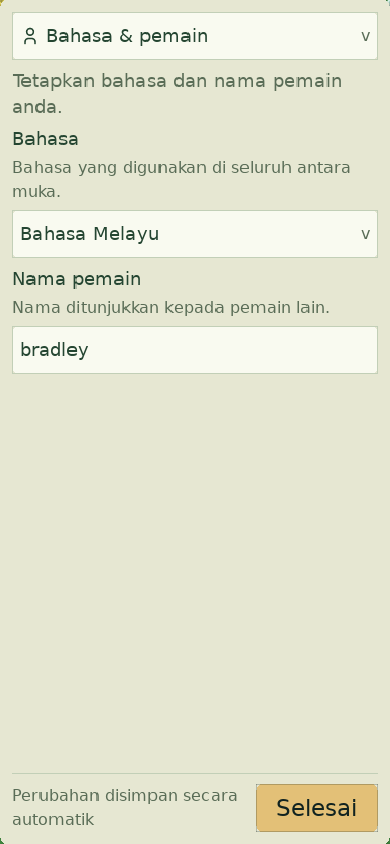
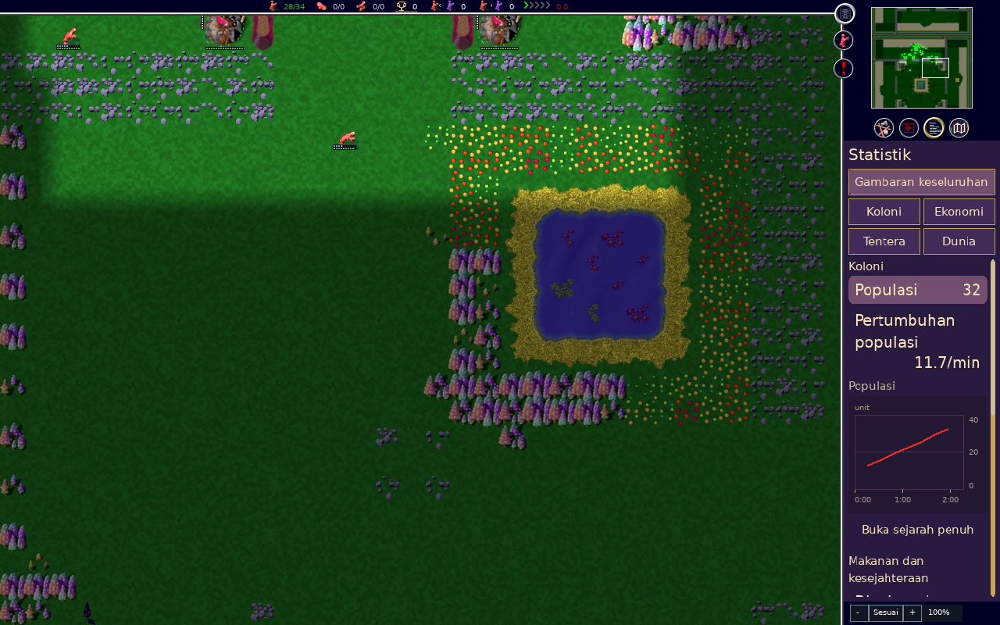
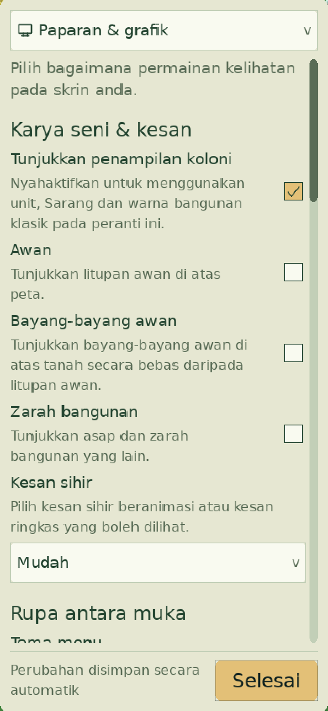
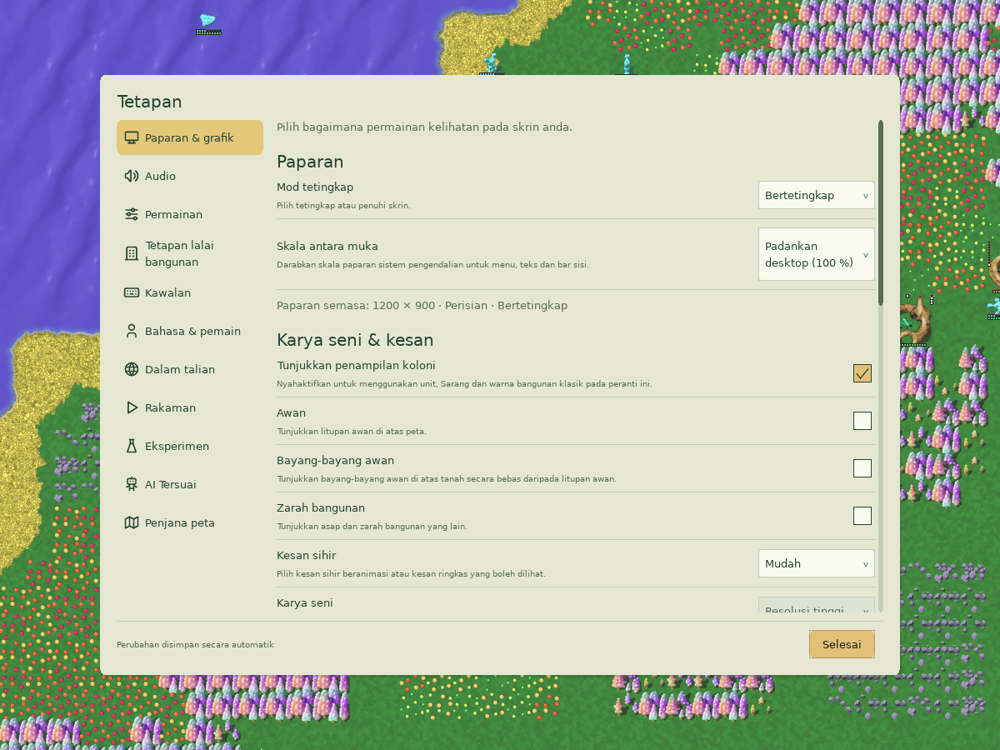

# Malay localization review evidence

Source PR: https://github.com/Globulation2/glob2/pull/1332

Final source revision: `e18cb7223f2784ff0c952260b26b01fc89af34c2`. Integration base: `bc8fb2c2bda69af14a7a6c5ed5ca1dfed7575ddb`.

This evidence branch contains review artifacts only. Download the bounded archives and verify SHA-256 against `archive-summary.json`; `file-index.json` identifies each member and its archive. Extract them into the same directory. Paths in receipts retain their original local producer context and do not imply remote files exist at those local paths.

The final Malay catalog contains 3,411 native and 2,947 online messages. Initial machine drafts used actual Cloud Translation v3 requests authenticated through gcloud. Distinct author, semantic reviewer, editor and fourth adversarial agent passes checked all entries; changed captions received fresh independent readings after each source integration. This is agent review, not native-human certification. Final approved review results and exact source/target carry-forward proofs are included. Provider response caches, credentials, intermediate editorial files, dependency prefixes and executable binaries are intentionally excluded.

Evidence has explicit producer stages. A later commit does not relabel an older run. `localization-ms/validation/final-layout-source-scope.json` and `native-final-layout-scope-proof.json` show the last change affects only narrow live-statistics navigation and its regression. Its final focused execution and topic screenshots supersede the old topic-layout images. Other native menus/tutorials, catalog/font matrices and the online application retain their exact earlier reviewed source inputs, with scoped proofs. The 6,358-key font coverage combines the full 6,342-key matrix with the separately measured 16 added captions; it is not a fresh complete matrix on the final binary.

Native verification uses Linux x86_64, GCC15, the repository fast-development build and pinned SDL3/recording prefixes; it is not a native shipping release or a performance measurement. The browser runtimes use release builds. The committed canonical record is simulation revision111, save format191, with save/replay floors58/187 unchanged. The oldest58 scripting test checks the SGSL payload, not an entire format58 saved game.

The browser unit suite retains three pre-existing stale-fixture failures (148 pass), with unchanged fixture/test files and original-base reproduction. Complete desktop game-gallery runs passed. The phone gallery stops at the same late construction-order assertion in both English and Malay on the same binary; the cause is unproven. Reviewed statistics screenshots precede that assertion; a complete phone gallery pass is not claimed. Superseded/interrupted build and runtime attempts remain identified as such; genuine failures are not recast as passes.

Compact Linux phone rendering and browser phone emulation are distinct from physical Android/iOS execution. Native Windows, macOS, Android and iOS runtime execution is unverified locally. Native package source selection checks verify catalog/inventory/font inclusion for Linux, Android and iOS; they are not device or install tests. No font assets or runtime dependencies were added.

## Final results

- [Release coverage and limits](release-summary.json); [source-current translation audit](translation-audit.log).
- [Final native 24-case result](native-validation.json), [JUnit](native-junit.xml), [broader 128-case result at its original producer](native-broad-validation.json), [broader JUnit](native-broad-junit.xml).
- [Browser execution, sources, package hashes, attempts and limits](browser-validation.json): 8 staged passes/1 stock skip; 6 effective UI-save combinations; 6 exact canonical traces; actual mobile onboarding into Settings.
- [Font coverage with explicit producer stages](font-coverage.json).
- [Canonical match record](canonical-record.g2mr) and [complete per-tick trace](canonical-trace.txt).
- [Every selected file and its archive](file-index.json); [archive sizes and hashes](archive-summary.json); [representative image producers](representative-images.json).

Browser coverage distinguishes requested and effective modes. WebKit's default worker-WebGL probe falls back to serial; actual software-threaded persistence passed. Firefox threaded WebGL2 captures remain blank in both English and Malay on the same binary even after real Settings interaction and bounded settling; two visual assertions failed and remain in the kit. Malay software-threaded Settings is visibly verified. The underlying blank-frame cause is unproven. Six direct engine/Wasm canonical checks separately enforce actual serial/shared-memory-threaded execution and exact full native traces.

The phone initially stopped on an unhandled first-run audio choice; an audio-only harness retry was interrupted when source inspection revealed the following hand-preference screen. The final test drives actual sound, hand and introduction controls, then opens Settings. No preferences were fabricated to bypass onboarding.

## Representative actual pixels

Native compact phone Settings (11d producer; exact final text, unaffected by the statistics-only follow-up):

Final live statistics at 150% text size (e18 producer):

Final browser phone Settings, 390x844 at DPR 2 (e18 producer):

Final Firefox effective threaded/software Settings (e18 producer; shared worker-WebGL limitation described above):

