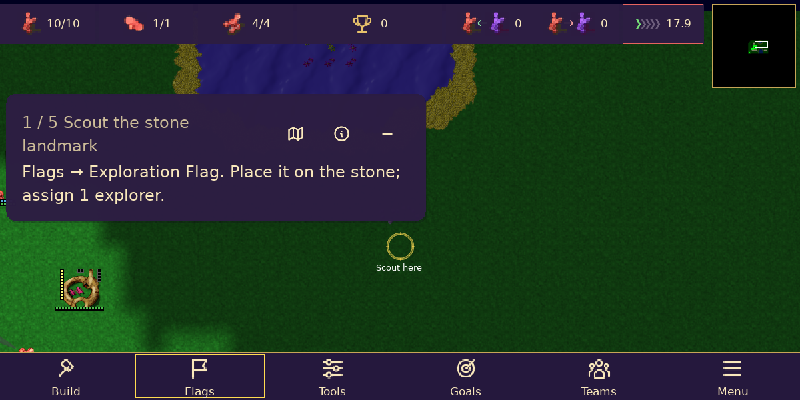

# PR #1297 — subagent review and fixes

Review evidence only; this branch is not intended to merge into master. See FINDINGS.md for the five review findings and fixes. SHA256SUMS.json covers uploaded artifacts.

## Revision and scope

Tested source is commit 8ce957bd09894b8a1ecc07763873a1649d9ae8bc on codex/shared-training-tutorials, based on the already integrated master 6a16670c6daafa34f1f86a47014f23e0d05fd4e3. Current fetched master 0abe90bbb9 adds unrelated distribution metadata, tournament tooling and GOG packaging work; merge-tree reports no conflicts. Source content was frozen before final builds/tests; the commit only records that content.

Three independent subagents covered scripting/save compatibility, landscape/content/progression and onboarding/mobile UI. Five confirmed issues were fixed: invalid local-player indexing in scenario orders, Warrior Training learning-ahead deadlock, pointer ownership crossing the card, lost-bound-unit recovery, and creation placement before training overrides. Follow-up content review accepted the lesson changes.

Simulation revision is104 with a matching regenerated golden match record. Existing save versions and embedded scenario-source behavior are unchanged. Original SGSL tutorial assets remain intact.

## Verification

- **86 native checks passed**, with94 JUnit cases including subcases. Covers all Introduction and ScriptGenerator cases; all ten lessons complete through ordinary orders and saved continuation; order validation/area alteration/paint counts; terrain properties/runtime; frozen Generator Studio continuation; committed match verification. See review/review-final-native.log and .xml.
- **5 UI checks passed**, including the new concurrent-touch/map-drag ownership regression and desktop/phone orientation/text-size checks. See review/review-final-ui.log and .xml.
- **149 JavaScript unit tests passed**, including early training, replacement warriors, lost patient after save/load, reused identities and lost trainees across all four training lessons.
- **6 authoring and10 translation contracts passed**; generated bindings, CLI reference and sim-version consistency checks pass.
- All ten maps/bundles pass deterministic regeneration checks. Six maps changed only to embed revised lesson definitions. Shared terrain/resources/named-region assertions pass using shipped assets.
- Targeted checks repeated after commit: scenario area/queued-building save continuation, initial swim placement and golden record—all3 pass (review/review-committed.log).
- Both native Studio traces retain their prior digests. Generator generation and reloading its initial save produce byte-identical traces. Only their simulation-version fixture metadata changed.
- **54 exact native/browser trace matches**: nine trace sets across serial/threaded Chromium, Firefox and WebKit. All six browser configurations passed on the revised source, including the new scripted-area save/load trace. The phone portrait/landscape touch-layout test also passed.
- Touch-emulated Chromium portrait400×800 and landscape800×400 passed, including visible action bounds and minimum44 CSS pixels; current screenshots are under review/browser-ui/.

The first scenario regression fixture was corrected: farm paint requires water-supported growing ground, and queued building projects require a unit occupying otherwise legal ground rather than blocking timber. Final native results above use the corrected fixture. A first browser launch omitted GLOB2_TEST_BUILD_DIR; the corrected invocation points the runtime host at the served development build.

## Reproduction

Linux x86_64; Ubuntu g++15.2.0; Python3.14.4; Node22.22.1. Existing pinned dependencies/SDL3 prefix; native and Emscripten builds are dev_fast=1 (-O0 -g1), not release performance tests. Full build logs retain actual flags and dependencies.

From the checkout root:

```sh
GLOB2_SDL3_PREFIX=/path/to/sdl3/prefix python3 tools/dev_build.py -j10 engine-tests build/linux/client/debug/dev-dev_fast-true-linker-auto/src/glob2
python3 tools/tutorials/build.py --check --maps --binary build/linux/client/debug/dev-dev_fast-true-linker-auto/src/glob2
env -u SDL_VIDEO_DRIVER -u SDL_VIDEODRIVER python3 test/run_tests.py --build-dir build/linux/client/debug/dev-dev_fast-true-linker-auto --filter 'Introduction/*' --filter 'ScriptGenerator/*' --filter 'TurnEngineHarness/the committed match record verifies*' --filter 'MapPreview/generator Studio*' --filter 'OrderValidation/*' --filter 'OrderAlterateArea/*' --filter 'MapPaintedAreas/*' --filter 'TerrainProperties/*' --filter 'TerrainRuntime/*' --no-display
DISPLAY= SDL_VIDEO_DRIVER=x11 python3 test/run_tests.py --build-dir build/linux/client/debug/dev-dev_fast-true-linker-auto --filter 'IntroductionUI/*' --tag display
node --test browser/unit/*.test.js
python3 test/test_tutorial_content.py
python3 test/test_translations.py
python3 test/check_sim_revision.py --base origin/master
python3 tools/dev_build.py target=web web_variant=serial -j8 web-tests build/emscripten/client/debug/dev-dev_fast-true-linker-auto-web_variant-serial/index.html
python3 tools/dev_build.py target=web web_variant=threaded -j16 web-tests
python3 browser/serve.py 8781 --bind 127.0.0.1 --directory build/emscripten/client/debug/dev-dev_fast-true-linker-auto-web_variant-serial
```

Serve the threaded build output via the serial root's threaded/ directory. From browser/, pointing GLOB2_TEST_BUILD_DIR at that served root and GLOB2_INTRODUCTION_NATIVE_TRACE at downloaded/native-generated review-reference/introduction.trace:

```sh
GLOB2_TEST_URL=http://127.0.0.1:8781 GLOB2_TEST_BUILD_DIR=/checkout/build/emscripten/client/debug/dev-dev_fast-true-linker-auto-web_variant-serial GLOB2_INTRODUCTION_NATIVE_TRACE=/checkout/artifacts/training/review-reference/introduction.trace npx playwright test introduction.spec.js --grep '\(serial\)' --workers=3 --reporter=line --output=../artifacts/training/review-browser-serial-output
# Repeat with --grep '\(threaded\)' and a separate output directory.
GLOB2_TEST_URL=http://127.0.0.1:8781 npx playwright test tutorial-phone.spec.js --project=chromium --reporter=line --output=../artifacts/training/review-browser-phone-output
```

## Limits

No physical Android/iOS or native Windows/macOS checksum comparison, release performance measurement or fresh-player usability study. The original MCP Swimming playthrough is recorded in the earlier evidence branch; this review adds automated browser/mobile checks, not a new manual MCP playthrough. The archived legacy SGSL chapter-three checkpoint retains its documented baseline loader failure; source compilation and other available legacy continuation checks pass. No maintainer acceptance is asserted; PR stays draft.


