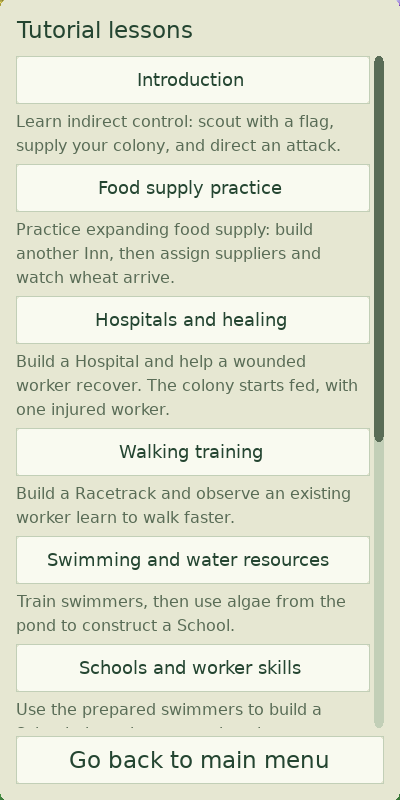
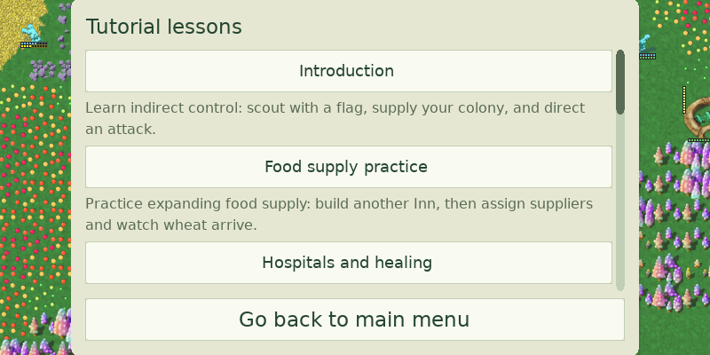

# Tutorial retirement — PR #1297

Tested source: ce8b04d55271f967578342434a64756cd0224774, based on the reviewed implementation 8ce957bd09894b8a1ecc07763873a1649d9ae8bc. This branch contains evidence only and is not intended to merge. SHA256SUMS.json covers the uploaded files.

## Behavior

Tutorial is the single main-menu entry and opens all ten JavaScript lessons. First-run onboarding starts Introduction. Quitting a lesson, cancelling its loader, and completion navigation return to the catalog. The experimental entry, legacy completion button and old tutorial campaign definition are removed.

Old tutorial maps/scripts are frozen test-only archives under test/fixtures/tutorial/legacy/, excluded from runtime assets. General campaigns, SGSL support and the prototype presentation adapter remain solely for custom content and existing saves. Retired campaign progress stays on disk and is hidden from launch selection. Ordinary campaign tests use an independent two-mission fixture. Release validators require all catalog assets and reject accidentally staged retired assets.

## Verification

- 16 native lesson/compatibility checks passed, including all ten real-order completions and saved continuation. Two display cases skipped in that headless pass were exercised with the display suite.
- 8 native UI/localization cases passed, including the single menu/catalog route and retained-but-hidden old campaign progress.
- 149 JS unit tests,7 authoring contracts,10 translation contracts,10 GOG package contracts and4 release-guard tests passed.
- Web asset planning:25 passed; one optional fontTools-dependent test skipped because fontTools is absent. All catalog maps/scripts/definitions are in core assets; retired files and test archives are absent.
- Golden match verification and sim-version contract pass. Simulation revision stays 104: retirement changes client navigation and shipped content, with no engine simulation or save-format change.
- All ten maps/bundles pass deterministic regeneration checks. Native and serial browser development builds pass, as do mobile-gallery and menu-colony-harness builds.
- Chromium phone catalog and tutorial-control tests pass in 400×800 and 800×400; screenshots below.
- Chromium ordinary campaign persistence tests pass 4/4: import/export/invalid backup handling, quota retry/discard, reload and durable backups. These tests now seed a test-only campaign definition and drive the ordinary campaign chooser.
- Chromium lesson quit/restart and loader cancel/retry pass. Software and WebGL2 team-color/resize checks pass 2/2.
- All 9 native/Chromium serial simulation traces match byte-for-byte, including the archived-save and scripted-area traces. Raw browser files and reference hashes are included.

Early test attempts exposed stale generated Introduction metadata while its map was being regenerated, and test-driver assumptions about list-row selection, HUD readiness/pixel scaling and the additional campaign navigation time. The final logs named final/checked record the corrected, stable runs. Production changes were not made to bypass these failures.

## Reproduction and environment

Linux x86_64, Ubuntu g++15.2.0, Python3.14.4, Node22.22.1; existing pinned dependencies and SDL3 prefix. Development builds use dev_fast=1 (-O0 -g1). Exact compiler commands are in the build logs.

```sh
GLOB2_SDL3_PREFIX=/path/to/sdl3/prefix python3 tools/dev_build.py -j12 engine-tests build/linux/client/debug/dev-dev_fast-true-linker-auto/src/glob2
python3 tools/tutorials/build.py --check --maps --binary build/linux/client/debug/dev-dev_fast-true-linker-auto/src/glob2
env -u SDL_VIDEO_DRIVER -u SDL_VIDEODRIVER python3 test/run_tests.py --build-dir build/linux/client/debug/dev-dev_fast-true-linker-auto --filter 'Introduction/*' --filter 'TutorialLocalization/*' --no-display
DISPLAY= SDL_VIDEO_DRIVER=x11 python3 test/run_tests.py --build-dir build/linux/client/debug/dev-dev_fast-true-linker-auto --filter 'IntroductionUI/*' --filter 'TutorialLocalization/*' --tag display
node --test browser/unit/*.test.js
python3 test/test_tutorial_content.py
python3 test/test_translations.py
python3 test/test_gog_release.py
python3 test/build_system/test_web_assets.py
python3 test/build_system/test_release_guards.py
python3 tools/dev_build.py target=web web_variant=serial -j12 web-tests build/emscripten/client/debug/dev-dev_fast-true-linker-auto-web_variant-serial/index.html
python3 browser/serve.py 8782 --bind 127.0.0.1 --directory build/emscripten/client/debug/dev-dev_fast-true-linker-auto-web_variant-serial
```

From browser/, with that server:

```sh
GLOB2_TEST_URL=http://127.0.0.1:8782 npx playwright test tutorial-phone.spec.js campaign-progress.spec.js --project=chromium
GLOB2_TEST_URL=http://127.0.0.1:8782 npx playwright test single-player.spec.js --grep 'tutorial sessions quit|custom and tutorial startup' --project=chromium
GLOB2_TEST_URL=http://127.0.0.1:8782 npx playwright test team-colors.spec.js --project=chromium
GLOB2_TEST_URL=http://127.0.0.1:8782 GLOB2_TEST_BUILD_DIR=/checkout/build/emscripten/client/debug/dev-dev_fast-true-linker-auto-web_variant-serial GLOB2_INTRODUCTION_NATIVE_TRACE=/checkout/artifacts/training/retire-reference/introduction.trace npx playwright test introduction.spec.js --grep '\(serial\)' --project=chromium
```

Use separate Playwright output directories for concurrent runs. The successful phone runs appear in retire-browser.log (two phone passes; earlier obsolete campaign attempts in that combined log failed); corrected campaign runs are retire-campaign-checked.log. Corrected quit/restart is retire-flow-checked.log; loader cancel/retry passed in retire-flow.log. Current color and trace logs are named retire-colors.log and retire-browser-trace.log.

## Limits

Physical Android/iOS, native Windows/macOS, Firefox/WebKit and threaded browser builds were not rerun for this retirement commit. The preceding review evidence covers the previous implementation's full browser matrix; this evidence makes a narrower claim. Fresh-player usability and release performance remain untested. Localization is incomplete: the updated review-text exporter reports 230 missing Simplified Chinese messages, rather than silently scanning deleted SGSL sources. English fallback remains active. Archived chapter-three SGSL checkpoint loading retains its documented pre-existing failure; source compilation and other archived continuation checks pass.

Fetched master 6e83e9f4de contains newer unrelated packaging/music work, including asset-test edits. Merge-tree is conflict-free. These results qualify the PR head, not a merged-master build; hosted integration checks remain separate. No maintainer acceptance is asserted; PR stays draft.



