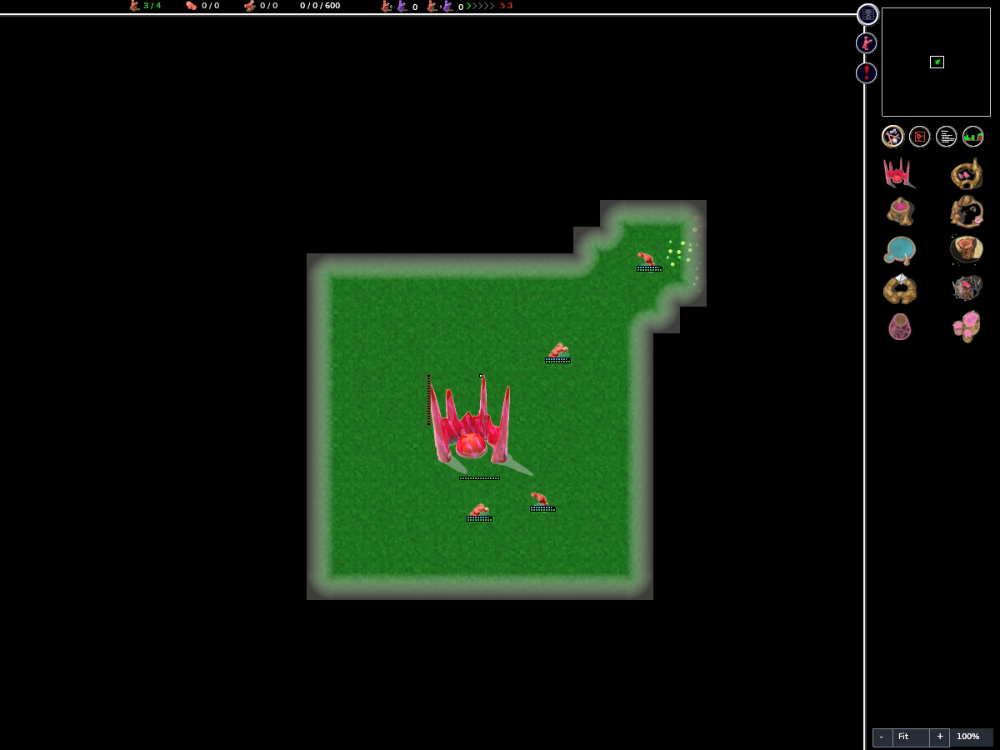

# Browser runtime fix verification

PR: https://github.com/Globulation2/glob2/pull/1094

Integration source: `3574fe1aea5a46690d41cb02fe0deea0fb8b2cbe`. `integration/revision.json` describes the current tested revision and configuration. `prior/verification.json` describes earlier tests performed before integration, with exact source hashes and a patch. These earlier results do not claim to test the integrated revision.

This branch contains development evidence only; it is not merged into master. Logs over 1 MB are gzip compressed. See the PR verification comment for coverage and limitations.

Current integration: both release browser variants built; 458 build contracts, 47 deployment tests, 28 native asset cases, 15 native compute cases, 18 native save/editor cases, both native HD renderer cases, 24 browser engine tests, 21 byte-identical native/browser traces, 156 shared cases per browser variant, eight installed NVIDIA GPU tests and four additional recording tests passed. See [exact commands](integration/commands-refresh.txt), [validation manifest](integration/revision.json), [binary provenance](integration/binary-provenance-refresh.json), [checksum comparisons](integration/trace-comparisons-refresh.json), and [recording probes](integration/recording-probes-refresh.json).

