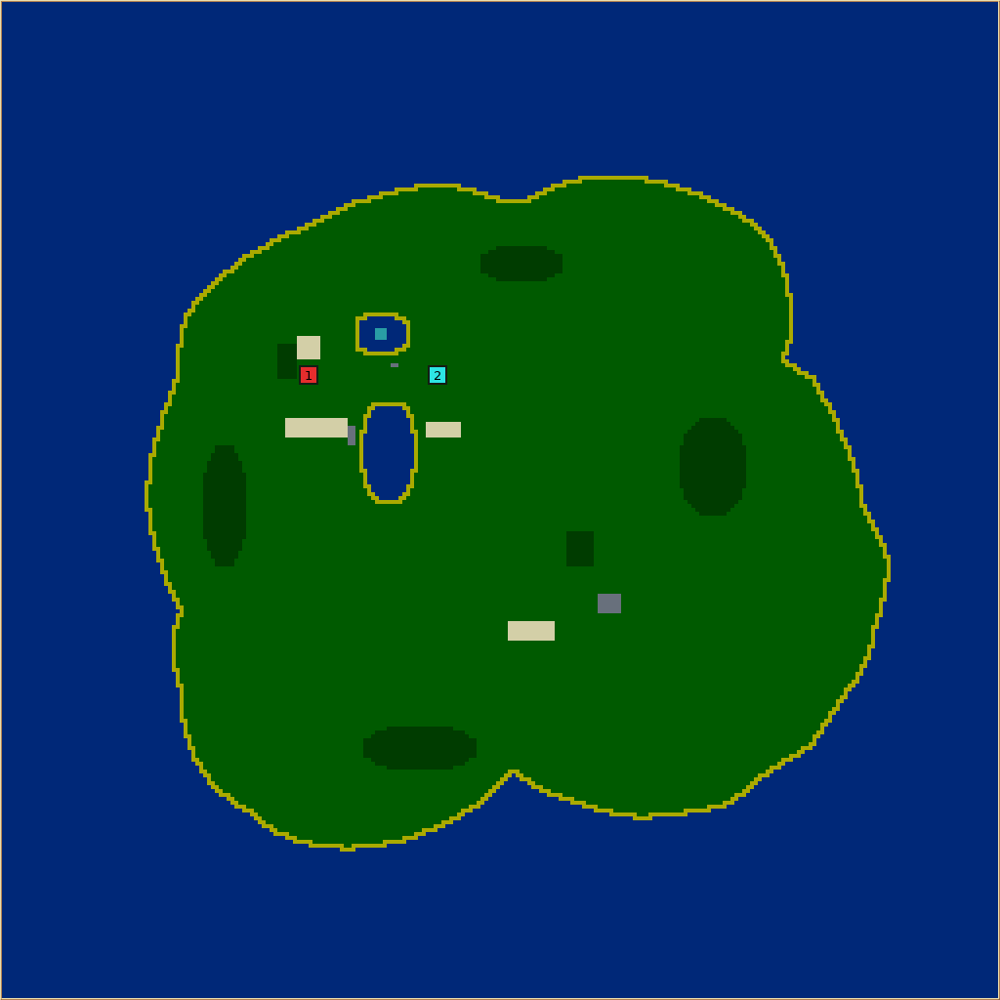
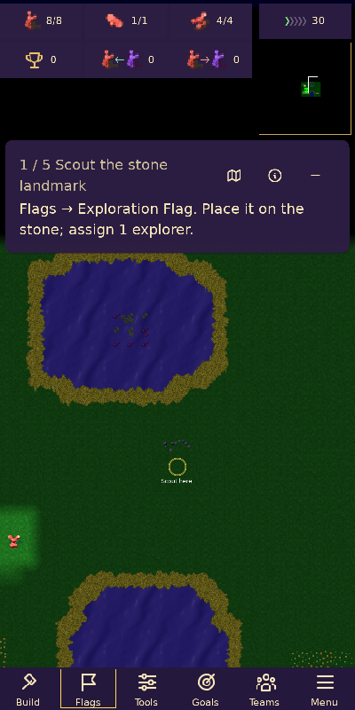
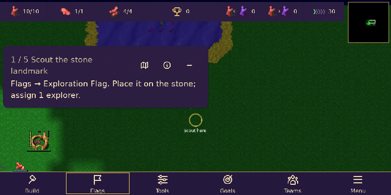
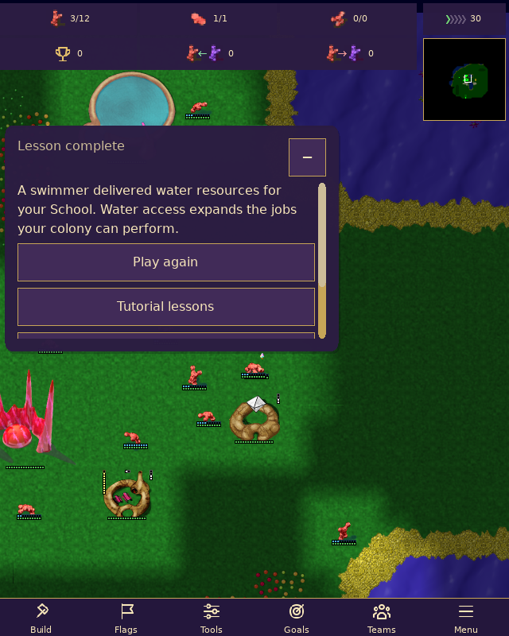

# Tutorial PR #1297 — review evidence

This evidence branch contains generated review artifacts only. It is not intended to merge into master. SHA256SUMS.json covers the uploaded files.

## Revision and integration

- Original tutorial implementation: 94de70a91d (base 5c691899db0080764f5257be7058622dbbefef60).
- Current master merged: 6a16670c6daafa34f1f86a47014f23e0d05fd4e3.
- Integrated production sources tested: b9db345880fb852309934080710cc0525806bb85.
- Final PR revision: f811a0121b61bf14fe5a5a9067ffd2e210442d1f. The final commit changes only two browser fixture manifests after native reference execution proved their trace digests unchanged.
- Integration conflicts resolved by retaining both sets of translation keys and tutorial SIM_REVISION 103 / matching golden record. Save version and minimum loader format are unchanged.

## Environment and configuration

Linux x86_64, Ubuntu g++ 15.2.0, Python 3.14.4, Node 22.22.1; existing pinned project dependencies and SDL3 prefix. Native and browser development builds use dev_fast=1 (-O0 -g1), not release performance qualification. Build logs include exact compiler flags. Physical mobile devices and native Windows/macOS were not tested.

## Integrated verification

- 48 native cases passed: all Introduction cases (all ten lessons via real game orders, saved progression and encounters, original/prototype continuity, idle sustainability and no-swim negative), all ScriptGenerator cases, golden match verification and frozen Generator Studio save continuation. See training/pr-native.log and .xml.
- Four UI cases exercise desktop, phone portrait/landscape and text scaling. Final result recorded in training/pr-ui.log and .xml.
- 146 JavaScript unit tests, six tutorial authoring contracts and ten translation contracts passed. See training/pr-js-unit.log, pr-authoring.log and pr-translations.log.
- All ten generated maps and embedded bundles match their pinned inputs (training/pr-regeneration.log). SIM_REVISION / committed match consistency passes (pr-sim-version.log). CLI reference regenerated and checked during pr-native-checks.sh.
- All eight integrated native lesson traces equal the prior references. Both Studio native traces also equal the existing browser reference digests; generated and reloaded Generator Studio execution agrees. Review training/pr-native-trace-comparison.json, pr-studio/, pr-generator/ and pr-generator-load/.

## Earlier browser and manual evidence

These browser runs tested the original tutorial implementation before merging current master. They are not a claim that the merged browser builds were rerun.

- Eight trace sets × serial/threaded × Chromium/Firefox/WebKit = 48 exact native/browser trace matches. Raw traces and JUnit reports are under browser/; original native references under training/reference/. Comparison manifest: training/browser-trace-comparison.json.
- Initial five configurations passed, with a WebKit threaded teardown error caused by another Playwright run clearing the shared output directory. Its trace comparisons passed; an isolated rerun also passed. Both logs are retained.
- Chromium touch emulation passed at 400×800 and 800×400, checking visible actions are at least 44 CSS pixels. Screenshots under training/browser-ui/.
- MCP desktop inspection exercised destination centering and flag placement. Swimming was completed through MCP UI input in the native mobile HUD: Pool placement, swimmer training, School construction, algae delivery, completion. Native desktop enforces 640px minimum width, so browser touch emulation supplies the actual 400px evidence. See training/mcp-mobile-*.png.
- Earlier 40 scripting headless and two display cases passed; logs retained. Original SGSL tutorial files were byte-identical to the starting revision. The archived chapter-three SGSL checkpoint has the documented baseline loader failure; its source still compiles.

## Reproduction commands

From the PR checkout, using the appropriate installed SDL3 prefix:

```sh
GLOB2_SDL3_PREFIX=/path/to/sdl3/prefix python3 tools/dev_build.py -j10 engine-tests build/linux/client/debug/dev-dev_fast-true-linker-auto/src/glob2
bash artifacts/training/pr-native-checks.sh
python3 test/test_tutorial_content.py
python3 test/test_translations.py
python3 test/check_sim_revision.py --base origin/master
node --test browser/unit/*.test.js
```

The uploaded training/pr-native-checks.sh records exact filters, build directory, regeneration and UI commands. Use a local copy, adjusting the checkout path at its top.

Original browser build and test commands:

```sh
python3 tools/dev_build.py target=web web_variant=serial -j8 web-tests build/emscripten/client/debug/dev-dev_fast-true-linker-auto-web_variant-serial/index.html
python3 tools/dev_build.py target=web web_variant=threaded -j8 web-tests
python3 browser/serve.py 8779 --bind 127.0.0.1 --directory build/emscripten/client/debug/dev-dev_fast-true-linker-auto-web_variant-serial
# In browser/, with the native references and both variants served:
GLOB2_TEST_URL=http://127.0.0.1:8779 GLOB2_INTRODUCTION_NATIVE_TRACE=/checkout/artifacts/training/reference/introduction.trace npx playwright test introduction.spec.js --reporter=line --output=../artifacts/training/browser-output
GLOB2_TEST_URL=http://127.0.0.1:8779 npx playwright test tutorial-phone.spec.js --project=chromium --reporter=line --output=../artifacts/training/browser-ui-output
```

For threaded hosting, the serial root's threaded directory points to the threaded build output. Use separate Playwright output directories for concurrent commands.

## Remaining qualification

No physical Android/iOS test, native Windows/macOS checksum comparison, fresh-player usability study or release performance claim. Browser integration against the merged master remains to be rerun. Recovery/feel still benefits from maintainer play review beyond the automated order tests. No maintainer acceptance is asserted by this evidence.





