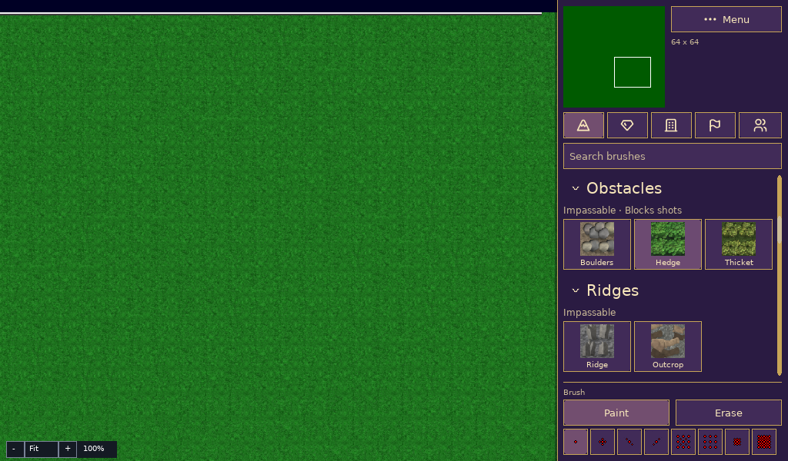

# Terrain graduation verification for PR #1308

Final commit: `a047e691dfe6d3527f93034abbfbc5dd149e52d6`. Integrated master: `e7613e93b08234dbf785ceef3bd9b884cbb73221`.
Current master `de1d2ff6c87cb8b4d6edb7d3de9b1c2ea7a7a650` adds only the independent wiki-release workflow/docs/tooling since the integrated base. No overlapping runtime or build-selection inputs changed.

Three independent automated reviewers covered compatibility, editor/UI behavior and evidence. Their integration/version and catalog-key findings were resolved. Integration checks also found the tutorial helper comparing file-version metadata across save migration; its test-only fix excludes header component zero, retains all simulation/unit/building components and separately checks the loaded format.

## Results and revision mapping

- `a8147d843de2f961049ee438afb6844a43c3fcab`: full unit suite **1249/1249**, driver exit 0. Integrated engine run **146 passed / 7 failed**; all seven failures were the shared format-header comparison assumption.
- `a047e691dfe6d3527f93034abbfbc5dd149e52d6`: Introduction **15/15**, ExperimentalFeatures **11/11**, normal golden verification **1/1**, all driver exits 0. This supersedes all seven earlier failures. The **153 unique engine cases** are covered across the integrated run and final rerun (eight Introduction successes were repeated).
- The sole source delta from the broader tested parent to the final commit is `src/tutorial/IntroductionTest.cpp`; production code, unit test bodies, dependencies and flags are unchanged. The broader suites are explicitly parent results, not claimed as full final-head reruns.
- Final-head strict translations, 21 Python header checks, 11 Python tutorial checks, tutorial generated-source verification, browser lesson unit test, 39 protocol tests, changed TypeScript formatting and simulation-version check passed. Exact commands, SHAs, return codes and timings are in the status JSON files and logs in `validation.zip`.
- Linux x86_64, GCC 13.3.0, fast development build (`-O0 -g1`), pinned SDL3 and build-only glslang 15.1.0 with Vulkan shaders. Native Vulkan differential tests ran successfully in the full unit suite.

No Windows/macOS/browser checksum-equivalence, release-build qualification or human gameplay review is claimed. Hosted CI is separate and pending. Screenshot reviewed for readable cards without terrain locks or enable controls; phone input/tray behavior is covered by automated tests.

The archive includes JUnit reports, complete logs (including superseded failures), exact-command/status records, dependency identity, the regenerated match record/trace and the historical format-137 terrain save used by the continuation coverage.

Archive SHA256: `552a2e27087e3570d4906e3fa73a0799d17d86acc08414e0a205066a878059b5`.

