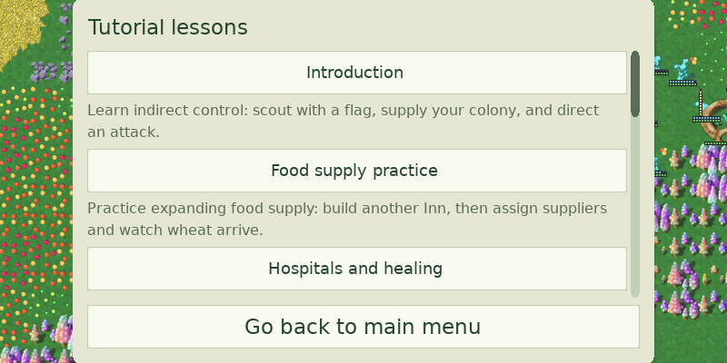
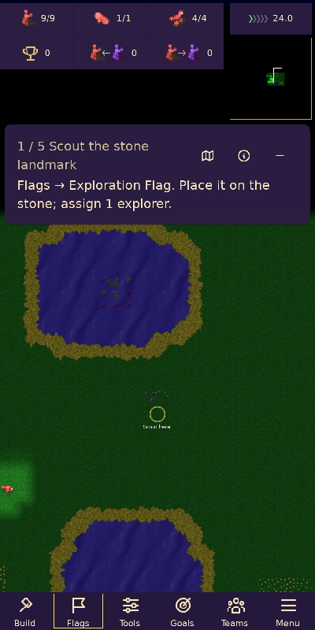
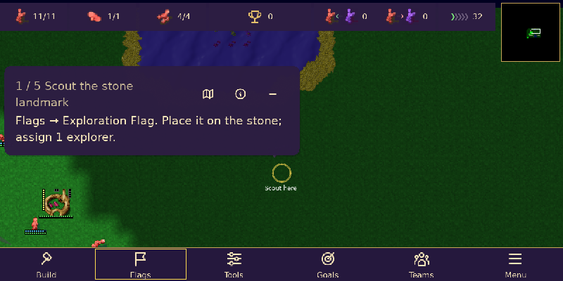

# Tutorial replacement and final cleanup — PR #1297

Tested source: 6bd60263a4040dd3993b0c3c13e62725fd9a46ed. Integrated master: b011f8f0ddeeb24d415408460c648ed287b724a0. This is an evidence-only branch, not production content. SHA256SUMS.json covers the attached files.

## Independent review and fixes

Three independent agents reviewed runtime/save compatibility, assets/authoring/packaging, and UI/mobile behavior. The final cleanup removes the prototype-only C++ adapter, old translation alias tables/source fingerprinting, redundant lesson state and order wrappers, unused legacy fixtures and standalone scripts, copied lesson targets, and duplicate release inventories.

Concrete regressions fixed: false 64×64 prototype guidance before the real scenario publishes a model; recovery hints hidden behind Help on touch; retained keyboard focus swallowing gameplay keys after map clicks, Escape or window focus loss; mistyped `--lessons` selection falsely succeeding; and callbacks returning null/undefined/empty effects losing cached presentation. Atomic effect validation still checks overwritten effects. Eighteen dead lesson targets were removed; bundles and seven maps were regenerated.

General SGSL/custom campaigns remain supported. One known-good SGSL checkpoint and one JS prototype checkpoint remain as compatibility fixtures. Old saves keep embedded source, original message language/wording, objectives and hints; no alias translation or special prototype guidance is synthesized. Save format is unchanged. Retired campaign progress remains on disk without a launch entry.

## Final verification

- Native: 95 passed, zero failed, two display-only cases skipped in the headless invocation. Both skipped cases passed separately with a display (cleanup-js-display.log). All ten shipped lessons complete with real validated orders and saved continuation. Coverage includes generator determinism, named areas, swimming access, sustainable food, diplomacy, controlled encounters, recovery and archived-save continuation.
- Native UI: nine passed, including focus release, automatically visible recovery hints at 100/150% text size in both phone orientations, pointer ownership, catalog/navigation and generic UTF-8 scenario messages.
- Authoring: 11 passed. JS unit tests: 149 passed. Translation contracts: nine passed. GOG packaging: 26 passed. Release guards: four passed.
- Web asset planning: 25 passed, one optional fontTools-dependent skip. Current catalog assets are required; retired content and test archives are excluded.
- All ten maps/bundles pass deterministic regeneration/stale checks. Native and Chromium serial development builds pass. Golden match verification and the sim-version contract against integrated master pass; SIM_REVISION remains 104 with its matching committed record.
- Chromium serial: all 15 Introduction cases pass, and all nine traces match the native references byte-for-byte. Both phone tests pass in portrait/landscape; screenshots were inspected. Quit/restart passes, and custom/tutorial loader cancellation/retry passes with a 300-second test budget (114 seconds actual; initial 90-second budget expired).
- The full gameplay touch harness passes (443.9 seconds), covering scenario-message scrolling/acknowledgment, rotation, dialogs, German/Japanese presentation, replay controls and ordinary touch orders. Its initial 300-second timeout is retained alongside the successful 900-second-budget run.

The large touch harness runs in its own process/Xvfb session. Test-global SDL state is not shared with other cases. Early attempts during binary linking or map regeneration were rerun after stable outputs. The full touch harness initially exceeded its 300-second budget and was rerun with 900 seconds; the navigation test initially exceeded its 90-second budget and passed with 300 seconds. Initial timeout logs are retained. Final logs contain the completed stable runs. No checks were bypassed to address those setup races.

## Reproduction

Linux x86_64, Ubuntu GCC 15.2.0, Python 3.14.4, Node 22.22.1, pinned repository dependencies and existing SDL3 prefix. These are fast development builds, not release-performance evidence. Full compiler inputs are in the build logs. Run from the checkout root unless indicated:

```sh
GLOB2_SDL3_PREFIX=/path/to/sdl3/prefix python3 tools/dev_build.py -j16 engine-tests build/linux/client/debug/dev-dev_fast-true-linker-auto/src/glob2
python3 tools/tutorials/build.py --maps --binary build/linux/client/debug/dev-dev_fast-true-linker-auto/src/glob2
python3 tools/tutorials/build.py --check --maps --binary build/linux/client/debug/dev-dev_fast-true-linker-auto/src/glob2
env -u SDL_VIDEO_DRIVER -u SDL_VIDEODRIVER python3 test/run_tests.py --build-dir build/linux/client/debug/dev-dev_fast-true-linker-auto --filter 'Introduction/*' --filter 'JavaScriptPresentation/*' --filter 'JavaScriptIntegration/*' --filter 'JavaScriptCompatibility/*' --filter 'JavaScriptTransactions/*' --filter 'ScriptGenerator/*' --filter 'TurnEngineHarness/the committed match record verifies*' --no-display
DISPLAY= SDL_VIDEO_DRIVER=x11 python3 test/run_tests.py --build-dir build/linux/client/debug/dev-dev_fast-true-linker-auto --filter 'IntroductionUI/*' --filter 'ScenarioMessages/*' --filter 'GameGUITouch/*scenario*' --tag display
DISPLAY= SDL_VIDEO_DRIVER=x11 python3 test/run_tests.py --build-dir build/linux/client/debug/dev-dev_fast-true-linker-auto --filter 'JavaScriptIntegration/*' --tag display
DISPLAY= SDL_VIDEO_DRIVER=x11 python3 test/run_tests.py --build-dir build/linux/client/debug/dev-dev_fast-true-linker-auto --filter 'GameGUITouch/actual gameplay touch*' --tag display --timeout 900
node --test browser/unit/*.test.js
python3 test/test_tutorial_content.py
python3 test/test_translations.py
python3 test/test_gog_release.py
python3 test/build_system/test_web_assets.py
python3 test/build_system/test_release_guards.py
python3 test/check_sim_revision.py --base origin/master
python3 tools/dev_build.py target=web web_variant=serial -j16 web-tests build/emscripten/client/debug/dev-dev_fast-true-linker-auto-web_variant-serial/index.html
python3 browser/serve.py 8783 --directory build/emscripten/client/debug/dev-dev_fast-true-linker-auto-web_variant-serial
```

Copy the nine native Introduction traces to one directory before browser comparison. From browser/, set `GLOB2_TEST_URL=http://127.0.0.1:8783`, `GLOB2_TEST_BUILD_DIR` to the absolute serial build directory, and `GLOB2_INTRODUCTION_NATIVE_TRACE` to the copied introduction.trace. Run with distinct `--output` directories when concurrent:

```sh
npx playwright test introduction.spec.js --grep '\(serial\)' --project=chromium --workers=1 --reporter=line
npx playwright test tutorial-phone.spec.js --project=chromium --reporter=line
npx playwright test single-player.spec.js --grep 'tutorial sessions quit|custom and tutorial startup' --project=chromium --timeout=300000 --reporter=line
```

## Limits

This final cleanup was not rerun on physical Android/iOS, native Windows/macOS, Firefox/WebKit or the threaded browser variant. Earlier implementation evidence covers a broader browser matrix; it does not establish final-revision coverage. Fresh-player usability and release performance remain untested. Translation coverage is incomplete and uses English fallback. Hosted checks are separate evidence and may still be pending when the authorized merge is attempted.




