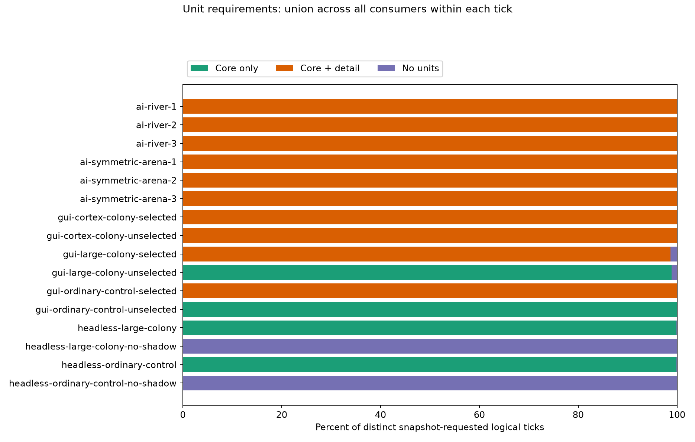
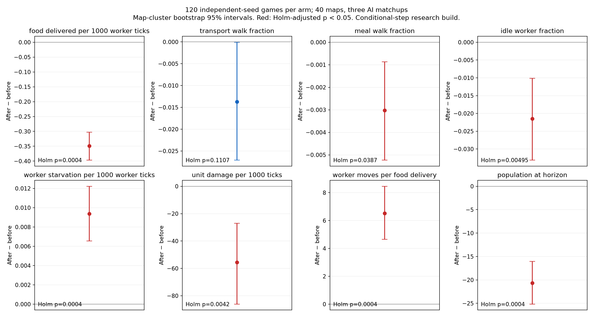
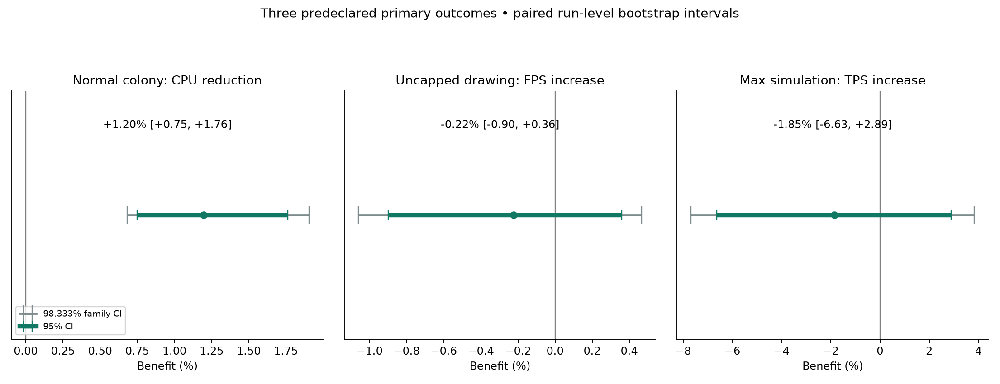
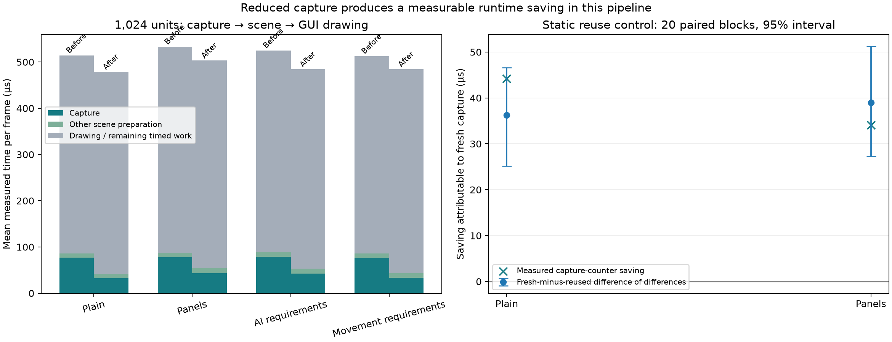
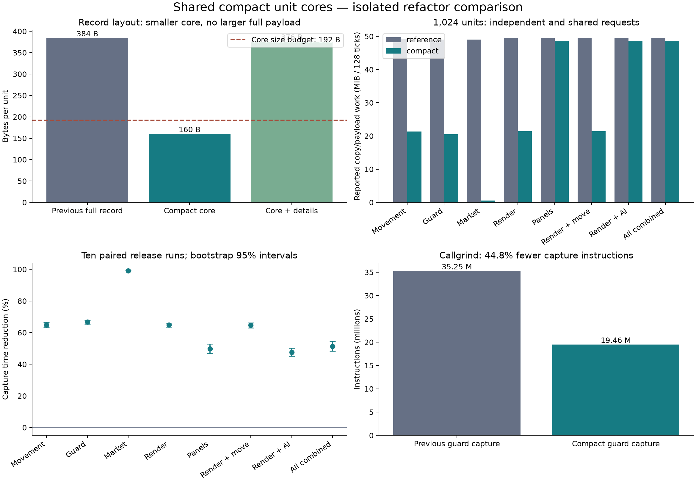
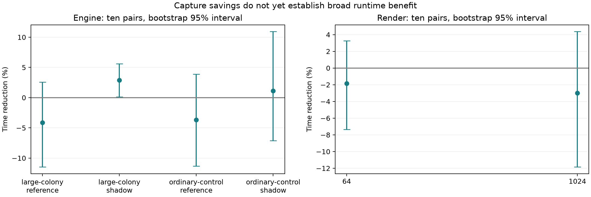
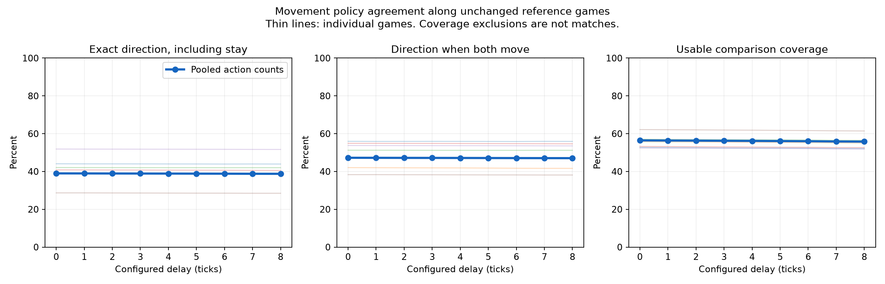

# Compact unit core evidence

[Unit view frequency measurements](unit-view-report.md) · [Raw samples](unit-view-samples.csv) · [Commands and controls](unit-view-evidence.zip)

Six real AI matches need details on every advancing gameplay tick. Null-AI movement-only runs need cores only on every advancing tick. The unselected 1,024-unit GUI colony is core-only on 98.9% of observed ticks; selecting a unit requests details on 98.7%. Cortex GUI sessions need details on all ticks regardless of selection. Requests are unioned within a tick; copy counts/bytes are separate.

[Movement disagreement investigation](deep-report.md) · [Traces and controls](movement-deep-evidence.zip) · [240-game research tournament](tournament-report.md)

The revised K=1 shadow policy reaches 78.46% exact agreement and 86.96% comparison coverage on the same six reference histories; all 60 reference comparisons preserve canonical outputs. **The separately patched conditional-step tournament fails:** food/worker-time −30.36%, starvation/worker-time +66.19%, worker moves/food-delivery +19.20%, significant after Holm correction. Do not adopt this policy. Production remains shadow-only, disabled by default; original gates are unchanged. No new net runtime benefit is claimed for the added completion refresh.

[New reserved-core live match comparison](live-report.md) · [Live raw evidence](live-evidence.zip)

Ten paired release repetitions per scenario, with concurrent simulation and software presentation: the normal 1,024-unit colony uses about **1.2% less game CPU** (95% CI 0.75–1.76%). Capture is about **35% cheaper**, with **36% less logical capture payload**. Both variants hold 60 FPS/30 TPS; uncapped FPS and maximum TPS gains are inconclusive. The full-observation Cortex case and ordinary control are reported separately. CPU restoration audits, all paired samples and byte-identical live replay/checksum evidence are included. Linux software/Xvfb coverage does not establish GPU/desktop-display performance.

[New capture-inclusive runtime follow-up](runtime-report.md) · [Runtime raw evidence](runtime-evidence.zip)

Twenty paired GUI repetitions and a separate longer-window replication establish a large-colony capture-inclusive pipeline benefit. The report preserves ordinary/panel limitations and distinguishes this from live-match frame rates.

[Report and limitations](report.md) · [Raw evidence archive](compact-core-evidence.zip) · [Source/platform metadata](source-state.json)

The timings compare frozen revisions; final integration checks are separately identified in the report. Movement remains Stage A. The archive includes raw commands, samples, profiles, JUnit XML, baseline reproductions, saves/replays/checksums and corrected software images. Reproduced baseline failures and unavailable platform/gameplay coverage remain explicit.

[Real-game direction agreement and delay sweep](agreement-report.md) · [Raw metrics/traces/commands](agreement-evidence.zip)

Six active AI games, diagnostic delays 0 through 8, 54 matched reference comparisons. Exact agreement is 38.99% to 38.77%; usable coverage is 56.45% to 55.81%. Resource steering agrees about 75%, while building comparison coverage is poor and requires validation-semantic investigation. These are conditional steps along unchanged reference histories, not adopted-policy gameplay. The report links deduplicated initial saves, replays and checksums for every game. The core/detail layout remains unchanged.

