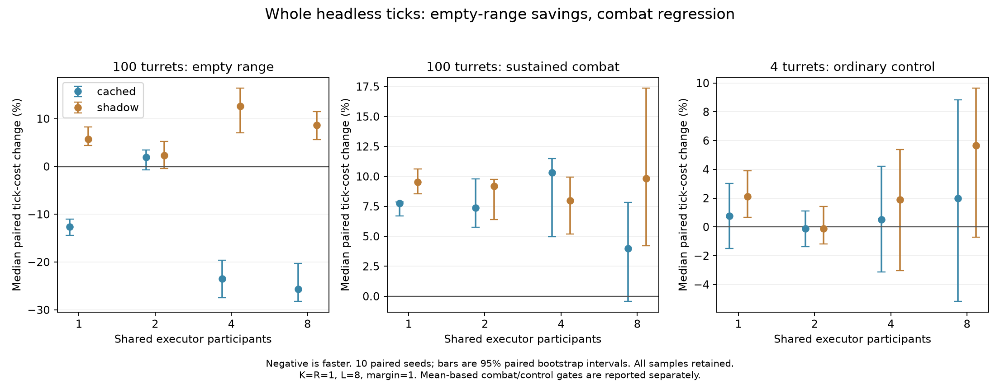

# Cached turret targeting prototype evidence

This branch contains generated review evidence only. The implementation PR uses
`codex/cached-turret-targets-prototype`; none of these files are proposed for master.

Start with [whole-engine findings](whole-engine/summary.md). This is the authoritative
full-tick analysis: combat performance gates and cached continuation fail. Then read
[shared capture measurements](shared-pipeline/summary.md),
[Callgrind optimization](callgrind/summary.md) and
[shadow combat analysis](shadow-matrix/continued-summary.md).
Historical reports can contain earlier designs/results; the full-tick findings take
precedence. Invalid serial-only participant measurements are retained and explicitly
excluded. Timing and correctness are separate; all outliers and host samples remain.



## Reproduce/archive

Download all `turret-evidence.tar.gz.part*` files in numeric order, then:

```sh
cat turret-evidence.tar.gz.part* > turret-evidence.tar.gz
sha256sum turret-evidence.tar.gz
# Compare the full archive hash in manifest.json, then:
tar -xzf turret-evidence.tar.gz
```

The archive contains all retained turret artifacts except the disposable plotting
virtual environment: raw CSV/JSON, scripts, logs, checksum/order traces, complete
saves, charts, profiles, failure evidence, source snapshots and exact archived native
executables. Software/dependency paths and compiler flags are in provenance/build
logs. Individual archive parts have hashes and sizes in manifest.json.

## Revision boundaries

The benchmark-tested feature snapshot is commit `fba14920c24b4ea411a8e574e47c535e5db4bac3`
on base `f9eae2549f608f804c240709df819bfe5f09f3fb`. Tests originally ran on identical
uncommitted source contents; archived sources/binary hashes identify actual inputs.
The PR then merged master `3e2ba6c07450c94ce0f997220479fd309b71e461` as head
`7aafe4c10ff4d26e31823ac6a50574efd3a19fe9`, preserving newer executor telemetry and
gradient lifecycle behavior. Four affected translation units pass syntax compilation
on that merge. Full release integration, runtime and performance qualification of
the merged draft head are **not yet complete**; pre-merge benchmark evidence must
not be presented as final-head validation. Linux x86_64 is the only measured platform.

The shipping game still uses original targeting. The actual first-valid firing
replacement is confined to the dedicated benchmark binary. No live match rule,
persistent cache pipeline, simulation-version change or general rollout is claimed.
