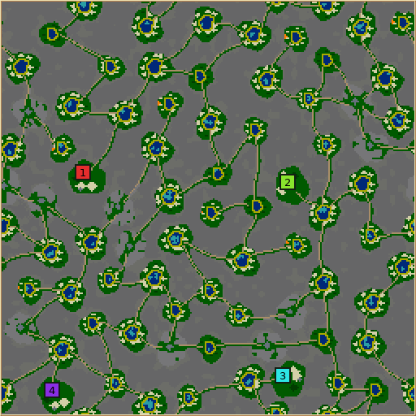
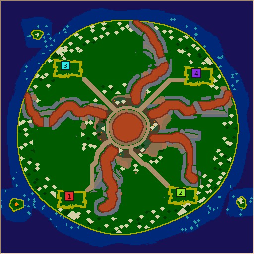

Verification evidence for [Globulation2/glob2 PR #1388](https://github.com/Globulation2/glob2/pull/1388).

The final runtime algorithms were frozen at `e4a60b70bc70725cbf486f5f60344d0ea6deafb2` (E4). Later changes advance recipe counters, update test expectations/reference oracles, refresh fixtures, and correct comments/documentation. Both platforms identify clean E4 source tree `805bf5e4f4fd8b2503b9eafa7f09b7f13e5730a142dd6be0550683391431171b` for the paired simulation traces. The integrated base was `ab643d39d7`; master `cde58dbdf5` was checked before final validation and adds unrelated artwork.

Linux GCC 13, x86_64, ordinary full-featured fast development compilation (`-O0 -g1`, no PCH/unity):

- 75 focused terrain, routing, generator and version cases passed; 98 mobility/continuation cases passed; 1,236 headless unit cases passed, with 92 display cases excluded from that unit invocation.
- 4 portable JS/tiling cases and 3 fertility-binding cases passed. JS fixtures retain complete 256-tick one/four-worker, save/continuation and replay comparisons.
- All 18 CLI smoke cases, map-report contracts and read-only golden-observation guards passed. SIM 124 match verification succeeds; the actual master SIM 123 record is rejected as unverifiable.
- All 564 final native request keys, statuses and fingerprints matched fresh isolated processes, with a complete inventory check. See `linux/final-generator-request-checks.json.gz`. The first measurement and final checks are independent executions; no new generation failures appeared against the committed baseline.
- The initial 68 default/rectangle/repeatability cases exposed Lava Shield's circuit failure. The affected Lava Shield and Anthill cases pass in the final focused run after the bounded passage fixes.

macOS ARM64 release compilation succeeded in [run 41719551996, attempt 2](https://github.com/Globulation2/glob2/actions/runs/41719551996/attempts/2). The stock replay, verified match, resource composition and unit ablation traces are byte-identical to Linux E4. Both JS fixtures also match the refreshed Linux deep-state fixtures for all 256 ticks at one and four workers. Comparisons and raw traces are retained here, rather than inferred from matching orders.

All 564 Mac world hashes/statuses come from actual E4 native output, repeated in two fresh processes. Current expected rows transparently rekey 228 of those rows across 28 recipe-counter-only updates. `macos/generators/raw` preserves the actual producer and observations; `derived/rekey.json` records the mapping. Recipe counters are serialized as descriptors/provenance but do not seed generation or enter generated-world fingerprints. Independent source review and the complete native before/after checks support this narrow transformation. This is derived fixture evidence, not Mac execution of the final SHA or reuse of its binary as a different source build.

The frozen Mac workflow is intentionally not reported green: its old JS/tiling checksums, path cost, gradient references and sand-cache expectation failed, as did its superseded accepted-generator baseline. The current expectations/oracles were corrected and rerun on Linux; actual Mac JS states match the refreshed fixtures. Original Mac JUnit failures remain in `macos/frozen-run` for review.

Coverage limits: the aggregate catalog contract timed out at 1800 seconds in the development build (included as incomplete evidence). Three other extended generator contracts passed with a larger time allowance. No exact-final-SHA Mac suite, Windows/browser/mobile verification, optimized performance comparison or human gameplay session is claimed. Renderer checks and the following layout previews were inspected; they do not substitute for judging animation/game feel in play.

Standard reproduction starts with `python3 tools/dev_build.py engine-tests unit-tests map-generator-golden-test`, `python3 test/run_tests.py --binary unit --no-display`, the named focused suites in the JUnit files, and `MapGeneratorGoldenTest <profile> --require-rows` on each native platform. `test/run-browser-determinism.py` retains the paired simulation traces. Raw command paths/configuration and actual producer identities remain in the machine-readable evidence.
