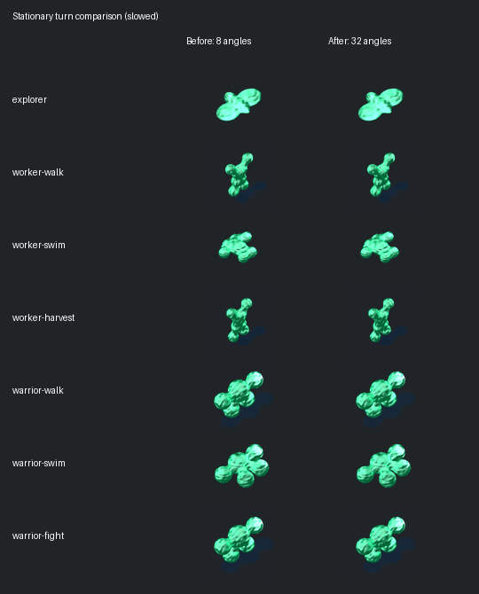

# Stationary turn validation for PR #1257

Source revision: `8fa158cd8c8de11b94f465db970697991223ec1f`.
Base revision: `2c66ea850c92a526eba96ae8d04ef32d20fc6aa1`.
The PR changes stock stationary turns from eight to 32 rendered headings at the existing cadence. Movement art and simulation state are unchanged; published custom skins retain eight-heading turns.



[Actual OpenGL worker-turn capture](renderer-worker-turns.png), [all rendered headings](contact.png), [pixel audit](pixel-audit.json), [independent review](review.txt).

## Environment and coverage

Linux x86_64, GCC 13.3.0, glibc 2.39, Python 3.12.3; repository-pinned SDL3 3.4.16 family. Builds use `dev_fast=1 linker=auto` (`-O0 -g1`) with all supported features. OpenGL checks run under Xvfb; no physical GPU coverage is claimed. Blender rendering uses the pinned 2.34 Linux i386 executable and private legacy libraries. The 23 Python pipeline cases were rerun with repository-pinned Pillow 12.2.0; the native build/export environment used system Pillow 10.2.0. Native and HD outputs contain 224 new poses each, plus their applicable shadows: all 704 installed layers match the verified output receipts in [render-provenance.json.gz](render-provenance.json.gz).

- Clean final revision: game and both test binaries build; 15 affected native cases pass. [Build provenance](build-provenance.json), [final build log](build-final-revision.log.gz), [JUnit](final-revision-tests.xml), [test log](final-revision-tests.log).
- Reviewed working tree before final commit: 36 native cases pass, including sprite loading/sheets, skin isolation, all 2,016 stock poses through native/HD shader comparisons, HD completeness fallback, bounded caches, catalog bounds, and the 3,665-frame runtime pack across 16 hues. This is supplemental integration evidence; the clean final-revision run above retains its own provenance. [Build log](build-reviewed.log.gz), [JUnit](reviewed-tests.xml), [test log](reviewed-tests.log).
- Python pipeline: 15 turn cases and eight movement-pipeline cases pass. These include malformed/corrupt/stale input, canonical geometry, no-output and failed renderer recovery, source/scene races, preservation of unrelated assets, and repeated installation. [Turn tests](test-turns-reviewed.log), [movement tests](test-render-reviewed.log).
- Packaging and source/output provenance checks pass: [package check](package-check-reviewed.log), [provenance check](provenance-reviewed.log). [SDL dependency identity](sdl3-manifest.json).
- Every turn loop has 32 distinct images; body silhouettes fit their canvases and adjacent/last-to-first differences are continuous. Explorer pose zero matches the original native RGBA exactly inside the new four-pixel gutter. The sprite PNGs are byte-identical before and after review hardening.

## Commands

From the source checkout, with the pinned dependencies built as documented:

```sh
export GLOB2_SDL3_PREFIX="$PWD/artifacts/unit-turn/sdl-prefix"
export LD_LIBRARY_PATH="$GLOB2_SDL3_PREFIX/lib"
python3 tools/dev_build.py -j16 tests build/linux/client/debug/dev-dev_fast-true-linker-auto/src/glob2
artifacts/unit-turn/venv/bin/python tools/unit-animation/test_render.py
artifacts/unit-turn/venv/bin/python tools/unit-animation/test_turns.py
python3 tools/artwork/package_runtime.py --check
python3 tools/artwork/runtime_provenance.py --check
python3 test/run_tests.py \
  --build-dir build/linux/client/debug/dev-dev_fast-true-linker-auto --binary all \
  --filter 'UnitAnimation/*' --filter 'SkinModel/*' \
  --filter 'SpriteLoad/*' --filter 'SpriteSheets/*' \
  --filter 'UnitHighResolutionCache/*' --filter 'UnitTeamShader/*' \
  --filter 'UnitTeamColorCache/*' --filter 'ColonySkinPreview/*' \
  --filter 'RuntimePack/*' \
  --filter 'UnitCatalog/authored animation spans stay inside the stock atlas'
```

The clean final-revision test command selects `UnitAnimation`, `SkinModel`, `UnitTeamShader`, `UnitHighResolutionCache`, `ColonySkinPreview`, and the same catalog-boundary case. The broader selection above ran immediately before the final commit with the same reviewed implementation; the final commit triggered a clean rebuild and the smaller rerun.

Render commands and preparation are in the PR's `tools/unit-animation/README.md`; [render log](render-reviewed.log.gz) and receipts retain source, scene, renderer and output identities. [verification.json](verification.json) retains the command inventory and environment summary. No runtime performance claim is made from development builds or the synthetic timings emitted by diagnostic tests.

## Limits and existing failures

Other operating systems, browser/mobile backends, physical GPUs and interactive in-game feel review remain unverified. No save/replay/network format or simulation calculation changed, so no simulation revision or golden-match update is needed.

The broad artwork validator fails while discovering the unchanged terrain table, before unit validation ([log](validate-runtime.log)). Hosted CI's shared contract step fails the unchanged music-inventory test: nine installed sets versus ten expected. [Final-revision hosted failure](https://github.com/Globulation2/glob2/actions/runs/40126928290), [retained final log](ci-final-failure.log.gz), [initial log](ci-initial-failure.log.gz), [local reproduction](music-baseline-failure.log). The music test and music inventory are unchanged from the base. These failures are recorded rather than repaired in this animation PR, consistent with the repository's policy for existing master regressions.
