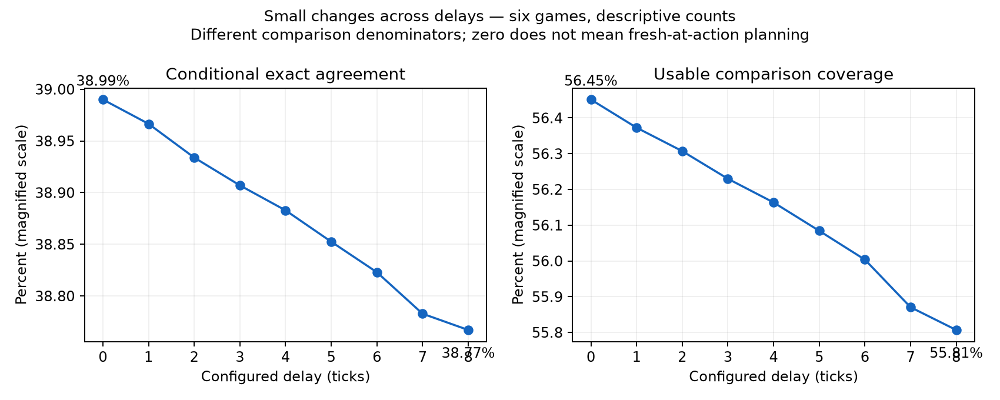
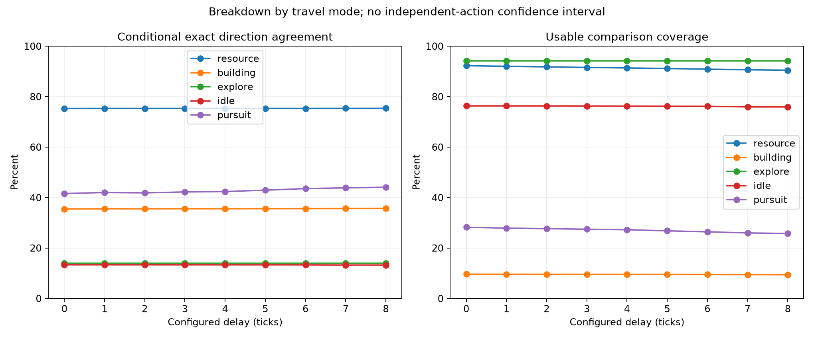
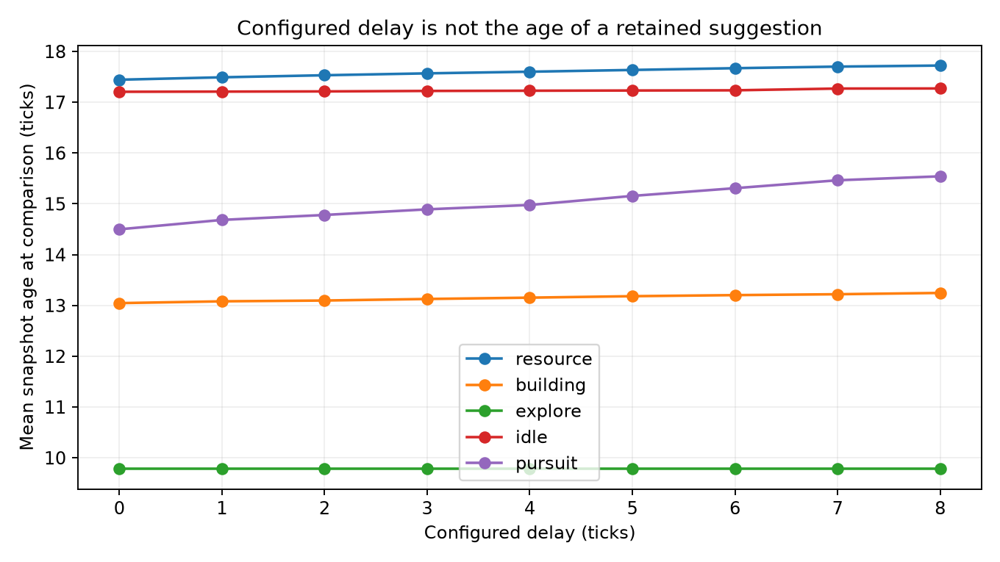

# Real-game movement direction agreement: diagnostic delays 0–8

Six active AI matches were replayed from identical initial saves at every diagnostic delay from 0 through 8, alongside an unconfigured reference run. All 54 reference/diagnostic pairs match per-tick world checksums, replay bytes, replay checksum files and decompressed final-save payloads. This is an unchanged reference trajectory with conditional counterfactual steps, **not gameplay with adopted movement**. Movement stays Stage A, and the PR stays draft.

The additional presentation split was cancelled after auditing actual AI reads. The existing authoritative core/detail split is unchanged. AI health/hunger, experience, construction, cargo, facing and under-attack dependencies remain in core; no presentation layer has been implemented. JavaScript observations also expose these gameplay fields. Only the two animation clocks were clearly presentation-only in the audited compact record, representing eight field bytes rather than a large headless saving.

## Agreement across delays

Each action is classified into eight directions or stay. The proposal is the suggestion's first currently legal direction, or stay for no route/goal reached/no legal direction. Exact agreement counts equal outcomes; moving-only agreement restricts the denominator to actions where both policies move. Coverage is compared actions divided by eligible reference travel completions. Missing/rejected/cancelled suggestions are coverage losses, not matches or invented fallback outcomes.

| Delay | Compared actions | Exact direction/stay | Moving-only direction | Move/stay agreement | Comparison coverage | Mean observation age |
|---:|---:|---:|---:|---:|---:|---:|
| 0 | 86,081 | 38.99% | 47.25% | 82.21% | 56.45% | 15.56 ticks |
| 1 | 85,961 | 38.97% | 47.22% | 82.20% | 56.37% | 15.59 ticks |
| 2 | 85,861 | 38.93% | 47.19% | 82.19% | 56.31% | 15.60 ticks |
| 3 | 85,743 | 38.91% | 47.17% | 82.17% | 56.23% | 15.62 ticks |
| 4 | 85,642 | 38.88% | 47.15% | 82.16% | 56.16% | 15.64 ticks |
| 5 | 85,521 | 38.85% | 47.12% | 82.15% | 56.08% | 15.65 ticks |
| 6 | 85,398 | 38.82% | 47.09% | 82.14% | 56.00% | 15.67 ticks |
| 7 | 85,195 | 38.78% | 47.06% | 82.11% | 55.87% | 15.69 ticks |
| 8 | 85,098 | 38.77% | 47.04% | 82.11% | 55.81% | 15.70 ticks |

The curves are nearly flat in this corpus. Zero means immediate serial computation/publication **at admission**, using the completed-world snapshot; it does not recompute at each action. Requests may be admitted after assignment or the preceding action and retained until completion. Thus zero already has substantial observation age, and this is not a fresh-at-decision zero-delay policy comparison. Nonzero delays use the existing executor with configured publication deadlines. The allowed live-trial delays remain unchanged.

Rates are descriptive census counts for these games. Actions are correlated within games, and the six games reuse three gameplay seeds across two terrain styles. No independent-action confidence interval or population-level significance is claimed. Per-game lines show heterogeneity; pooled rates are weighted by compared actions. Higher delay changes which actions have a usable suggestion, so rates at different delays have different denominators. In particular, an apparent rise in pursuit agreement must be read beside falling pursuit coverage.

| Mode | Delay-0 compared / opportunities | Exact agreement: 0 → 8 | Coverage: 0 → 8 |
|---|---:|---:|---:|
| idle | 29,937 / 39,223 | 13.35% → 13.22% | 76.33% → 75.93% |
| explore | 16,774 / 17,794 | 13.92% → 13.92% | 94.27% → 94.27% |
| resource | 33,171 / 35,947 | 75.34% → 75.38% | 92.28% → 90.48% |
| building | 5,485 / 56,994 | 35.46% → 35.67% | 9.62% → 9.42% |
| pursuit | 714 / 2,529 | 41.60% → 44.09% | 28.23% → 25.74% |
| clearing | 0 / 0 | Not observed | Not observed |

Resource steering agrees about three quarters of the time among compared suggestions. Wandering and exploration use private planning randomness, so low direction agreement alone does not imply poor gameplay. Building travel has very poor coverage; its agreement percentage describes a small selected subset. At delay zero there are 45,694 building destination rejections. Inspection finds the existing destination checker applies supplier/home restrictions to a building-tagged destination (including `supplier != home`) before the Resource-specific stock check. A normal destination can be the assigned home building. This is a validation-semantics issue requiring correction and fresh measurement before adoption; the curve does not justify building-policy equivalence. It was left visible in this measurement rather than silently changing the policy under test.

Clearing was not observed. Pursuit has low coverage and a small comparison population. These ordinary growing matches do not provide the sustainable 1,000-worker workload, comprehensive flying/congestion/clearing coverage, mirrored combat seeds or the 30-seed gameplay trial required by the original plan.

## What is compared

The observer runs after the reference medical/activity/displacement and movement preparation, before reference action execution. It validates identity, task, action generation, position, destination and the first locally legal step against current terrain/occupancy/forbidden/hazard checks. The reference action executes once, in existing unit order; the final committed wrapped cell supplies the actual move/stay outcome. Non-travel transitions or unexpected displacement cancel comparison.

Target acquisition, stock claims and service transitions have already followed the reference path. This measures conditional steering after those decisions; it does not measure agreement of an independent destination-selection/adoption policy or a simulated alternative future. The destination-coordinate counters compare stored coordinates only, not supplier/claim semantics. GoalReached/NoRoute proposals model stay; a missing/rejected suggestion has no modeled live fallback. Workers do not touch gameplay RNG and diagnostics do not write canonical state.

CSV traces contain the first 64 matches and first 64 differences per team/mode, with identity, sequence, input/publication/action ticks, origin, outcomes and destination coordinates. These are bounded examples, not random distribution samples. Aggregate counters and 9×9 confusion counts include every compared action. No trace-write errors occurred.

## Corpus and reproducibility

All games use existing generator settings: 128×128, two teams, eight initial workers, scalar gradient backend and four compute participants. Each initial game is generated/saved at tick one, then every mode loads that same save and runs to absolute tick 12,000 (11,999 further ticks). Controllers remain active and issue real orders. Initial saves, reference replays, checksum files and final saves are published, not only synthetic fixture outputs.

| Match | Map seed | Gameplay seed | Controllers | End units / buildings by team |
|---|---:|---:|---|---|
| symmetric-arena-1 | 1101 | 101 | cortex vs warrush | T0: 44 / 13; T1: 16 / 37 |
| symmetric-arena-2 | 1102 | 102 | nicowar vs warrush | T0: 81 / 12; T1: 12 / 35 |
| symmetric-arena-3 | 1103 | 103 | cortex vs nicowar | T0: 27 / 12; T1: 44 / 10 |
| river-1 | 1101 | 101 | cortex vs warrush | T0: 36 / 15; T1: 30 / 30 |
| river-2 | 1102 | 102 | nicowar vs warrush | T0: 64 / 11; T1: 24 / 34 |
| river-3 | 1103 | 103 | cortex vs nicowar | T0: 85 / 19; T1: 53 / 16 |

The report does not claim FPS/TPS, concurrency or timing benefit from instrumented runs, and no exclusive CPU reservation is claimed here. Timing experiments remain in the separate live-measurement report.

Five additional controls use the first arena game: the pre-dense-sweep release binary without movement diagnostics; one participant at delays 0, 3 and 8; and four participants at delay 3 without trace output. All match the reference canonical payloads; all four agreement-enabled controls also match the aggregate agreement counters. Initial controls omitted the team-timeline telemetry selector and their saved payloads differed; those results are retained as `control-mismatched-telemetry.json`. With identical telemetry selectors the saves match. Do not compare canonical save bytes across differing collection configurations.

## Verification and source

Source: `e09f80733c8c99533925baede8f24abc3427e4d0`; measurement implementation commit `54c2ce8d0`; base `277510840054b1416f2defd7d86fe1431dd0ddc0`. Master was fetched again before final integration validation and remained at that base. Linux x86-64, GCC 15.2, pinned existing SDL 3.4.16 and existing dependencies. No runtime dependency, save/replay/network version or SIM_REVISION changes.

The corpus binary was built with ordinary `scons release=1 --build=build/movement-release -j12 build/movement-release/src/glob2`, `-O3`, from the working tree subsequently committed as the measurement implementation. Its build revision stamp predates that commit; the exact binary hash and commands are in the protocol. Subsequent game-source change was indentation only; the final commit adds the repaired CLI test fixture. Final source integration was rebuilt separately and checked against the frozen corpus.

Focused development validation: 60 cases / 161,576 assertions pass across MovementPlanning, CommandLine, WorldSnapshot, SharedWorkerLifecycle and SimulationReadPhase. The suites already belong to the native compatibility registry. Tests include all nine move/stay outcomes, dense diagnostic delay range, zero publication, canonical state across delay phases, snapshot lifetime and shared simulation/worker boundaries. The CLI test initially omitted required input arguments; the failed runs and corrected fixture are retained. Documentation: 309 Markdown documents, zero errors. This scope covers the new diagnostic path; it does not rerun or replace the earlier complete representation/refactor verification. macOS arm64, Windows x64 and browser serial/threaded execution are unavailable.

**Recommendation:** retain Stage A and the current two-layer layout. The measured sweep supplies steering agreement evidence, but does not qualify live adoption or infer win rates, economy, travel-time quality or congestion. Repair destination validation and cover missing workload/mode populations before any stronger gameplay conclusion. No original performance/gameplay gate was relaxed.

## Reviewer-accessible evidence

[Commands, traces, metrics, analysis/plot scripts, build/test logs and control results](agreement-evidence.zip) · [Protocol and binary hash](agreement-protocol.json) · [Source/platform metadata](agreement-provenance.json) · [All comparison results](agreement-comparisons.json) · [Control results](agreement-control-comparisons.json) · [Per-team/mode counts](agreement-observations.csv) · [Canonical payload SHA-256 manifest](agreement-canonical-payload-manifest.json).

Canonical payloads are deduplicated in the archives: every diagnostic output maps by SHA-256 to its reference payload, rather than publishing 54 identical replay/checksum sets. The manifest includes on-disk and decompressed save hashes. Each archive includes the initial generator output/save and actual reference replay, checksums and final save:

- [symmetric-arena-1](agreement-symmetric-arena-1.zip)
- [symmetric-arena-2](agreement-symmetric-arena-2.zip)
- [symmetric-arena-3](agreement-symmetric-arena-3.zip)
- [river-1](agreement-river-1.zip)
- [river-2](agreement-river-2.zip)
- [river-3](agreement-river-3.zip)
