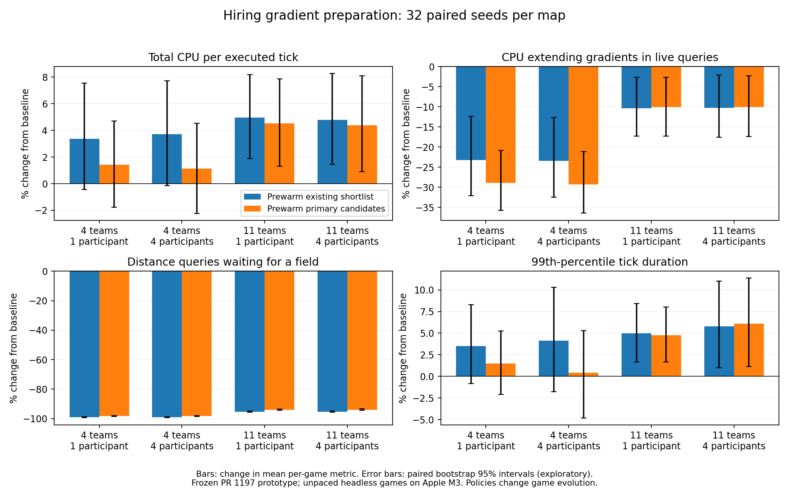

# Warming primary hiring candidates only

Private optimized benchmark prototype based on PR 1197; no production PR changed. Both experimental policies retain the complete shortlist and its fallback candidates. The full policy warms every final ground candidate; primary-only stops before the fallback suffix. Both use the existing distance estimate while a field is missing or stale. Existing usable fields still extend during normal ranking.

384 retained release runs: 32 seeds (42–73), two fixed maps, three policies, one/four compute participants, up to 32,768 ticks. Four scheduled building-gradient refreshes per team per tick in every policy. Apple M3/macOS ARM64, unpaced headless simulation. See experiment.json for commands, source/binary/map hashes, AI roster and contention controls.

## Interpretation

Primary-only retains almost all of full-shortlist warming's improvement in primary candidate field availability and extension. At publication, primary candidates with a missing field or unextended current cell total 0.36% versus 0.40% on the four-team map, and 1.43% versus 1.51% on the eleven-team map (full versus primary-only). These measures do not establish route reachability or field freshness.

On the large map, primary-only uses about 10.5–11.1% less hiring-job CPU and initializes 15.9% fewer private fields. Total process CPU falls only about 0.4% relative to full warming; both confidence intervals include no improvement. Primary-only still costs 4.4–4.5% more total CPU than the original baseline. On the small map, the total CPU saving relative to full warming is 1.9% with one participant (uncertain) and 2.5% with four participants (95% interval: 0.5–4.5% less CPU).

Fallback candidates cause more Pending distance calls under primary-only: 4.34 versus 2.48 per 1,000 ticks on the small map, 75.48 versus 59.45 on the large map. Both remain far below baseline (252.29 and 1,241.49). These are call counts, not unique units or waiting durations. The large-map tick-time tails and adjacent variability do not clearly improve relative to full warming. Policies change game evolution, so measured savings are not attributed solely to the skipped kernel work.

## Total CPU per executed tick

Values are percent changes in mean per-game CPU, with paired bootstrap 95% intervals.

| Workload | Full shortlist vs baseline | Primary-only vs baseline | Primary-only vs full shortlist |
| --- | ---: | ---: | ---: |
| 4 teams, 1 participant | +3.38% [-0.43, +7.56] | +1.43% [-1.78, +4.71] | -1.89% [-4.14, +0.24] |
| 4 teams, 4 participants | +3.71% [-0.15, +7.73] | +1.15% [-2.23, +4.52] | -2.47% [-4.50, -0.52] |
| 11 teams, 1 participant | +4.96% [+1.88, +8.18] | +4.52% [+1.31, +7.87] | -0.43% [-2.23, +1.48] |
| 11 teams, 4 participants | +4.79% [+1.47, +8.26] | +4.39% [+0.90, +8.09] | -0.38% [-2.53, +1.94] |

## Readiness and work

Counts below are per 1,000 executed ticks; percentages are mean per-game fractions. One-participant event counts also apply to four participants because same-policy simulation results match.

| Workload / metric | Baseline | Full shortlist | Primary-only |
| --- | ---: | ---: | ---: |
| 4 teams / Primary candidates missing a field (%) | 21.910 | 0.253 | 0.270 |
| 4 teams / Primary candidates with unextended current position (%) | 2.517 | 0.109 | 0.131 |
| 4 teams / All candidates missing a field (%) | 22.875 | 0.273 | 1.450 |
| 4 teams / All candidates with unextended current position (%) | 2.294 | 0.142 | 0.729 |
| 4 teams / Pending distance calls / 1k ticks | 252.286 | 2.475 | 4.339 |
| 4 teams / Pending movement calls / 1k ticks | 12.706 | 12.829 | 12.646 |
| 4 teams / Explicit primary warm requests / 1k ticks | 0.000 | 404.457 | 407.432 |
| 4 teams / Explicit fallback warm requests / 1k ticks | 0.000 | 84.612 | 0.000 |
| 4 teams / Live-query extension CPU ms / 1k ticks | 0.637 | 0.489 | 0.453 |
| 4 teams / Worker-query extension CPU ms / 1k ticks | 0.178 | 0.458 | 0.437 |
| 4 teams / Private field initializations / 1k ticks | 0.000 | 28.914 | 27.323 |
| 4 teams / All field builds / 1k ticks | 412.808 | 445.785 | 422.010 |
| 11 teams / Primary candidates missing a field (%) | 25.194 | 1.189 | 1.259 |
| 11 teams / Primary candidates with unextended current position (%) | 6.730 | 0.241 | 0.251 |
| 11 teams / All candidates missing a field (%) | 26.652 | 1.324 | 3.788 |
| 11 teams / All candidates with unextended current position (%) | 6.036 | 0.271 | 1.543 |
| 11 teams / Pending distance calls / 1k ticks | 1241.492 | 59.449 | 75.477 |
| 11 teams / Pending movement calls / 1k ticks | 75.086 | 95.468 | 83.504 |
| 11 teams / Explicit primary warm requests / 1k ticks | 0.000 | 1442.933 | 1414.825 |
| 11 teams / Explicit fallback warm requests / 1k ticks | 0.000 | 463.431 | 0.000 |
| 11 teams / Live-query extension CPU ms / 1k ticks | 10.883 | 9.760 | 9.790 |
| 11 teams / Worker-query extension CPU ms / 1k ticks | 2.546 | 8.187 | 7.105 |
| 11 teams / Private field initializations / 1k ticks | 0.000 | 134.721 | 113.297 |
| 11 teams / All field builds / 1k ticks | 2064.418 | 2213.747 | 2173.542 |

## Tick execution variability

Primary-only relative to full-shortlist warming:

| Workload | Mean absolute adjacent tick change | P99 tick duration | P99 eight-tick window |
| --- | ---: | ---: | ---: |
| 4 teams, 1 participant | -0.94% [-4.03, +2.60] | -1.96% [-4.75, +0.84] | -2.19% [-6.88, +3.26] |
| 4 teams, 4 participants | -3.24% [-5.69, -0.85] | -3.58% [-6.02, -1.24] | -5.52% [-8.87, -2.24] |
| 11 teams, 1 participant | -0.64% [-2.31, +1.19] | -0.21% [-2.45, +2.25] | -1.09% [-3.67, +1.67] |
| 11 teams, 4 participants | -0.62% [-3.98, +3.12] | +0.28% [-3.60, +4.84] | +0.94% [-4.07, +6.56] |



## Coverage and reproduction

Validation: 46 focused case executions passed; all 192 same-policy final checksum pairs agree across participant counts. Per-tick world/entity checksum smoke traces match for all three policies. No cross-platform, save/load or rendered-frame qualification claimed.

Policies can change game evolution and candidate membership. Total CPU differences do not isolate gradient kernel cost; field counts do not measure equal-sized work. Both modes preserve stale-field ranking fallback, normal refresh scheduling and lazy extension backstops. Warm requests can cover already-settled cells and do not equal new searches.

Reproduce from source/ and experiment.patch in a clean checkout at the recorded base; use a fresh output folder:

```sh
PYTHONPATH=. CCACHE=1 scons -j8 release=1 client_profile=full server=0 engine-tests build/darwin/client/release/client-full-direct-1111/src/glob2
python3 artifacts/hiring-prewarm-top-candidates/qualify.py
python3 artifacts/hiring-prewarm-top-candidates/run_matrix.py --smoke
python3 artifacts/hiring-prewarm-top-candidates/run_matrix.py
uv run --no-project --offline --python 3.12 --with numpy==2.5.4 --with matplotlib==3.10.7 python artifacts/hiring-prewarm-top-candidates/analyze.py
python3 artifacts/hiring-prewarm-top-candidates/validate_results.py
```

Base `ba299a18eeed0fde46a6c74ccf116eb0d7535cc5`; binary SHA-256 `9188b076937a81eb554a8825e57dedbd3832fb570c5abf9bf19cd48e9258ee97`. Raw retained run commands, environments, logs, results and chronological tick samples are in valid-runs.tar.gz; smoke traces in smoke.tar.gz. Contended attempts are excluded and retained separately when present. methods.json defines metrics and limitations.
