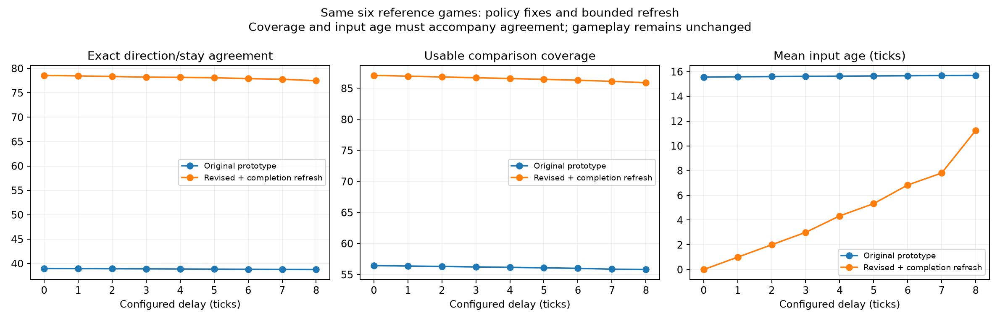
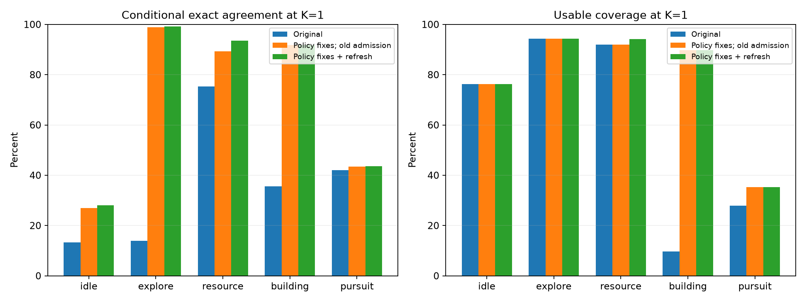
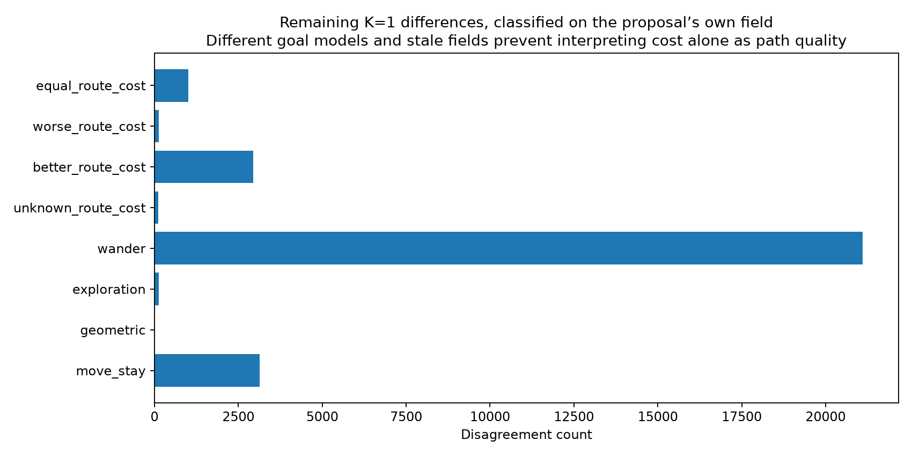

# Movement disagreement investigation and conditional-step tournament

Production remains shadow-only. The core/detail unit layout is unchanged. Source policy investigation frozen at `9edaadfc459c9de84c14f5f02c93548a08c9af0a`, base `277510840054b1416f2defd7d86fe1431dd0ddc0`. Newer diagnostic request counters are documented separately. No runtime dependencies or save/replay/network/SIM version changes.

## Why the original prototype disagreed

The original prototype did not reproduce ordinary exploration contours, flat-map exploration wandering, no-goal idle combat wandering, patrol scoring or reference ordering of equal improving directions. Building destination validation incorrectly applied resource-supplier restrictions, rejecting home-bound destinations. Finally, admission could prepare a suggestion approximately a whole action before use: zero configured executor delay did not imply fresh action-time inputs.

The revised pure policy restores those steering semantics while preserving private planning RNG. An at-most-once completion refresh supplies a recent input at the deadline. It increases computation: 158,116 refreshes among 321,852 admissions at K=1. No net performance improvement is claimed for these policy fixes.

## Same histories, much higher agreement

Six real Cortex/Nicowar/Warrush matches, two generators, three gameplay seeds, ticks 1–12,000. All delays 0–8 plus six K=1 old-admission ablations: **60/60** preserve per-tick checksums, replay bytes, replay checksum streams and decompressed final saves. Original payloads are deduplicated against the previous agreement evidence archives.

At K=1 exact direction/stay agreement increases from approximately 38.9% to **78.46%**, usable comparison coverage to **86.96%**, and mean input age to **1.00 ticks**. Excluding identified ordinary random wandering, agreement is **92.92%**. This exclusion describes a diagnostic category; it does not replace the full agreement metric or relax any gate.

Most remaining differences are wandering (21,112 of 28,565 disagreements), where independent private RNG need not reproduce the gameplay RNG stream. Changed captured occupancy (1,097 comparisons) is an overlapping observation, not a causal label. A terrain-only counterfactual finds 1,751 choices altered by current mobile occupancy. Differences therefore cannot all be dismissed as conflict resolution.

Route-cost labels use the proposal's own goal/field. They do not establish actual reference path quality: building perimeter versus footprint costs differ; combat goals and assigned flag/clearing radii are not fully faithful. Current-world probes are limited to the first 256 comparisons per team/mode, not representative random samples or an independent route oracle. Pursuit coverage remains poor. Clearing is absent from this ordinary-game corpus. No claim that all pathfinding concerns are resolved.

## Research tournament scope

120 independent-seed games per arm, 40 maps across eight generator families and three balanced/rotated AI matchups, 30,000 tick cap, predeclared horizon 12,288. Both arms use the same frozen optimized binary. The after arm adopts a usable planned **final step after original serial preparation**, with original movement fallback when unavailable. This is a local unversioned research patch, not a complete planned-movement implementation or production Stage B/C. Both teams receive the same policy within a game; this is not a head-to-head old-vs-new win-rate test. Replaced actions skip reference movement RNG draws, so aggregate effects include that divergence. The patch and exact build/hash/commands are archived.

Six concurrent matches use explicit disjoint CPU affinities, two executor participants per match. Affinity is not exclusive core reservation. Concurrent builds and other host work are allowed because this study measures gameplay counts, **not runtime performance**. Wall-time differences across histories/termination cannot establish speed gains.

Eight endpoints were declared before analysis. Games, rather than individual units/actions/teams, are observations; map clusters are resampled within generator strata. Independent map-cluster bootstrap (20,000 draws), unpaired stratified cluster permutations (20,000) and Holm correction across eight endpoints are used. The shared map inventory and unmatched gameplay seeds must be distinguished from matched trajectories. Nonsignificance does not establish equivalence. Zero-food games remain in the ratio-of-total worker-moves/deliveries calculation. Existing telemetry's geometric distance-to-building fields are not actual travel distances; the separate patch observes actual moves.

## Verification and limits

Linux x86-64, GCC 15.2, pinned existing dependencies, release `-O3` and development `-O0 -g1`. macOS arm64, Windows x64 and browser serial/threaded execution unavailable. No GPU/desktop gameplay footage qualification, full workload corpus or live movement performance/memory gate qualification. Stage A and all original thresholds remain unchanged; this experiment stays disabled by default and the PR remains draft.

## Completed gameplay result

[The 240-game conditional-step tournament](tournament-report.md) finds significant economy regressions: food delivery/worker time −30.36%, starvation/worker time +66.19%, worker moves/food delivery +19.20%. **Do not adopt the current policy.** Lower disagreement is not a gameplay-equivalence result. Goal fidelity, congestion/waiting and wandering/RNG effects require further isolated investigation. [Charts and raw evidence](tournament-report.md).

Final integration source `fdca48059e632268f0b814abba25afc60e2370f0`, unchanged base after delivery fetch. 127 focused native cases pass, one explicitly skipped display case. Two/four-participant release controls match checksums, replay/checksum streams and decompressed saves with matched options. [Unit-view request frequency follow-up](unit-view-report.md) includes those logs and controls. Other supported platforms remain unavailable.
