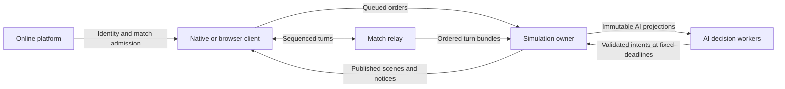

# System overview

Globulation 2 separates deterministic game state from presentation, host services and the online control plane. A colony is a `Team`; a `Player` controls a team, and several players may share one.

The simulation owner is the only authority that changes the match. Clients submit orders and display published results. Background workers calculate from frozen copies of selected state; the owner decides when their results become visible. This keeps game outcomes independent of drawing speed and worker timing.

The platform manages accounts and matches; the relay sequences network turns. The clients run the simulation and render its results.

## Simulation and orders

[Game_sync.cpp](../../src/game/Game_sync.cpp) advances authoritative state. [EngineRun.cpp](../../src/engine/EngineRun.cpp) connects engine timing, orders and clients; [SimulationRunner](../../src/engine/sim/SimulationRunner.h) owns threaded execution. Humans, AI controllers and map scripts produce orders whose delivery is validated by the simulation owner. Worker completion time cannot choose a logical publication deadline.

Units, buildings, teams, resources and maps own their domain state. Map terrain and resource properties feed shared field/pathfinding primitives. [Simulation state](simulation.md) describes those representations; [resource growth](resource-growth.md) describes the deferred ecology pipeline.

## Immutable observations

The game-owned snapshot store captures the complete simulation preset at each read boundary. Interactive sessions also include the ordinary presentation payload; cold UI and diagnostic data remain optional. AI controllers share one immutable view, and map jobs retain standard views containing their inputs. Their outputs are published by the owner in stable order. Presentation uses extracted scenes rather than live simulation entities. [AI observations](ai-observations.md) explains retained inputs, compute lanes and deadlines.

## Client and presentation

Simulation/client communication under `src/engine/sim/` uses values, queues and stable entity references. The UI owns input, menus and dialogs; the renderer consumes scenes, view state and assets. Presentation animation and random effects must not alter simulation draws. [Rendering](rendering.md) and the [UI framework](../development/ui-framework.md) describe these contracts.

## Platform services

`GAGCore::ApplicationHost` supplies scheduling, viewport/visibility, file selection, export and persistence. Native and browser implementations preserve that boundary. Browser code owns JavaScript interop and cooperative jobs; shared game code does not include Emscripten APIs. See the [browser overview and decisions](../browser/README.md).

## Persistence and online play

Save capture preserves state and outstanding work at a simulation barrier. Background encoding, atomic replacement and browser durable storage complete separately; failures remain actionable. See [persistence](persistence.md) and [save continuation](../development/savegame-continuation.md).

Online accounts, rooms, ratings and match history live in the TypeScript platform. The relay sequences turns; clients compute their local simulation using an admitted sim version. See [platform architecture](../multiplayer/architecture.md) and [turn protocol](../multiplayer/turn-protocol.md).

## Repository layout

| Directory | Holds |
| --- | --- |
| `src/` | The game and engine |
| `libs/` | The project's own libraries: `gag/` (graphics, UI, files) and `usl/` (scripting language) |
| `third_party/` | Vendored code |
| `content/` | The runtime tree: `data/`, `maps/`, `campaigns/`, `scripts/`, `games/` |
| `content-src/` | Source art and provenance for generated content |
| `platforms/` | Platform shells and packaging: `web/`, `mobile/`, `macos/`, `windows/`, `linux/`, `stores/` |
| `services/online/` | The TypeScript online platform; `deploy/` holds its hosting scripts |
| `tools/`, `buildsys/`, `test/` | Contributor tools, build helpers and cross-domain tests |

The game names its files by paths relative to the runtime tree (`data/gfx/...`,
`maps/...`). In a checkout that tree is `content/`: the file manager adds it beside
any search root that holds it, so running from the repository needs no setup.
Installed packages and exported asset trees hold those directories at their root.
Saves, replays and online sim-data hashes use the virtual paths, so the layout of
the repository does not affect them. `snap/` and `fastlane/` stay at the root
because snapcraft and F-Droid look for them there.

## Module libraries

`buildsys/sources.py` groups the client objects into two link layers, each built as a
static library that only the module test binaries link (the game keeps linking the
loose objects):

| Library | Group | Holds |
| --- | --- | --- |
| `libglob2_map.a` | `MAP_SOURCES` | `src/map` (cells, terrain, resources, gradients, routing, pathfinding, claims, map I/O), `src/field`, `src/resource`, `src/common` and the snapshot views map reads (`engine/sim/snapshot/WorldSnapshot.cpp`) |
| `libglob2_sim.a` | `SIM_SOURCES` | `src/game` without screens, `src/unit` and `src/building` without render and HUD code, `src/team`, `src/engine/sim`, `src/replay`, `src/scripting`, every AI, and the simulation files under `src/map` (`Sector`, `MapTiling`, `MapSetImport`) |

Dependency direction is presentation and application, then sim, then map, then
libgag and libusl. The direction is not yet strict at link time: map still calls
into sim through `Game` hooks, unit geometry and claims, building routes and
`Sector`, and sim still reaches a few presentation and application objects
(`GameAnimations`, the scene extractor behind game diagnostics, `TeamDisplay`, the
order codecs in `src/net/message`, `SimVersion`, and `GlobalContainer` for building
types, replay writers and settings). `test/tests.py` lists each of these welds as
the stubs or production objects its module test binary adds, and
`python3 tools/link_graph.py` (nm-based closures, strongly connected components and
reference chains) shows them for a built tree. A change that removes a weld also
removes its stub or production entry; a new one shows up as an undefined symbol
when a module test binary links an object that references it.

## Changing a boundary

Extend the owning domain, update capture/query contracts and test doubles, and build affected harnesses. Verify determinism, continuation and admission boundaries through [simulation verification](../development/simulation-verification.md). Keep presentation caches and diagnostics bounded; never rely on thread scheduling, pointer order or unspecified collection iteration for game outcomes.
