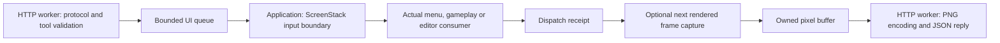

# Embedded MCP UI server

Desktop builds expose the game's mouse and keyboard interface to local MCP clients.
Enable **Settings → MCP server**, then copy the endpoint. The default is disabled, with
port 27202 and endpoint `http://127.0.0.1:27202/mcp`. Enablement and port are stored in
the local settings profile. Changes take effect immediately; a failed bind is shown in
the submenu and **Retry listener** attempts it again. During a restart, **Starting**
means the prior listener is draining before the replacement binds; this does not block
the game loop. Browser, Android, iOS and relay builds do not expose this category or
listener.

Enabling the listener permits local clients to view the window and operate the UI. It
listens only on IPv4 loopback, with no authentication token or option for remote
binding. Host must be `127.0.0.1:<port>` or `localhost:<port>`. If Origin is present it
must be the corresponding `http://` origin. Human input stays active. This controls the
game window only; native file pickers and other OS dialogs are outside its scope.

## Client workflow

Use HTTP POST `/mcp`, `Content-Type: application/json`, and Accept containing both
`application/json` and `text/event-stream`. Responses are JSON; GET and DELETE return
405. Each connection serves one request, then closes. At most 16 connections, 64 waiting
UI operations and 1 MiB per request body are accepted. UI requests have a ten-second
deadline. Clients must never automatically retry input calls: an input may have
dispatched before a disconnect or timeout became visible.

The [2026-07-28
protocol](https://modelcontextprotocol.io/specification/2026-07-28/basic/transports/streamable-http)
uses `server/discover` and stateless requests. Supply `MCP-Protocol-Version`,
`Mcp-Method`, and, for tool calls, `Mcp-Name`. `params._meta` contains matching
`io.modelcontextprotocol/protocolVersion`, required
`io.modelcontextprotocol/clientCapabilities`, and optionally clientInfo with name and
version. Results contain resultType and serverInfo metadata. Header mismatch returns
-32020, unsupported protocol version -32022, and unknown methods -32601. Tools discovery
supplies cache metadata.

The 2025-11-25 adapter supports `initialize`, `notifications/initialized`, `ping`,
`tools/list` and `tools/call`. Initialize supplies protocolVersion, capabilities, and
clientInfo. Subsequent POSTs supply `MCP-Protocol-Version: 2025-11-25`. The server does
not allocate protocol sessions or provide streaming, resources, prompts or
subscriptions.

Call `ui_acquire_control` and retain its opaque token. Acquisition fails when another
controller owns the lease. Input tools and `ui_release_control` require that token. A
valid controller call renews its 60-second idle lease. Individual keys and buttons
expire after five seconds; refresh a hold with another down call. `ui_release_inputs`
releases held inputs; `ui_release_control` also frees the lease. **Revoke control**,
disablement, expiry, listener replacement and shutdown cancel pending controller work
and release remote-owned inputs. Release tools also work while the window is
unavailable, so clients can relinquish held input when the game is minimized or a native
dialog opens.

## Tools

`tools/list` is the authoritative parameter schema. Coordinates are PNG pixels, measured
from the top left. Pass the viewport_id returned by inspection to coordinate tools; a
changed viewport rejects that identity. A resize or UI-scale change requires new
inspection. Events convert output pixels to SDL window coordinates, then the ordinary
input boundary converts them to logical units. Gameplay coalesces only adjacent mouse
motion; it flushes motion before subsequent wheel, key or text events. Wheel targeting
reads the supplied event coordinates, including compact HUD panels, so queued input does
not depend on the OS pointer position.

| Tool | Semantics |
| --- | --- |
| ui_status | Dimensions, availability, frame_id, viewport_id and controller. No lease required. |
| ui_screenshot | Next capturable complete game frame, as inline base64 PNG plus metadata. No lease required. |
| ui_acquire_control / ui_release_control | Acquire a token / release its lease and inputs. |
| ui_move | Move to x, y. |
| ui_click | Left (default), middle or right; count 1 (default) or 2. |
| ui_drag | Array of points; duration_ms defaults to 250, range 1–5000; advances across frames. |
| ui_mouse_button | down or up at x, y, across calls. |
| ui_scroll | dx/dy at x, y; positive dy is up, dx right. |
| ui_key | SDL scancode name; press (default), down or up; optional modifier scancode names. |
| ui_type_text | UTF-8 via the focused game's text-input path, up to 65536 bytes. |
| ui_release_inputs | Release remote-held mouse buttons and keys. |

Input tools accept capture_after (default false). Success means the actual input
consumer dispatched the operation; it does not establish that loading or other
asynchronous UI work has finished. With capture_after, completion waits for a frame
rendered after that dispatch. Menus consume events immediately. Gameplay and the map
editor buffer events, so their dispatch receipt can complete on a later GUI update or
simulation scheduling turn. Human input is processed first. On buffered screens,
pending human events defer new remote operations until their consumer has run, so
coordinates are validated against the resulting viewport. Continuous human activity
can delay a remote operation until its ten-second deadline. Cleanup releases still
proceed through human input frames.

Gestures are serialized in accepted order. Cancellation removes undispatched remote
events from buffered queues, preserves unrelated human events, stops remaining gesture
steps, and releases temporary holds. A screen transition that truncates an event batch
fails the call; undelivered releases remain queued for a later dispatch boundary.
Failures such as stale viewport, lost control, unavailable frames and cancelled capture
are tool results with isError; malformed JSON, invalid arguments and protocol errors
are JSON-RPC errors. An error may report input_started when earlier gesture steps were
emitted; never infer that a failure guarantees no side effects. Screenshots include
in-game dialogs and overlays, with native output resolution and top-left orientation.
Buffers are owned through worker PNG encoding; recording and ordinary screenshots
retain their independent capture paths.

## Extension boundary

The input and optional capture path crosses threads only through owned requests and
pixel buffers:

`src/mcp/Tools.h` defines ToolRegistry, Tool, Request, Result and ExecutionContext. Each
tool provides a name, description, input/output schemas, annotations and handler.
ToolRegistry::call validates arguments before invoking a handler with an execution
context; HTTP objects never reach handlers. Registration and extension callbacks run
once on the application thread before the listener starts. The registry is immutable
while networking runs. Validation and handlers run on the network worker and must not
read application state directly. The built-in schema validator supports object
properties/required/additionalProperties, primitive types, enums, numeric bounds, string
character limits and array items/count bounds. Use this vocabulary or provide validation
in the handler for domain constraints.

`Protocol` adapts version-specific MCP messages; `HttpServer` owns bounded HTTP sessions
and worker encoding; `UIService` owns the bounded queue, lease and input state.
Networking submits requests and reads futures only. Game/screens/renderer access stays
on the application's thread through pump/afterDispatch. Human input observation and
input expiry use pump with dispatchRequests=false while the UI is available. The
screen stack then appends remote events at its additional-input boundary. Buffered
screens retain an InputDispatchReceipt until their actual consumer processes the
tracked event range. The screen stack maps that receipt's consumed count back through
any application-intercepted events before invoking the completion callback. UIService
keeps the next operation behind this receipt, including through cancellation or
listener restart, so a delayed completion cannot acknowledge newer work.

A new screen that buffers events must override defersExecutionInput and
hasPendingExecutionInput, retain the receipt supplied by beginAdditionalInput, record
the range size from endAdditionalInput, and resolve the delivered prefix only after
actual consumption. Cancellation removes only the tracked range; screen teardown,
viewport changes, and suspension must resolve pending receipts explicitly. EventQueue
owns UTF-8 payloads through deferred consumption and retains their storage when
individual event ranges are erased. When the UI is unavailable, inspection and
ownership-release calls can progress without a normal screen update. Hidden cleanup
cancels buffered state and resolves release delivery without advancing simulation.

`GraphicContext::requestMemoryCapture` completes with an
independently owned surface or explicit cancellation. Renderer transitions retire
pending captures. Pass an extension registration callback to UIService's constructor to
add tools before the listener starts. An extension handler may use `context.enqueue` to
schedule a bounded, short main-thread callback returning Result; the callback must
retain any data it needs until dispatch and must not retain transient event pointers.
Queued callbacks share request ordering and the ten-second deadline. Other contexts can
implement that interface independently. Do not block the application callback on
networking or encoding. Domain validation can use Tool's validate callback, which throws
invalid_argument for invalid parameters. Controller-protected future tools must enforce
their domain's control policy explicitly. Listener restart cancels all queued work;
revocation also cancels queued extension callbacks. The UIService singleton is an
application/settings convenience and must not be used by worker handlers to bypass
ExecutionContext.

For verification, run the `MCP/*` engine cases plus settings, input and capture
harnesses relevant to the renderer/platform. Keep generated logs, images and client
transcripts under ignored `artifacts/`, and publish accessible evidence with the
[verification template](verification.md#local-and-vm-pr-verification). Desktop platform
and renderer checks are separate from simulation/save/replay continuity.
