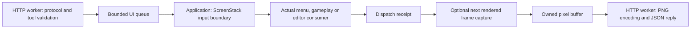

# Embedded MCP UI server

Desktop builds expose the game's mouse and keyboard interface to local MCP clients.
Enable **Settings → MCP server**, then copy the endpoint. The default is disabled, with
port 27202 and endpoint `http://127.0.0.1:27202/mcp`. Enablement and port are stored in
the local settings profile. `glob2 play --mcp-port PORT` (also `replay`) enables the
listener on PORT for that run only and saves nothing; the first edit to the MCP
settings during that run adopts the launch values as the saved choice. Changes take effect immediately; a failed bind is shown in
the submenu and **Retry listener** attempts it again. During a restart, **Starting**
means the prior listener is draining before the replacement binds; this does not block
the game loop. Browser, Android, iOS and relay builds do not expose this category or
listener.

Enabling the listener permits local clients to view the window and operate the UI. It
listens only on IPv4 loopback, with no authentication token or option for remote
binding. Host must be `127.0.0.1:<port>` or `localhost:<port>`. If Origin is present it
must be the corresponding `http://` origin. Human input stays active. This controls the
game window only; native file pickers and other OS dialogs are outside its scope.

## Client workflow

Use HTTP POST `/mcp`, `Content-Type: application/json`, and Accept containing both
`application/json` and `text/event-stream`. Responses are JSON; GET and DELETE return
405. Each connection serves one request, then closes. At most 16 connections, 64 waiting
UI operations and 1 MiB per request body are accepted. UI requests have a ten-second
deadline. Clients must never automatically retry input calls: an input may have
dispatched before a disconnect or timeout became visible.

The [2026-07-28
protocol](https://modelcontextprotocol.io/specification/2026-07-28/basic/transports/streamable-http)
uses `server/discover` and stateless requests. Supply `MCP-Protocol-Version`,
`Mcp-Method`, and, for tool calls, `Mcp-Name`. `params._meta` contains matching
`io.modelcontextprotocol/protocolVersion`, required
`io.modelcontextprotocol/clientCapabilities`, and optionally clientInfo with name and
version. Results contain resultType and serverInfo metadata. Header mismatch returns
-32020, unsupported protocol version -32022, and unknown methods -32601. Tools discovery
supplies cache metadata.

## Self-description

The server is written for agents that know nothing about the game and cannot read this
repository. Both protocol versions return `instructions` (what the game is, the call
sequence, where to start and links to the repository and this guide) and a
`serverInfo` with `title`, `description` and `websiteUrl`: in the 2025-11-25
`initialize` result and in the 2026-07-28 `server/discover` result. The read-only
`game_guide` tool serves longer topics (`overview`, `gameplay`, `screens`, `hud`,
`actions`, `control`, `hive`, `troubleshooting`, `links`); every topic carries the
links to the repository, these guides, Hive scripting and the tutorial lesson
scripts. Its text lives in `src/mcp/Guide.cpp` and must stay true to the game's
behavior: update it with the HUD, menus or rules it describes.

Tool descriptions say what each tool is for in game terms. Only `ui_status`,
`ui_acquire_control` and `ui_screenshot` publish an output schema, which keeps
`tools/list` under the 25,000-byte budget that `MCP/tools explain themselves within a
discovery size budget` enforces. Error results name what failed and the next step,
for example which ui_act check failed (unknown surface, missing key, stale revision
with the current one, disabled, hidden, blocked or unsupported action) or how to
regain control.

The 2025-11-25 adapter supports `initialize`, `notifications/initialized`, `ping`,
`tools/list` and `tools/call`. Initialize supplies protocolVersion, capabilities, and
clientInfo. Subsequent POSTs supply `MCP-Protocol-Version: 2025-11-25`. The server does
not allocate protocol sessions or provide streaming, resources, prompts or
subscriptions.

Call `ui_acquire_control` and retain its opaque token. Acquisition fails when another
controller owns the lease. Input tools and `ui_release_control` require that token. A
valid controller call renews its five-minute idle lease. Token-bearing inspection and explicit renewal also extend it; anonymous reads do not. Individual keys and buttons
expire after five seconds; refresh a hold with another down call. `ui_release_inputs`
releases held inputs; `ui_release_control` also frees the lease. **Revoke control**,
disablement, expiry, listener replacement and shutdown cancel pending controller work
and release remote-owned inputs. Window focus loss releases held inputs and cancels
pending controller actions while preserving the lease, so switching to the MCP client
does not require reacquisition. Release tools also work while the window is
unavailable, so clients can relinquish held input when the game is minimized or a native
dialog opens.

## Tools

`tools/list` is the authoritative parameter schema. Coordinates are PNG pixels, measured
from the top left. Pass the viewport_id returned by inspection to coordinate tools; a
changed viewport rejects that identity. A resize or UI-scale change requires new
inspection. Events convert output pixels to SDL window coordinates, then the ordinary
input boundary converts them to logical units. Gameplay coalesces only adjacent mouse
motion; it flushes motion before subsequent wheel, key or text events. Wheel targeting
reads the supplied event coordinates, including compact HUD panels, so queued input does
not depend on the OS pointer position.

| Tool | Semantics |
| --- | --- |
| game_guide | Game rules, menus, HUD, placement, control and errors by topic, with links. No lease required. |
| ui_status | Dimensions, availability, frame_id, viewport_id and controller. No lease required. |
| ui_screenshot | Next capturable complete game frame, as inline base64 PNG plus metadata. No lease required. |
| ui_acquire_control / ui_release_control | Acquire a token / release its lease and inputs. |
| ui_move | Move to x, y. |
| ui_click | Left (default), middle or right; count 1 (default) or 2. |
| ui_drag | Array of points; duration_ms defaults to 250, range 1–5000; advances across frames. |
| ui_mouse_button | down or up at x, y, across calls. |
| ui_scroll | dx/dy at x, y; positive dy is up, dx right. |
| ui_key | SDL scancode name; press (default), down or up; optional modifier scancode names. |
| ui_type_text | UTF-8 via the focused game's text-input path, up to 65536 bytes. |
| ui_release_inputs | Release remote-held mouse buttons and keys. |
| ui_inspect | Typed hierarchy; optional surface/subtree filters and bounded screenshot. |
| ui_act | Activate, select, set a value or scroll an inspected control; target revision required. |
| ui_wait | Observe a screen, control state or revision; default 10 seconds, maximum 30. |
| ui_renew_control | Renew the current token's five-minute control lease. |
| game_world | Your colony in map tiles: status (free/total units, prestige, win chance), recent alerts (attacks, completions) with tiles, buildings with id, top-left tile, size, level, site and workers, unit counts and your warriors by training level, hungry and injured units, known resources with the nearest tile, other teams' buildings in sight and remembered under fog, recent placements and the placeable names with sizes. `detail: full` adds unit lists; `area` filters by tiles. No lease required. |
| game_place | Place a building site or flag by name with its top-left on a tile, through the same checks as a click; `near` searches outward for room. Buildings need explored ground and never overlap the caller's pending placements; refusals say why. |
| game_building | Change one of your buildings or flags by id and generation: worker request (capped at the building's limit, reported), priority, Swarm production ratios, flag range, upgrade, repair, cancel_upgrade, destroy, cancel_destroy, or move a flag. Uses the validated script order path. |
| game_zone | Paint or erase a forbidden, guard or clearing zone over a tile rectangle. |
| game_view | Centre the camera on a tile and return its screen point (`tile_screen`, in inspection logical pixels). |

The `game_*` tools follow fog of war: they report only what the player's colony sees
now or has seen. Other teams' buildings out of sight are reported as last seen (from a
memory refreshed every 50 ticks from the same visibility as Hive observations, and
corrected only when the tile is in view again); resources come from the same
last-seen memory; another team's hit points and warrior training are never reported.
| hive_status | Local scripting availability, match-session identity and limits. |
| hive_api | Shared player JavaScript API and authoritative local control contract. |
| hive_run | Queue one bounded script invocation with a deduplicated operation key. |
| hive_result | Inspect an operation's output, errors and order-submission result. |
| hive_program | List/inspect/install/replace/pause/resume/cancel local standing orders. |

The [local Hive guide](../multiplayer/hive-mind.md#local-human-match-scripting-through-mcp)
describes script ownership, lifecycle and standing-order management.

Input tools accept capture_after (default false). Success means the actual input
consumer dispatched the operation; it does not establish that loading or other
asynchronous UI work has finished. With capture_after, completion waits for a frame
rendered after that dispatch. Menus consume events immediately. Gameplay and the map
editor buffer events, so their dispatch receipt can complete on a later GUI update or
simulation scheduling turn. Human input is processed first. On buffered screens,
pending human events defer new remote operations until their consumer has run, so
coordinates are validated against the resulting viewport. Continuous human activity
can delay a remote operation until its ten-second deadline. Cleanup releases still
proceed through human input frames.

Gestures are serialized in accepted order. Cancellation removes undispatched remote
events from buffered queues, preserves unrelated human events, stops remaining gesture
steps, and releases temporary holds. A screen transition that truncates an event batch
fails the call; undelivered releases remain queued for a later dispatch boundary.
Failures such as stale viewport, lost control, unavailable frames and cancelled capture
are tool results with isError; malformed JSON, invalid arguments and protocol errors
are JSON-RPC errors. An invalid-argument message names the field and the broken rule,
for example `Invalid argument: ui_drag.points[]: missing required property "x"`. An
error may report input_started when earlier gesture steps were
emitted; never infer that a failure guarantees no side effects. Screenshots include
in-game dialogs and overlays, with native output resolution and top-left orientation.
Buffers are owned through worker PNG encoding; recording and ordinary screenshots
retain their independent capture paths.

## Extension boundary

The input and optional capture path crosses threads only through owned requests and
pixel buffers:



`src/mcp/Tools.h` defines ToolRegistry, Tool, Request, Result and ExecutionContext. Each
tool provides a name, description, input/output schemas, annotations and handler.
ToolRegistry::call validates arguments before invoking a handler with an execution
context; HTTP objects never reach handlers. Registration and extension callbacks run
once on the application thread before the listener starts. The registry is immutable
while networking runs. Validation and handlers run on the network worker and must not
read application state directly. The built-in schema validator supports object
properties/required/additionalProperties, primitive types, enums, numeric bounds, string
character limits and array items/count bounds. Use this vocabulary or provide validation
in the handler for domain constraints.

`Protocol` adapts version-specific MCP messages; `HttpServer` owns bounded HTTP sessions
and worker encoding; `UIService` owns the bounded queue, lease and input state.
Networking submits requests and reads futures only. Game/screens/renderer access stays
on the application's thread through pump/afterDispatch. Human input observation and
input expiry use pump with dispatchRequests=false while the UI is available. The
screen stack then appends remote events at its additional-input boundary. Buffered
screens retain an InputDispatchReceipt until their actual consumer processes the
tracked event range. The screen stack maps that receipt's consumed count back through
any application-intercepted events before invoking the completion callback. UIService
keeps the next operation behind this receipt, including through cancellation or
listener restart, so a delayed completion cannot acknowledge newer work.

A new screen that buffers events must override defersExecutionInput and
hasPendingExecutionInput, retain the receipt supplied by beginAdditionalInput, record
the range size from endAdditionalInput, and resolve the delivered prefix only after
actual consumption. Cancellation removes only the tracked range; screen teardown,
viewport changes, and suspension must resolve pending receipts explicitly. EventQueue
owns UTF-8 payloads through deferred consumption and retains their storage when
individual event ranges are erased. When the UI is unavailable, inspection and
ownership-release calls can progress without a normal screen update. Hidden cleanup
cancels buffered state and resolves release delivery without advancing simulation.

`GraphicContext::requestMemoryCapture` completes with an
independently owned surface or explicit cancellation. Renderer transitions retire
pending captures. Pass an extension registration callback to UIService's constructor to
add tools before the listener starts. An extension handler may use `context.enqueue` to
schedule a bounded, short main-thread callback returning Result; the callback must
retain any data it needs until dispatch and must not retain transient event pointers.
Queued callbacks share request ordering and the ten-second deadline. Other contexts can
implement that interface independently. Do not block the application callback on
networking or encoding. Domain validation can use Tool's validate callback, which throws
invalid_argument for invalid parameters. Controller-protected future tools must enforce
their domain's control policy explicitly. Listener restart cancels all queued work;
revocation also cancels queued extension callbacks. The UIService singleton is an
application/settings convenience and must not be used by worker handlers to bypass
ExecutionContext.

For verification, run the `MCP/*` engine cases plus settings, input and capture
harnesses relevant to the renderer/platform. Keep generated logs, images and client
transcripts under ignored `artifacts/`, and publish accessible evidence with the
[verification template](verification.md#local-and-vm-pr-verification). Desktop platform
and renderer checks are separate from simulation/save/replay continuity.

## Typed interaction and scaled captures

`ui_inspect` accepts `surface` (an instance ID), `subtree` (a stable key), `token`
(optional), `screenshot` (default false) and `compact` (default false). `compact`
also applies to `ui_act`, `ui_wait` and `ui_acquire_control` inspections: it replaces
keyless, unlabelled, inert layout containers with their children, omits fields at
their defaults, keeps `revision` only on actionable controls and marks controls with
no visible area as `hidden`. Typical menu inspections shrink to a third of their size. Controls report their own `revision`.
Snapshot bounds use the owning surface's logical pixels; `viewport` records that
space. They can differ from native screenshot pixels under interface scaling or
HiDPI. Prefer semantic actions for controls and captured-image coordinates for
spatial gestures instead of feeding logical bounds directly to coordinate tools.
Use `ui_act` with `surface`, `key`, `revision`, `action` and optional `value`:

```json
{"token":"CONTROL_TOKEN","surface":1,"key":"start","revision":7,"action":"activate"}
```

Actions are `activate`, `select` (integer index), `set_value` (a control's typed
value) and `scroll` (signed logical-pixel delta). A stale, hidden, disabled or blocked
target fails. Commands traverse the deferred-input receipts and revalidate at actual
consumption. Unrelated counters do not invalidate a button. Successful `ui_act`
receipts include the current `inspection`, avoiding another read to discover the next
control. A queued screen transition may still need `ui_wait`. If inspection itself
fails after input was consumed, `inspection_error` reports that separately;
`dispatched: true` still records delivery, so do not replay the action.

`ui_wait` accepts `timeout_ms` (default 10000, maximum 30000) and `condition`.
A condition can name `screen`, `key`, `enabled`, `selected`, `focused`, `blocked`,
`visible`, `value`, and/or `revision_after`. It may use the same surface/subtree
filters. A control that has disappeared counts as not visible, so `{key, visible:
false}` is satisfied by its absence unless the condition also names another property
of that control. Waits do not occupy the action queue. Timeout returns the latest relevant
inspection with `satisfied: false`. At most eight waits may remain pending; excess
waits fail immediately with an actionable error. This leaves HTTP connections and
request capacity available for actions and inspections that can satisfy observers.
Token-bearing waits renew control while observed.
`ui_renew_control` explicitly renews the current token's five-minute lease.
`ui_acquire_control` optionally accepts `inspect: true` to return the current hierarchy
with the granted token. Its default response is unchanged. A failed optional read
returns `inspection_error` alongside the valid token; renew or use that token rather
than acquiring control again.

Screenshot requests and input `capture_after` accept `max_width` and `max_height`.
Images preserve aspect ratio within integer rounding and never upscale. Native readback
is owned by the request; resizing and PNG encoding run on the HTTP worker. Each image
has `capture_id`, returned-image `width`/`height`, native dimensions and `viewport_id`.
Pass `capture_id` to coordinate tools to use that image's pixel coordinates. The service
retains eight capture transforms; retirement or a viewport change requires a new image.
Omitting it preserves native-pixel coordinates.

The screen owner composes declarative menus, gameplay HUD and Hive cards, spectator
controls, desktop/compact editor controls, and active dialogs. Popups and modal
connection cards own input across their covered hosts; a queued action cannot bypass
that ownership. Building/editor targets bind entity generations, and compact placement
confirmation binds the construction type and world position. Informational unit and
resource panels remain read-only. Map, minimap and replay progress are canvas controls;
use captured-image coordinates for spatial gestures and Hive for player-visible world
records. A control reports `blocked` when any overlay intersects it, so the map canvas
reads as blocked while a lesson card or other panel covers part of it; coordinate
gestures still reach its uncovered part. The desktop HUD's top-bar counters are
read-only `label` controls under `game/stats/` (workers, explorers and warriors as
free/total, prestige, win chance, converted in and out). `game/placement` is a read-only
label naming the active placement tool: `none`, `building:<type>`, `flag:<type>` or
`zone:<kind>:paint|erase`. A flag's assignment slider is labelled for the unit it
requests (Assigned warriors or explorers). Building and flag palette entries are labelled
with the player-facing names; their keys keep the stable type names. Native OS dialogs
remain outside this interface.

## Linux stdio launcher

`python3 tools/mcp_stdio.py` connects to the default loopback endpoint, reusing a
compatible running game or starting `glob2` from `PATH`. A game it starts receives
`play --mcp-port PORT` (from `--url`) unless the arguments name another command or
their own `--mcp-port`; `--no-launch-flag` instead relies on Settings → MCP server.
`--help` describes the options and links the repository and this guide. Startup defaults to one 30-second budget (maximum 120),
including the initial probe and capability discovery. A listening but unresponsive or
incompatible endpoint fails without starting a second game; only connection refusal
starts the configured executable. Override the
executable, working directory, URL and argument list explicitly:

```sh
python3 tools/mcp_stdio.py --executable /opt/glob2/bin/glob2 --cwd /opt/glob2 \
  --url http://127.0.0.1:27202/mcp -- play --data-dir /opt/glob2/share/glob2
```

The launcher uses only Python's standard library and inherits the desktop environment,
including display and audio variables. Stdout carries newline-delimited MCP JSON only;
diagnostics and child logs go to stderr. Up to eight waits forward independently;
mutations retain stdin order, so a wait cannot hold up the action that satisfies it.
It never retries forwarded requests. Delivery
may be uncertain after a disconnect; inspect results before issuing another mutation.

Codex filters a stdio server's environment before starting it. Configure desktop
variable forwarding explicitly; inheriting the launcher's environment alone cannot
restore variables removed by the client. For example, with an installed launcher:

```toml
[mcp_servers.glob2]
command = "python3"
args = ["/opt/glob2/tools/mcp_stdio.py", "--executable", "/opt/glob2/bin/glob2", "--cwd", "/opt/glob2", "--", "play", "--data-dir", "/opt/glob2/share/glob2"]
env_vars = ["DISPLAY", "XAUTHORITY", "WAYLAND_DISPLAY", "XDG_RUNTIME_DIR", "XDG_SESSION_TYPE", "DBUS_SESSION_BUS_ADDRESS", "PULSE_SERVER", "PULSE_COOKIE", "PIPEWIRE_REMOTE"]
startup_timeout_sec = 45
tool_timeout_sec = 40
required = true
default_tools_approval_mode = "approve"
```

`XAUTHORITY` is needed when the X11 server uses a separate authorization file,
including isolated Xvfb sessions. Preserve the user's display/audio configuration;
do not hard-code a display number or override audio drivers in the launcher.
Headless Linux hosts still need an active display server. Run a persistent Xvfb
session independently of Codex, then configure that server's `DISPLAY`, `XAUTHORITY`
and `SDL_VIDEO_DRIVER=x11` in the client's environment. Wrapping the stdio launcher
in `xvfb-run` ties the display's lifetime to the client and can terminate the game's
display connection on disconnect. Virtual X11 verification does not establish
physical-monitor, Wayland or hardware HiDPI coverage.
Marking the server required makes an initialization failure visible before a task
runs without the game tools. See the [Codex MCP configuration guide](https://learn.chatgpt.com/docs/extend/mcp?surface=cli)
for current client options. Verify a native Codex call to `ui_inspect` and a bounded
screenshot after registration; `mcp list` only confirms configuration, not a working
connection or successful discovery.
The approval setting above preauthorizes this local game server's tools. Without
it, the client's automatic tool policy may still require confirmation for mutations,
even when the session's approval policy is `never`; those calls are then rejected
before delivery. Use a prompting policy instead when interactive confirmation is
preferred.
