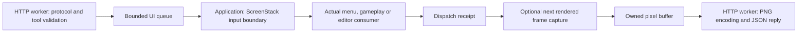

# Embedded MCP UI server

Desktop builds expose the game's mouse and keyboard interface to local MCP clients.
Enable **Settings → MCP server**, then copy the endpoint. The default is disabled, with
port 27202 and endpoint `http://127.0.0.1:27202/mcp`. Enablement and port are stored in
the local settings profile. `glob2 play --mcp-port PORT` (also `replay`) enables the
listener on PORT for that run only and saves nothing; the first edit to the MCP
settings during that run adopts the launch values as the saved choice. Changes take effect immediately; a failed bind is shown in
the submenu and **Retry listener** attempts it again. During a restart, **Starting**
means the prior listener is draining before the replacement binds; this does not block
the game loop. Browser, Android, iOS and relay builds do not expose this category or
listener.

Enabling the listener permits local clients to view the window and operate the UI. It
listens only on IPv4 loopback, with no authentication token or option for remote
binding. Host must be `127.0.0.1:<port>` or `localhost:<port>`. If Origin is present it
must be the corresponding `http://` origin. Human input stays active. This controls the
game window only; native file pickers and other OS dialogs are outside its scope.

## Client workflow

Use HTTP POST `/mcp`, `Content-Type: application/json`, and Accept containing both
`application/json` and `text/event-stream`. Responses are JSON; GET and DELETE return
405. Each connection serves one request, then closes. At most 16 connections, 64 waiting
UI operations and 1 MiB per request body are accepted. UI requests have a ten-second
deadline. Clients must never automatically retry input calls: an input may have
dispatched before a disconnect or timeout became visible.

The [2026-07-28
protocol](https://modelcontextprotocol.io/specification/2026-07-28/basic/transports/streamable-http)
uses `server/discover` and stateless requests. Supply `MCP-Protocol-Version`,
`Mcp-Method`, and, for tool calls, `Mcp-Name`. `params._meta` contains matching
`io.modelcontextprotocol/protocolVersion`, required
`io.modelcontextprotocol/clientCapabilities`, and optionally clientInfo with name and
version. Results contain resultType and serverInfo metadata. Header mismatch returns
-32020, unsupported protocol version -32022, and unknown methods -32601. Tools discovery
supplies cache metadata.

## Online play

Enabling the server makes the game an assisted client for the online platform,
whichever tools an agent then uses: quick match searches only assisted queues, so
players with MCP enabled meet only each other
([assisted queues](../multiplayer/ratings-and-matchmaking.md#assisted-queues)).
From the assignment of a quick match from an ordinary queue until its results close,
the server stays off even if the setting is switched on. Online matches refuse the `game_*` and `hive_*` tools; the
`ui_*` tools drive them like a player would.

## Self-description

The server is written for agents that know nothing about the game and cannot read this
repository. Both protocol versions return `instructions` (what the game is, the call
sequence, where to start and links to the repository and this guide) and a
`serverInfo` with `title`, `description` and `websiteUrl`: in the 2025-11-25
`initialize` result and in the 2026-07-28 `server/discover` result. The read-only
`game_guide` tool serves longer topics (`overview`, `gameplay`, `screens`, `hud`,
`actions`, `control`, `hive`, `troubleshooting`, `links`, and eight `strategy-*` topics:
economy, food and conversion, scouting, defence, attack, training, terrain, timing,
written as plain advice with tradeoffs) and `search` (whole words, optionally within
one `topic`); every topic carries the
links to the repository, these guides, Hive scripting and the tutorial lesson
scripts. Its text lives in `src/mcp/Guide.cpp` and must stay true to the game's
behavior: update it with the HUD, menus or rules it describes.

Tool descriptions say what each tool is for in game terms. Annotations are set per tool
(`annotationsFor` in `src/mcp/Tools.cpp`): reads are `readOnlyHint`; tools that can
destroy, erase, cancel or send arbitrary input are `destructiveHint`; views, alliances,
zones and operation-keyed Hive calls are `idempotentHint` (only those may be retried
after a dropped connection); raw UI input is `openWorldHint`, since it can reach online
matches. Only `ui_status`,
`ui_acquire_control` and `ui_screenshot` publish an output schema, which keeps
`tools/list` under the 31,500-byte budget that `MCP/tools explain themselves within a
discovery size budget` enforces. Error results name what failed and the next step,
for example which ui_act check failed (unknown surface, missing key, a control with no
actions such as a canvas, stale revision with the current one, disabled with its
`disabled_reason`, hidden, blocked or unsupported action) or how to regain control.
Schema validation names the allowed values: an integer outside its range reads
`game_building.workers: out of range: 0..255, got 300`, a wrong type `expected integer
0..255, got 2.5`, an enum `expected one of [...], got "urgent"`. A wait on a screen
name that inspection never reports (`ui_act wait_for {"screen": ...}`, `ui_wait
condition.screen`) is refused before dispatch, listing the known names
(`knownScreens` in `src/mcp/Guide.cpp`, kept in step with the screens'
`recordingId`).

The 2025-11-25 adapter supports `initialize`, `notifications/initialized`, `ping`,
`tools/list` and `tools/call`. Initialize supplies protocolVersion, capabilities, and
clientInfo. Subsequent POSTs supply `MCP-Protocol-Version: 2025-11-25`. The server does
not allocate protocol sessions or provide streaming, resources, prompts or
subscriptions.

Call `ui_acquire_control` and retain its opaque token. Acquisition fails when another
controller owns the lease. Input tools and `ui_release_control` require that token. A
valid controller call renews its five-minute idle lease. Token-bearing inspection and explicit renewal also extend it; anonymous reads do not. Individual keys and buttons
expire after five seconds; refresh a hold with another down call. `ui_release_inputs`
releases held inputs; `ui_release_control` also frees the lease. A call whose token is
wrong while another lease is held says `Token does not match the current control
lease (held by ...)`; `Controller lease lost` means no client holds control any more.
**Revoke control**,
disablement, expiry, listener replacement and shutdown cancel pending controller work
and release remote-owned inputs. Window focus loss releases held inputs and cancels
pending controller actions while preserving the lease, so switching to the MCP client
does not require reacquisition. Input sent after the loss is delivered without focus:
remote key and mouse events carry the `GAGCore::RemoteInputDevice` marker
(`libs/gag/include/InputState.h`), which lets them past gameplay's focus gate, while
the human's keys and mouse stay ignored until focus returns, as before. Held-key camera
scrolling and drag stepping still read focus, so an unfocused match moves its camera
through `game_view` rather than a held arrow key. The map editor keeps its focus gate
for all input. Release tools also work while the window is
unavailable, so clients can relinquish held input when the game is minimized or a native
dialog opens.

## Tools

`tools/list` is the authoritative parameter schema. Coordinates are PNG pixels, measured
from the top left. Pass the viewport_id returned by inspection to coordinate tools; a
changed viewport rejects that identity. A resize or UI-scale change requires new
inspection. Events convert output pixels to SDL window coordinates, then the ordinary
input boundary converts them to logical units. Gameplay coalesces only adjacent mouse
motion; it flushes motion before subsequent wheel, key or text events. Wheel targeting
reads the supplied event coordinates, including compact HUD panels, so queued input does
not depend on the OS pointer position.

| Tool | Semantics |
| --- | --- |
| game_guide | Game rules, menus, HUD, placement, control and errors by topic, with links; `search` returns the blocks of every topic containing all its words: a short paragraph whole, so a heading comes with its list of steps, or a few lines of a long one extended over the list items and indented lines that continue them. No lease required. |
| ui_status | Dimensions, availability, frame_id, viewport_id and controller. No lease required. |
| ui_screenshot | Next capturable complete game frame, as inline base64 PNG plus metadata. No lease required. |
| ui_acquire_control / ui_release_control | Acquire a token / release its lease and inputs. |
| ui_move | Move to x, y, or to the centre of an inspected control by `key` (and `surface` when the key is on several). |
| ui_click | Left (default), middle or right; count 1 (default) or 2; at x, y or on a control by `key`/`surface`, refused when that control is hidden or blocked. |
| ui_drag | Array of points; duration_ms defaults to 250, range 1–5000; advances across frames. |
| ui_mouse_button | down or up at x, y, across calls. |
| ui_scroll | dx/dy at x, y; positive dy is up, dx right. |
| (pointer space) | The pointer tools (`ui_move`, `ui_click`, `ui_mouse_button`, `ui_scroll`, `ui_drag`) take `space`: `native` (the default) is window pixels, `logical` is the pixels of `ui_inspect` bounds and `game_view`'s `tile_screen`; a `capture_id` instead names screenshot pixels. |
| ui_key | SDL scancode name; press (default), down or up; optional modifier scancode names. |
| ui_type_text | UTF-8 via the focused game's text-input path, up to 65536 bytes. |
| ui_release_inputs | Release remote-held mouse buttons and keys. |
| ui_inspect | Typed hierarchy; optional surface/subtree filters and bounded screenshot. Choices and lists give their `options` (compact output gives `option_count` for lists and choices over 24 options), `disabled_options` and the chosen `value_label`; sliders and steppers give `min`, `max`, `step` and, when the number is not the reading, `value_label` (`1.6x` for speed 2). A disabled control whose screen knows why carries `disabled_reason`. `find` returns instead a flat list of the controls whose label or key contains the text (surface, key, label, role, actions, revision, state, `hidden`; at most 40). Compact output (the default) gives rectangles only to canvases and controls without actions, since `ui_click {key}` needs none (`bounds: true` gives every control's, `bounds: false` none), and folds each run of off-screen controls into one `hidden_controls` entry per container, merged across layout containers: the count, the `keys` of those that take actions (plain keys) and their `labels` by key; scroll their container, or select on a choice that lists them, to reach one. A filter that matches nothing carries a `note` naming the missing key or surface. A wrong or expired token is ignored by reads. |
| ui_act | Activate, select, set a value or scroll an inspected control; target revision required. `select` takes an option's index, its label, or a unique case-insensitive start of a label (`Maxima` for `Maxima - Hard (1873)`); an ambiguous start is refused with its matches. Values are checked against the control's options or `min`/`max` before dispatch; a refusal lists them and reports `dispatched: false`. Once consumed it returns, on the same screen, only the acted control's subtree (`inspection_scope` says so; the whole screen if that control went away), and on a new screen its whole inspection; `inspect: false` returns only the screen name (also with `capture_after`) and `result_subtree` trims it to one control's subtree, dropping surfaces without it. `wait_for` (`"next_screen"` or `{"screen": NAME}`, with `timeout_ms`, default 10000) holds the reply until that screen shows; it shares the eight-wait limit with `ui_wait`, and a timeout answers `satisfied: false` with a `wait_note` rather than an error, since the action happened. |
| ui_wait | Observe a screen, control state or revision; default 10 seconds, maximum 30. `inspect: false` returns only the screen name. |
| ui_renew_control | Renew the current token's five-minute control lease. |
| game_world | Your colony in map tiles, with this match's `session`: status (`units_free` per unit type counted now: free, total, and the non-zero counts of idle, working, at flags, in guard zones, fighting, hungry, injured and inside; `win_chance` as a number; the top bar's sampled text under `hud_sampled`), alerts from the colony's event journal, grouped by kind, team and program over the window (`n` reports, the latest x/y, an `area` box, unit and building breakdowns, `first_tick`, `last_tick`, `ticks_ago`; positions are a unit's tile, a building's top-left, and a completed building's centre), newest first, the last five minutes unless `since_tick` is given, at most 25 groups (kinds: unit/building attacked, building completed, destroyed or demolished, units converted away or to you, enemy building sighted or gone, Hive program failed, Hive wake), `losses` (buildings destroyed recently and in total, buildings demolished in total, units converted away in total and since the previous read), buildings with id, top-left tile, size, level, site, workers (requested) and `assigned` (units that have taken the job), the stock the building panel shows as `amount/capacity` (material keys such as `food` for wheat and `cherries`, plus `bullets`; a site's delivered of needed), units `inside` and an Inn's `happiness`, unit counts and your warriors by training level, hungry and injured units, known resources by type (tiles, amount, the nearest tile and the largest `fields` of touching tiles, `resource_fields` of them, default 3; `resources_scope` echoes the searched rectangle, `resources_note` says when nothing was seen or how to look further; `area` restricts the search), other teams' buildings in sight and remembered under fog, recent placements and the placeable names with sizes. `detail: brief` returns only status, unit counts, forces, alerts, losses, placements and one line per building, for polling; `detail: alerts` drops the building list too; `detail: full` adds unit lists and the placeable names and note, which the default summary leaves out; `include` returns only the named top-level sections (with `tick`, `session` and `team`; unknown names are refused with the list), for example `["status", "alerts"]` to poll cheaply; `area` filters by tiles; `since_tick` keeps only alerts after that tick. Alerts also report standing Hive programs that failed (`hive_program_failed`, with `paused`) and other teams' buildings first seen (`enemy_building_sighted`). Placement follow-ups see every own building whatever `area` or `limit` say, and give the placed `id` and `generation`. No lease required. |
| game_place | Place a building site or flag by name with its top-left on a tile, through the same checks as a click; `near` searches outward for room and reports how far it `moved` and why the requested spot was refused. The new building's id appears under `game_world` placements once the next step has applied the order; a `session` from another match is refused. `workers`, `builders` and a flag's `range` go in the create order itself, capped at the type's limits and reported under `settings`; `priority` follows as a priority order once the site or flag appears, since the create order carries none. Buildings need explored ground and never overlap the caller's pending placements; refusals say why (with `near`, how many spots were unexplored, pending or blocked). |
| game_building | Change one of your buildings or flags by id and generation, as this match's `game_world` reported them (a `session` from another match, or an id `game_world` never reported without this match's session, is refused): worker request (capped at the building's limit, reported), priority, Swarm production ratios, flag range (capped at the flag type's maximum, reported), upgrade, repair, cancel_upgrade, destroy, cancel_destroy, or move a flag. Uses the validated script order path. A reference is checked first: another team's building, an unknown id or a stale generation (with the current one) are refused with the reason; so are impossible requests (upgrading a site, a flag or a top-level building, moving a building, a range on a building). `builders` alone sets a site's builders; a cap of 0 says why. |
| game_zone | Paint or erase a forbidden, guard or clearing zone over a tile rectangle; the reply echoes the zone, mode and area. |
| game_view | Centre the camera on tile `x`/`y` (on your Swarm, or your colony's centre, when they are omitted) and return its screen point (`tile_screen`, in inspection logical pixels, with `on_screen`; across the map edge it is the copy in view). Optional `zoom` sets the HUD zoom first (1 is 100%, up to 5; 0 fits the whole map); `width`/`height` instead frame that many tiles around the centre. |
| game_chat | Send an in-game chat message as the local player, as the chat box's Send would (to the recipients the chat box addresses). The text is plain text on one line of at most 254 bytes of UTF-8, the chat order's limit; longer text, control characters and whitespace-only text are refused with an error rather than altered. It needs no chat box, focus or keystrokes. Like the other `game_*` tools, it works only in a local match with a human player, never online or LAN. It is refused while the player's age band has no chat (under 13, or not yet answered; see [age bands](../multiplayer/identity.md#age-bands)). |
| game_time | `action` (default `status`, no lease): `pause`, `resume` or `step` with `ticks` (1–3000, default 30; the match stays paused after; `wait: true` replies once the steps ran, as game_wait does). `speed` -3..10 sets the top bar speed with any action: -3..9 are 0.25, 0.5, 0.75, 1, 1.25, 1.6, 2, 2.5, 4, 5, 8, 13 and 40 times normal, 10 unlimited. Reports `tick`, `paused`, `paused_by`, `steps_remaining`, `speed`, `speed_value` and `ticks_per_second` (rounded; null with a warning at unlimited speed, when many ticks pass between calls). |
| game_wait | Let game time pass: up to `ticks` (1–9000, default 300) or until an `until` event reaches the colony, the game announces the result (`match_end`), or `timeout_ms` (default 25000, at most 30000) passes. `until` takes categories (`attack`, which ignores attacks on explorers only, `attack_buildings`, `attack_warriors`, `building_lost`, `conversion` in either direction, `conversion_lost`, `conversion_gained`, `enemy_sighted`, `enemy_building_gone`, `hive_failure`, `hive_wake`, `building_completed`) or any alert kind; the default is `attack`, `building_lost`, `conversion_lost`, `enemy_sighted`, `enemy_building_gone`, `hive_failure` and `hive_wake`. An attack already under way when the wait starts does not end it; a new one does. Steps still running from `game_time step` are waited for rather than reported as a pause. `since_tick` also counts events since an earlier tick; `resume: true` lets a paused match run first. Held as an observer and checked each frame from the event journal, without parking the simulation. `include` narrows the embedded `game_world` reply to the named sections, as in game_world. Answers `reason` (the until name that matched, `ticks`, `timeout` with how many ticks passed, `paused` or `match_end` with `outcome`), the `trigger`, `from_tick`, `waited_ticks` and the `game_world` alerts reply since it began. No lease required. |
| game_alliance | The in-game Alliance dialog. With only the token: each other team with its players, whether it is an AI, and your settings toward it (`allied`, `share_map`, `share_food_vision`, `share_market`) plus `teams_fixed`. With `team` and settings: the dialog's OK for that team, other settings and teams unchanged, echoing what was requested. When Teams Fixed is on (the Game Rules default) only a change of `allied` is refused; a game that hides the dialog refuses all changes. |
| game_stats | Statistics over time from the same metric catalog as the game's panels (`stats/MetricCatalog.h`), each with per-team series (`seconds`, `values` or `band_values`, thinned to `points`, default 20, at most 300) and a summary over every sample (`latest`, `peak`, `low`, and a counter's `total`). `list: true` names the metrics; `metrics` picks up to 16; `split` shows their parts; `series: false` returns each team's summary without the series. Each metric's `unit` is `percent` when it is shown as a percentage (win probability, shares). In a match: your colony only, exactly the in-game Statistics panel, plus the top bar; no other team and no win-probability history, which reads hidden opponent state. On the `end_game` screen, while it is shown: every team of the finished match with name, colour, outcome, the overview figures and the win probability history, as the results screen charts them. No lease required. |

The `game_*` tools follow fog of war: they report only what the player's colony sees
now or has seen. Other teams' buildings out of sight are reported as last seen (from a
memory refreshed every 50 ticks, once an agent first calls `game_world`, from the same
visibility as Hive observations, and
corrected only when the tile is in view again); resources come from the same
last-seen memory; another team's hit points and warrior training are never reported.
Stock, units inside and happiness are given for your own buildings only, never for
another team's Inns. The game raises no event when a building is lost, so the same
refresh notes which of your buildings have disappeared: one that was not being
demolished (or ordered destroyed through `game_building`) is reported as destroyed. A
demolition ordered in the HUD that completes between two refreshes is reported as
destroyed too. An Inn's happiness is the level `Team::findNearestFood` compares when a
hungry unit chooses between your Inns and the Inns of a non-allied colony that shares
its food vision; the `gameplay` guide topic explains conversion.
| hive_status | Local scripting availability, match-session identity and limits. Colony scripts run in a disposable worker outside the simulation, so each run gets 250 million work units (250 times an AI or map script's) and a 128 MiB JavaScript heap, bounded by the worker's 5 s deadline; a whole-map scan of a 256 x 256 map fits. |
| hive_api | The Hive JavaScript reference, browsable rather than one blob: no arguments lists its sections (the shared player contract split at its headings, then `helpers`, `local-control`, `limits` and `types`, the TypeScript declarations from `examples/hive-mind/hive.d.ts`); all of it is compiled into the game, so release builds serve it without the source tree; `section` reads one with its `previous`/`next`; `search` returns the paragraphs containing every word. `helpers` documents the local colony helpers: `units`/`buildings` filters by name and `"mine"`/`"enemies"`, `buildingType`, `events`, `map.scan`, `map.canPlace`, `map.findPlacement`, `map.delta`/`distance`, create orders by building name, resource keys on tiles and `assigned` on own buildings. All read only the colony's own snapshot. |
| hive_run | Queue one bounded script invocation with a deduplicated operation key; `wait: true` holds the call (up to 25 seconds) and returns the finished result instead of `queued`. Each order stands alone: one the game no longer accepts (a stale or foreign building reference, a bad descriptor) is listed in `rejected` with its index and reason, and the rest are sent. |
| hive_result | Inspect an operation's output, errors and order-submission result; `wait: true` waits until it has finished. |
| hive_program | List/inspect/install/replace/pause/resume/cancel local standing orders. A program whose worker could not start is retried up to three times; any other failure pauses it. Both appear as `game_world` alerts. `list` stays short (no description, last output or events: `inspect` has them) and reports each program's `paused_reason`, `last_error`, `intervalTicks`, `last_run_tick` and `runs`; a replaced program keeps its pause and says so. An install over an existing name, a replace of a missing program, or a stale `expected_revision` fails at once, naming the current revision. |

`game_time` is a client scheduling control, not an order: `pause` sets the same hard
pause as the player's Hard pause shortcut, which holds the engine's whole order and
tick loop on this client and records nothing in the replay, and the map shows
Paused. `step` sets a tick budget on that hard pause (`GameGUI::heldSteps`); the
engine runs that many ticks at the current speed exactly as if unpaused, then holds
again, so what the simulation computes and records is unchanged. `resume` clears it
and also lifts an ordinary pause from the menu or Pause key (a recorded pause order),
which `step` refuses to run through. The player's own Hard pause shortcut replaces
an agent pause or step. It is available only where the player may hard-pause and
Hive runs: the local human player of a match without network players, never a
network match, replay or spectator view. While held, reads, `game_place`,
`game_building`, `game_zone`, clicks and typing still work and their dispatch receipts
complete, since the GUI keeps consuming input; the orders they queue wait in the
client order queue and apply as the next ticks run, so `game_world` shows a placement
pending until a step or resume.

The [local Hive guide](../multiplayer/hive-mind.md#local-human-match-scripting-through-mcp)
describes script ownership, lifecycle and standing-order management.

Input tools accept capture_after (default false). Success means the actual input
consumer dispatched the operation; it does not establish that loading or other
asynchronous UI work has finished. With capture_after, completion waits for a frame
rendered after that dispatch. Menus consume events immediately. Gameplay and the map
editor buffer events, so their dispatch receipt can complete on a later GUI update or
simulation scheduling turn. Human input is processed first. On buffered screens,
pending human events defer new remote operations until their consumer has run, so
coordinates are validated against the resulting viewport. Continuous human activity
can delay a remote operation until its ten-second deadline. Cleanup releases still
proceed through human input frames.

Gestures are serialized in accepted order. Cancellation removes undispatched remote
events from buffered queues, preserves unrelated human events, stops remaining gesture
steps, and releases temporary holds. A screen transition that truncates an event batch
fails the call; undelivered releases remain queued for a later dispatch boundary.
Failures such as stale viewport, lost control, unavailable frames and cancelled capture
are tool results with isError. So are invalid arguments, as the MCP tools spec asks, so
that the model sees them and can correct the call: `structuredContent` carries `error`
and `error_code: "invalid_argument"`. Malformed JSON, unknown tools and protocol errors
are JSON-RPC errors. An invalid-argument message names the field and the broken rule,
for example `Invalid argument: ui_drag.points[]: missing required property "x"`. An
error may report input_started when earlier gesture steps were
emitted; never infer that a failure guarantees no side effects. Screenshots include
in-game dialogs and overlays, with native output resolution and top-left orientation.
Buffers are owned through worker PNG encoding; recording and ordinary screenshots
retain their independent capture paths.

## Extension boundary

The input and optional capture path crosses threads only through owned requests and
pixel buffers:



`src/mcp/Tools.h` defines ToolRegistry, Tool, Request, Result and ExecutionContext. Each
tool provides a name, description, input/output schemas, annotations and handler.
ToolRegistry::call validates arguments before invoking a handler with an execution
context; HTTP objects never reach handlers. Registration and extension callbacks run
once on the application thread before the listener starts. The registry is immutable
while networking runs. Validation and handlers run on the network worker and must not
read application state directly. The built-in schema validator supports object
properties/required/additionalProperties, primitive types, enums, numeric bounds, string
character limits and array items/count bounds; an array without `items` accepts any
elements. Use this vocabulary or provide validation in the handler for domain constraints.

`Protocol` adapts version-specific MCP messages; `HttpServer` owns bounded HTTP sessions
and worker encoding; `UIService` owns the bounded queue, lease and input state.
Networking submits requests and reads futures only. Game/screens/renderer access stays
on the application's thread through pump/afterDispatch. Human input observation and
input expiry use pump with dispatchRequests=false while the UI is available. The
screen stack then appends remote events at its additional-input boundary. Buffered
screens retain an InputDispatchReceipt until their actual consumer processes the
tracked event range. The screen stack maps that receipt's consumed count back through
any application-intercepted events before invoking the completion callback. UIService
keeps the next operation behind this receipt, including through cancellation or
listener restart, so a delayed completion cannot acknowledge newer work.

A new screen that buffers events must override defersExecutionInput and
hasPendingExecutionInput, retain the receipt supplied by beginAdditionalInput, record
the range size from endAdditionalInput, and resolve the delivered prefix only after
actual consumption. Cancellation removes only the tracked range; screen teardown,
viewport changes, and suspension must resolve pending receipts explicitly. EventQueue
owns UTF-8 payloads through deferred consumption and retains their storage when
individual event ranges are erased. When the UI is unavailable, inspection and
ownership-release calls can progress without a normal screen update. Hidden cleanup
cancels buffered state and resolves release delivery without advancing simulation.

`GraphicContext::requestMemoryCapture` completes with an
independently owned surface or explicit cancellation. Renderer transitions retire
pending captures. Pass an extension registration callback to UIService's constructor to
add tools before the listener starts. An extension handler may use `context.enqueue` to
schedule a bounded, short main-thread callback returning Result; the callback must
retain any data it needs until dispatch and must not retain transient event pointers.
Queued callbacks share request ordering and the ten-second deadline. Other contexts can
implement that interface independently. Do not block the application callback on
networking or encoding. Domain validation can use Tool's validate callback, which throws
invalid_argument for invalid parameters. Controller-protected future tools must enforce
their domain's control policy explicitly. Listener restart cancels all queued work;
revocation also cancels queued extension callbacks. The UIService singleton is an
application/settings convenience and must not be used by worker handlers to bypass
ExecutionContext.

For verification, run the `MCP/*` engine cases plus settings, input and capture
harnesses relevant to the renderer/platform. Keep generated logs, images and client
transcripts under ignored `artifacts/`, and publish accessible evidence with the
[verification template](verification.md#local-and-vm-pr-verification). Desktop platform
and renderer checks are separate from simulation/save/replay continuity.

## Typed interaction and scaled captures

`ui_inspect` accepts `surface` (an instance ID), `subtree` (a stable key), `token`
(optional), `screenshot` (default false) and `compact` (default true; pass false for
the full tree). `compact`
also applies to `ui_act`, `ui_wait` and `ui_acquire_control` inspections: it replaces
keyless, unlabelled, inert layout containers with their children, omits fields at
their defaults, keeps `revision` only on actionable controls and marks controls with
no visible area as `hidden`. Typical menu inspections shrink to a third of their size. Controls report their own `revision`, which changes only with their meaning: label, value, enabled, selected, options, range, actions, the domain identity they act on, and whether they are visible at all. Bounds are not part of it, so a layout settling, a preview arriving or a list scrolling leaves revisions (and the surface revision) unchanged.
Snapshot bounds use the owning surface's logical pixels; `viewport` records that
space. They can differ from native screenshot pixels under interface scaling or
HiDPI. Prefer semantic actions for controls and captured-image coordinates for
spatial gestures instead of feeding logical bounds directly to coordinate tools.
Use `ui_act` with `surface`, `key`, `revision`, `action` and optional `value`:

```json
{"token":"CONTROL_TOKEN","surface":1,"key":"start","revision":7,"action":"activate"}
```

Actions are `activate`, `select` (option index, label or unique label start), `set_value` (a control's typed
value) and `scroll` (signed logical-pixel delta). A stale, hidden, disabled or blocked
target fails. Commands traverse the deferred-input receipts and revalidate at actual
consumption. Unrelated counters do not invalidate a button. Successful `ui_act`
receipts include the current `inspection`, avoiding another read to discover the next
control. A queued screen transition is awaited with `wait_for` on the same call. If inspection itself
fails after input was consumed, `inspection_error` reports that separately;
`dispatched: true` still records delivery, so do not replay the action.

`ui_wait` accepts `timeout_ms` (default 10000, maximum 30000) and `condition`.
A condition can name `screen`, `key`, `enabled`, `selected`, `focused`, `blocked`,
`visible`, `value`, and/or `revision_after`. It may use the same surface/subtree
filters. A control that has disappeared counts as not visible, so `{key, visible:
false}` is satisfied by its absence unless the condition also names another property
of that control. Waits do not occupy the action queue. Timeout returns the latest relevant
inspection with `satisfied: false`. At most eight waits may remain pending; excess
waits fail immediately with an actionable error. This leaves HTTP connections and
request capacity available for actions and inspections that can satisfy observers.
Token-bearing waits renew control while observed.
`ui_renew_control` explicitly renews the current token's five-minute lease.
`ui_acquire_control` optionally accepts `inspect: true` to return the current hierarchy
with the granted token. Its default response is unchanged. A failed optional read
returns `inspection_error` alongside the valid token; renew or use that token rather
than acquiring control again.

Screenshot requests and input `capture_after` accept `max_width` and `max_height`.
Without either, images are scaled to at most 1280 pixels wide, so a HiDPI window does
not produce a multi-megabyte reply; pass a larger `max_width` for native detail.
Images preserve aspect ratio within integer rounding and never upscale. Native readback
is owned by the request; resizing and PNG encoding run on the HTTP worker. Each image
has `capture_id`, returned-image `width`/`height`, native dimensions and `viewport_id`.
Pass `capture_id` to coordinate tools to use that image's pixel coordinates. The service
retains eight capture transforms; retirement or a viewport change requires a new image.
Omitting it preserves native-pixel coordinates.

The screen owner composes declarative menus, gameplay HUD and Hive cards, spectator
controls, desktop/compact editor controls, and active dialogs. Popups and modal
connection cards own input across their covered hosts; a queued action cannot bypass
that ownership. Building/editor targets bind entity generations, and compact placement
confirmation binds the construction type and world position. Informational unit and
resource panels remain read-only. Map, minimap and replay progress are canvas controls;
use captured-image coordinates for spatial gestures and Hive for player-visible world
records. A control reports `blocked` when any overlay intersects it, so the map canvas
reads as blocked while a lesson card or other panel covers part of it; coordinate
gestures still reach its uncovered part. The desktop HUD's top-bar counters are
read-only `label` controls under `game/stats/` (workers, explorers and warriors as
free/total, prestige, win chance, converted in and out). `game/placement` is a read-only
label naming the active placement tool: `none`, `building:<type>`, `flag:<type>` or
`zone:<kind>:paint|erase`. A flag's assignment slider is labelled for the unit it
requests (Assigned warriors or explorers). Building and flag palette entries are labelled
with the player-facing names; their keys keep the stable type names. `game/speed` is a
stepper: `set_value` -3..10; `activate` steps through the top bar's chevron presets
(levels 0, 3, 5, 7 and 10, wrapping to 0), so from normal speed it jumps to 3 (2x). A
left `ui_click` on the map while a building or flag tool is armed adds `placement`
(`tool`, whether it is still `armed`, and a note): the order applies over the next
ticks, so the reply cannot confirm it; `game_world` shows the new site and `game_place`
reports refusals with reasons. The tool stays armed after a placement, and its preview
outline turns red over the new site because that tile is now taken. Statistics rows are
keyed `stats/metric/<id>` with spaces as hyphens (`stats/metric/net-growth`) and read
`Name: value`. The Alliance dialog's abbreviated toggles read `Share food vision with
<player>: on|off`. On `end_game` each overview row is `overview/team/<team>` and reads
the team and every shown column with its figure. In `landscape_picker`,
`landscape/choice` lists every landscape as an option (filtered or incompatible ones
disabled): `select` one by name to choose it and scroll its card into view; hidden
`landscape/N` cards are refused until scrolled into view, like any hidden control.
`landscape/use` and the custom game's `start` give a `disabled_reason` while they
wait. Native OS dialogs remain outside this interface.

## Linux stdio launcher

`python3 tools/mcp_stdio.py` connects to the default loopback endpoint, reusing a
compatible running game or starting `glob2` from `PATH`. A game it starts receives
`play --mcp-port PORT` (from `--url`) unless the arguments name another command or
their own `--mcp-port`; `--no-launch-flag` instead relies on Settings → MCP server.
`--help` describes the options and links the repository and this guide. Startup defaults to one 30-second budget (maximum 120),
including the initial probe and capability discovery. A listening but unresponsive or
incompatible endpoint fails without starting a second game; only connection refusal
starts the configured executable. Override the
executable, working directory, URL and argument list explicitly:

```sh
python3 tools/mcp_stdio.py --executable /opt/glob2/bin/glob2 --cwd /opt/glob2 \
  --url http://127.0.0.1:27202/mcp -- play --data-dir /opt/glob2/share/glob2
```

The launcher uses only Python's standard library and inherits the desktop environment,
including display and audio variables. Stdout carries newline-delimited MCP JSON only;
diagnostics and child logs go to stderr. Up to eight waits forward independently;
mutations retain stdin order, so a wait cannot hold up the action that satisfies it.
It never retries forwarded requests. Delivery
may be uncertain after a disconnect; inspect results before issuing another mutation.

Codex filters a stdio server's environment before starting it. Configure desktop
variable forwarding explicitly; inheriting the launcher's environment alone cannot
restore variables removed by the client. For example, with an installed launcher:

```toml
[mcp_servers.glob2]
command = "python3"
args = ["/opt/glob2/tools/mcp_stdio.py", "--executable", "/opt/glob2/bin/glob2", "--cwd", "/opt/glob2", "--", "play", "--data-dir", "/opt/glob2/share/glob2"]
env_vars = ["DISPLAY", "XAUTHORITY", "WAYLAND_DISPLAY", "XDG_RUNTIME_DIR", "XDG_SESSION_TYPE", "DBUS_SESSION_BUS_ADDRESS", "PULSE_SERVER", "PULSE_COOKIE", "PIPEWIRE_REMOTE"]
startup_timeout_sec = 45
tool_timeout_sec = 40
required = true
default_tools_approval_mode = "approve"
```

`XAUTHORITY` is needed when the X11 server uses a separate authorization file,
including isolated Xvfb sessions. Preserve the user's display/audio configuration;
do not hard-code a display number or override audio drivers in the launcher.
Headless Linux hosts still need an active display server. Run a persistent Xvfb
session independently of Codex, then configure that server's `DISPLAY`, `XAUTHORITY`
and `SDL_VIDEO_DRIVER=x11` in the client's environment. Wrapping the stdio launcher
in `xvfb-run` ties the display's lifetime to the client and can terminate the game's
display connection on disconnect. Virtual X11 verification does not establish
physical-monitor, Wayland or hardware HiDPI coverage.
Marking the server required makes an initialization failure visible before a task
runs without the game tools. See the [Codex MCP configuration guide](https://learn.chatgpt.com/docs/extend/mcp?surface=cli)
for current client options. Verify a native Codex call to `ui_inspect` and a bounded
screenshot after registration; `mcp list` only confirms configuration, not a working
connection or successful discovery.
The approval setting above preauthorizes this local game server's tools. Without
it, the client's automatic tool policy may still require confirmation for mutations,
even when the session's approval policy is `never`; those calls are then rejected
before delivery. Use a prompting policy instead when interactive confirmation is
preferred.
