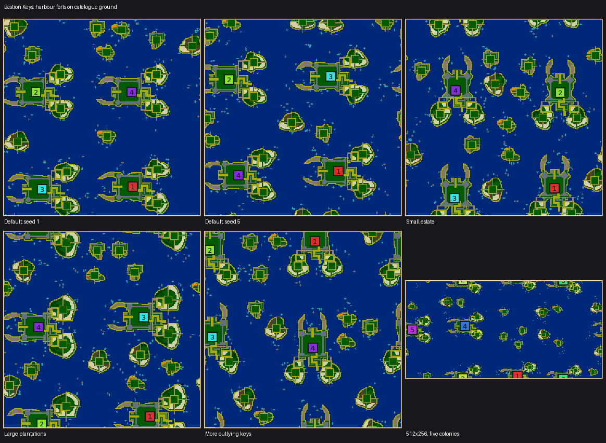
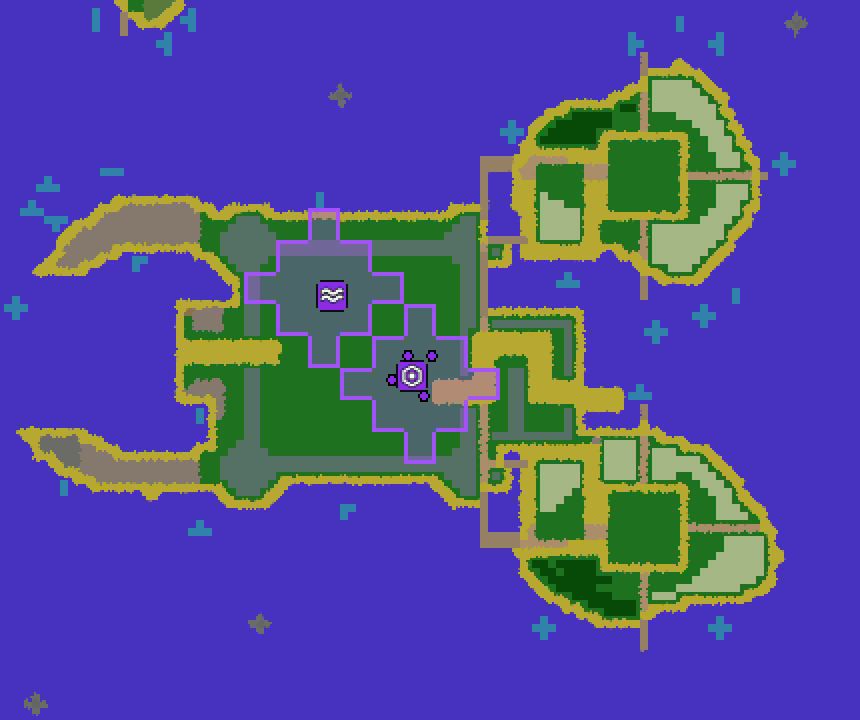

# Bastion Keys

Bastion Keys (`bastion-keys`, numeric ID 68) is an archipelago of harbour forts
whose wheat and timber grow outside their ramparts from the beginning.
**Swimming is required between estates and to reach outlying islands.** There
are no inter-fort roads or causeways. Each colony starts with a swarm and a
completed swimming pool.

The three signatures are stone bastions enclosing a clear town court, crescent
harbours, and paired exposed plantation islands. Short local supply piers connect
each town to its own farms and grain fields. A folded fortified landing guards
one gate; the harbour provides another. Attackers can swim to exposed plantations
or choose their landing around the fort. No towers are granted.

Each plantation has a permanent sand-contained service court. Each colony gets
at least 72 wheat and 32 timber tiles on its plantations, plus 48 wheat in two
small landing fields. Sand and water contain crop growth; no no-growth flags are
used. The pool and courtyard leave room for construction and upgrades.

Revision 3 builds the estates from the terrain catalogue: the piers are
boardwalk, the harbour arms are rocky headlands, the neutral keys have grounds
of their own, and reefs break the open sea. Geometry, controls and guarantees
are those of revision 2.

## Ground

| Ground | Where | Why |
| --- | --- | --- |
| Boardwalk | Supply piers over open water | Walkable and quick, nothing grows on it. The piers are the estate's only land link between its islands. |
| Dirt track | Outer lanes on land, including the cross lanes that part each plantation's wheat from its timber | Parts the crops as sand did, and hauling along it is quicker. |
| Sand | The folded gate corridor, and every lane that touches a beach | Nothing can be built on it, so a colony cannot wall in its own gate. The validator refuses a corridor vertex that has been dressed. |
| Gravel, with dirt | A glacis band outside the ramparts; harbour arms; the stone battery keys | Barren ground holds crops back like sand, yet can be built on. |
| Outcrop | The far half of each harbour arm | Impassable rock that towers shoot over: the arms read as breakwaters. The sand shore beside it stays walkable. |
| Dirt, clay, flower meadow | Dry scrub on island rims; meadow patches on open grass | Breaks up the lawn without touching any tile the economy needs. |
| Loam, with moss | The wheat ground of neutral plantation keys | See the measurement below. |
| Moss, spring meadow | Neutral orchard keys | Fertile ground for the fruit prize. |
| Ridge rock and outcrop | Reefs: small shoals in open water | Seven or more steps from any land, with every vertex within three of them open water, so no channel is narrowed. |

A tile takes its rules from its four corner vertices, so ground is set on
corners and kept off every tile that must stay pure grass: towns, ramparts,
service courts, landing fields and lanes. The sea is shallow water throughout
and deep water is deliberately absent: a tile whose corners are shallow and
deep water is neither walkable nor swimmable, so a deep ring would seal every
island from swimmers.

### A colony's own plantations stay grass

An earlier build laid loam under every plantation's wheat. Paired Nicowar/Maxima
games on the same seeds then grew 30% fewer units and harvested a third less wheat
and half as much wood than on grass, with nothing else changed, so a colony's own
plantations stay grass; loam appears only on neutral plantation keys. The other
changes were switched on and off one group at a time. Soils on the orchard and
battery keys and every other kind of ground were neutral, and the lanes were not
harmful. Why loam hurts has not been diagnosed; the measurement is what is recorded.

## Controls and supported settings

| Control | Default | Range | Effect |
| --- | --- | --- | --- |
| Home size | 14 | 13–15 | Fort half-width and interior construction room |
| Plantation size | 14 | 14–18, step 2 | Size of each external home farm |
| Outlying islands | 3 | 1–5 | Requested neutral keys per colony, limited by open water |
| Resource amounts | 100% | 0–300%, step 25 | Wheat, wood, stone, algae and fruit |

Each map side must be at least 128 tiles, with at most one estate per 128×128 area:
128×128 supports one colony, 256×128 supports two, 256×256 supports four, and
512×512 supports all twelve. Other shared colony/worker limits apply. Crowded
requests are refused explicitly.

Wheat and timber amounts interpolate from starter guarantees at 0%, through
normal density at 100%, to fertile plot capacity at 300%. Landing fields stay
fixed. Stone walls remain at zero stone abundance; that control changes extra
outwork deposits. Fruit appears on neutral orchard keys. Requested outlying
islands may not all fit; telemetry reports both requested and placed counts.

Homes share a fort design and facing chosen once per map. Coastlines, home
positions and neutral islands vary. Starts have comparable opening budgets;
this natural archipelago does not claim exact competitive balance. Both axes wrap.

## Validation and review

The validator checks ramparts, gate isolation, outside production, permanent
building courts, starter access, completed pools, and swimming reachability.
After treating buildings and harvestable crops as cleared, no walking component
may join two estates or connect an estate to a neutral key. Both local plantation
courts must remain connected to their own town. Outlying courts and at least one worker from each colony must be reachable using
the engine's swimming movement predicate. Crop growth is judged on the land that
can grow a crop: grass and fertile ground, and the tiles where the two meet. The
finished terrain must equal the replayed design vertex for vertex, and no gate
corridor vertex may have been dressed with buildable ground.

The generator uses existing simulation rules. It changes no engine behavior,
save format, replay acceptance, network protocol or AI, and no other generator.
Revision 3 produces different maps from the same seed, so it moves the generator
revision and the golden rows. It deliberately leaves `SIM_REVISION` alone for now
(a maintainer decision); Bastion Keys is not in the online fair-generator pool, and
whether any path regenerates maps from a generator descriptor was not verified.

### Revision 3 evidence

The studies below ran the revision 2 and revision 3 binaries on the same seeds
and rolls (macOS arm64, `dev_fast` debug build).

- **Control studies.** 567 single-control maps (six seeds, 256², four colonies,
  plus extremes on 128², 512² and 512×256) and 600 random rolls of every control
  across seven shapes and one to twelve colonies. Both revisions generate and
  validate the same 516 of 567 and 250 of 600; every failure, in both, is the
  documented "estates need more room" refusal. Planted wheat and wood targets are
  identical, as designed.
- **Paired AI games.** Six seeds, 256², four colonies (Nicowar, Maxima, Nicowar,
  Maxima), 30,000 ticks, same map seed and game seed. Per colony-game, mean of 24:

  | | Revision 2 | Revision 3 |
  | --- | --- | --- |
  | Final units | 49.1 | 55.7 |
  | Wheat harvested | 467 | 516 |
  | Wood harvested | 76 | 82 |
  | Buildings | 13.7 | 13.0 |
  | Starved | 3.0 | 2.8 |

  No colony was eliminated in either set. The first revision 3 build, with loam
  under the colonies' own wheat, scored 35.5 units, 314 wheat and 34.5 wood.
  Switching every dressing off reproduced revision 2 exactly (same units, wheat,
  wood and buildings; three seeds), so the geometry is unchanged. Revision 3 is
  ahead of revision 2 on units and wheat; which dressing produces the gain was not
  isolated (the faster tracks and piers are the likely candidates).
- **Contract.** `MapGeneratorDefaults` passes, including the Bastion contract:
  envelope, variants, rectangles, twelve colonies, 20,000 ticks of resource growth
  without a crop escaping its plot, pool and rampart corruption, a land bridge,
  the declared experiments, and a corrupted pier refused by the final-world check.

The original review evidence (native maps and a final save, parameter measurements,
gameplay counters, cross-platform checksums, translation review and profiling
results) was reviewed in PR #354 and is available from that PR and from git history
(`git show b932161e0:test/fixtures/bastion-keys/README.md`), not in the tree.
Revision 2 passed 2,508 supported requests across control, random and shape
studies, and rejected 2,773 unsupported requests explicitly. Its ten 60,000-tick
games completed; every Nicowar and Maxima colony dealt damage to enemy buildings
across the water. Cabino struggled to staff its first inn with four starting
workers, and Cortex resigned early; these are known AI limitations, also observed
in the Forts reference.

### Not established

Automated games establish economy and combat behavior, not human enjoyment or
exact competitive balance. Revision 3 has not been checked on Linux or Windows,
so its golden rows exist for macOS arm64 only. The faster tracks and piers change
how the opening feels, which needs a person to play it. The longer, 60,000-tick
games and the other AIs were not rerun for revision 3.

## Implementation source

[BastionKeysGenerator.cpp](../../src/map/generator/generators/BastionKeysGenerator.cpp) owns this landscape's construction, controls and validation.
See the [catalog](catalog.md) for its stable command and legacy IDs.

Related: [map generators](README.md).
