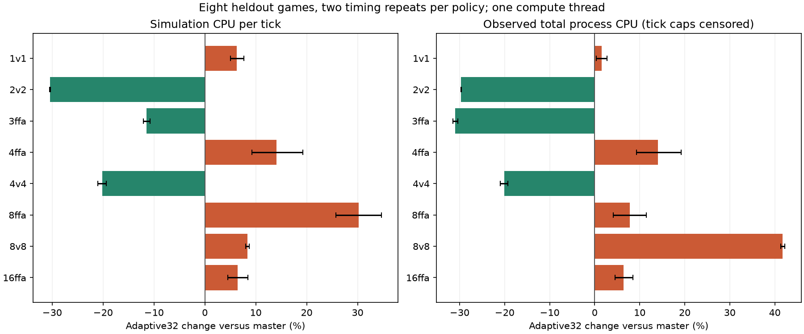

# Final master versus adaptive32 release comparison

Eight heldout starting states, two repetitions per policy, one game at a time, explicit one-thread compute, CPU backend, telemetry disabled.90000-tick cap or earlier engine end. Same master173-generated map file per paired state.

|Format|CPU ms/tick master|CPU ms/tick A32|Change|Observed total CPU change|Observed wall change|Ticks master / A32|End master / A32|
|---|---:|---:|---:|---:|---:|---:|---|
|1v1|0.1207|0.1283|+6.3%|+1.5%|+0.9%|41154 / 39394|engine_end / engine_end|
|2v2|0.1134|0.0789|-30.4%|-29.7%|-29.6%|90000 / 90000|tick_cap / tick_cap|
|3ffa|0.0584|0.0518|-11.4%|-31.0%|-31.2%|24578 / 17730|engine_end / engine_end|
|4ffa|1.4574|1.6622|+14.1%|+14.0%|+14.3%|90000 / 90000|tick_cap / tick_cap|
|4v4|0.6864|0.5478|-20.2%|-20.1%|-20.9%|90000 / 90000|tick_cap / tick_cap|
|8ffa|0.3334|0.4341|+30.2%|+7.8%|+8.8%|81730 / 67746|engine_end / engine_end|
|8v8|3.2802|3.5545|+8.4%|+41.8%|+42.8%|68770 / 90000|engine_end / tick_cap|
|16ffa|2.6956|2.8684|+6.4%|+6.4%|+6.1%|90000 / 90000|tick_cap / tick_cap|

Pooled measured CPU/tick change: +16.51%. Total process CPU: +16.19%. Wall: +16.40%. Total ticks: -0.24%. Equal-format geometric mean CPU/tick change: -1.37%.

- Eight starting states; two timing repetitions per policy. This is a final smoke comparison, not robust across-map inference.
- Whole-policy trajectories/populations/game lengths differ. CPU/tick is not an isolated refresh-kernel cost.
- Serial games with explicit one-thread compute and GPU/probe off; default multi-core gameplay wall time was not benchmarked.
- Tick-capped games have no measured finish time.
- Range bars span the two paired timing ratios; bar centers and table entries use the ratio of policy means. They are not confidence intervals across maps.
- Tick-capped totals are censored observed-prefix CPU/wall costs, not full-game finish costs; end status is shown for each policy.
- One-host timing without a recorded continuous host-load/thermal guard; counterbalancing reduces drift but cannot rule out external confounding.

Commands, maps/seeds, per-run CPU/wall/results and immutable binary hashes are retained with this report. Every repeated policy/state produced identical ticks, final checksum, winning teams and termination.
