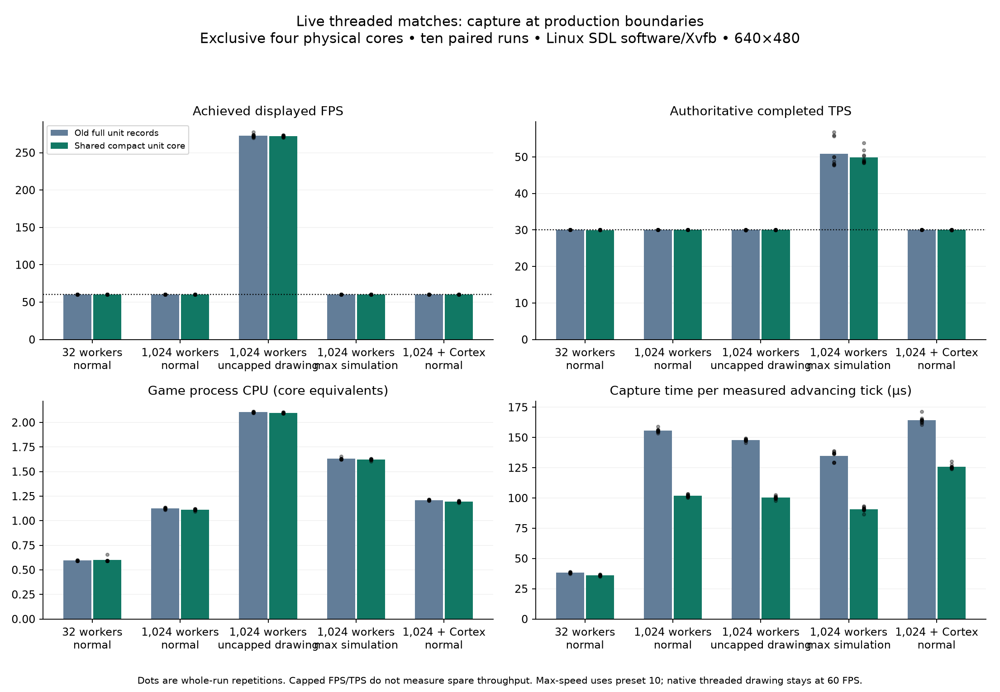
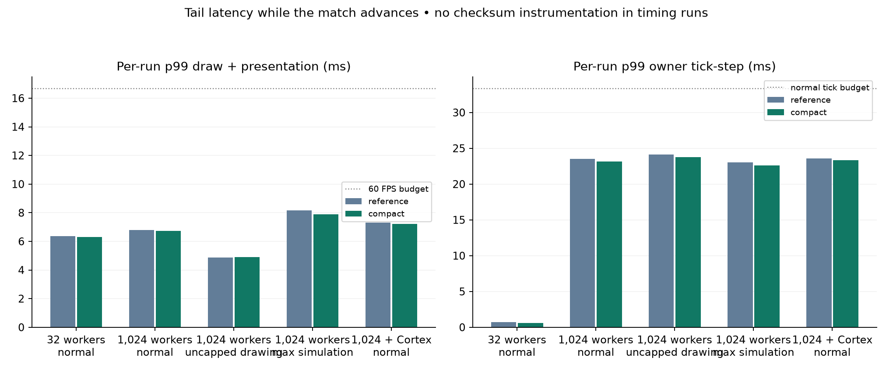

# Live-match compact-core comparison

Actual native simulation and rendering ran concurrently, including SDL software presentation. These measurements isolate the compact-unit representation using the frozen release sources from the preceding capture experiments. They do not combine later terrain/raster optimizations. They do not establish the live movement experiment gates.

Before: `3a3917757752fe64a2af9c1dc964c074794ebf3e`. Compact: `5a40f7a9f281cd1aa71c6980573cee3f6f35a36f`. PR source when started: `6b0dcacb8a5ad81592197de759252179cee01036`. Master base at fetch: `277510840054b1416f2defd7d86fe1431dd0ddc0`.

The normal 1,024-worker colony uses about 1.2% less game-process CPU (95% interval 0.75–1.76%; family-adjusted interval 0.68–1.90%). This is a modest supported live CPU benefit. It holds 60 FPS/30 TPS in both versions; uncapped FPS and maximum TPS improvements remain inconclusive. No measured capped session missed a render deadline. Movement stays Stage A.

## Throughput and CPU

One excluded full warmup pair, then ten rotated paired repetitions per scenario. Normal-speed sessions warm for 3 seconds and measure 15 seconds. Maximum-speed sessions warm for 128 ticks then measure exactly 1,024 ticks, using owner completion timestamps. Capped drawing targets 60 FPS; normal simulation targets 30 TPS. Uncapped drawing is a diagnostic stress test. Maximum-speed uses the existing preset 10; its serial GUI interval setting is 16, while native threaded drawing remains independently capped at 60 FPS.

| Scenario | Before FPS | Compact FPS | Before TPS | Compact TPS | Before CPU cores | Compact CPU cores | Missed frames before/after |
|---|---:|---:|---:|---:|---:|---:|---:|
| 32 workers, normal | 60.002 | 60.000 | 30.001 | 29.993 | 0.594 | 0.599 | 0/0 |
| 1,024 workers, normal | 60.000 | 60.001 | 30.000 | 30.000 | 1.125 | 1.112 | 0/0 |
| 1,024 workers, uncapped drawing | 272.689 | 272.074 | 29.998 | 29.999 | 2.104 | 2.097 | n/a |
| 1,024 workers, max simulation | 60.021 | 60.024 | 50.905 | 49.873 | 1.631 | 1.623 | 0/0 |
| 1,024 workers + Cortex, normal | 60.004 | 60.000 | 30.002 | 30.000 | 1.210 | 1.194 | 0/0 |

CPU cores are game-process CPU seconds divided by measured wall seconds, summed across all its threads. Xvfb CPU is not included in this CPU counter; its actual presentation work remains in wall-clock FPS/frame latency. Fixed-tick TPS uses exact owner boundaries; the UI/CPU/FPS polling window can differ by one render interval. Fractional capped FPS/TPS differences reflect window boundaries and tick quantization, not spare throughput.



## Predeclared primary comparisons

Paired geometric mean ratios, whole-run bootstrap (100,000 resamples, fixed seed). Frames within a run are not treated as independent experiments. Positive percentages indicate benefit. Family intervals control these three primary comparisons; the other phase/latency estimates are exploratory.

| Primary outcome | Benefit | 95% interval | 98.333% family interval | Family-level assessment |
|---|---:|---|---|---|
| 1,024 workers, normal: cpu_cores | +1.20% | [+0.75, +1.76]% | [+0.68, +1.90]% | supported improvement |
| 1,024 workers, uncapped drawing: fps | -0.22% | [-0.90, +0.36]% | [-1.06, +0.47]% | inconclusive |
| 1,024 workers, max simulation: tps | -1.85% | [-6.63, +2.89]% | [-7.68, +3.83]% | inconclusive |


## Capture and latency

These capture counters cover only measured advancing simulation steps, excluding warmup. Separate whole-session counters remain in the raw logs. No forced per-render-frame capture or static-world invalidation is used. The legacy `bytesCopied` counter counts logical populated capture payload, including generated unit metadata and padding; it is not strictly the number of bytes passed to memcpy or measured memory bandwidth. For core-only unit captures, authoritative state copied per unit changes from 360 to 132 bytes, while populated unit records change from 384 to 160 bytes. When details are needed, state copies total 132 + 216 = 348 bytes and populated records total 160 + 216 = 376 bytes. `UnitState` itself is 352 bytes due to composition padding. These distinctions explain why the full-observation Cortex case saves much less logical payload than the core-only colony. Capture timings are wall-clock observations.

| Scenario | Capture µs/tick before/after | Logical capture KiB/tick before/after | Capture fraction of owner tick before/after | Draw/present p99 ms before/after | Owner tick p99 ms before/after |
|---|---:|---:|---:|---:|---:|
| 32 workers, normal | 38.27 / 36.01 | 49.25 / 42.25 | 13.38% / 13.00% | 6.35 / 6.29 | 0.75 / 0.57 |
| 1,024 workers, normal | 155.62 / 101.86 | 621.00 / 397.00 | 0.89% / 0.59% | 6.80 / 6.73 | 23.54 / 23.13 |
| 1,024 workers, uncapped drawing | 147.84 / 100.25 | 621.00 / 397.00 | 0.86% / 0.59% | 4.88 / 4.90 | 24.10 / 23.76 |
| 1,024 workers, max simulation | 134.90 / 90.83 | 647.04 / 423.33 | 0.69% / 0.45% | 8.16 / 7.88 | 23.04 / 22.61 |
| 1,024 workers + Cortex, normal | 164.36 / 125.88 | 642.78 / 634.78 | 0.94% / 0.73% | 7.31 / 7.22 | 23.59 / 23.31 |

Owner tick-step includes authoritative work and its read-boundary preparation; asynchronous callbacks can overlap. Capture reduction alone does not establish FPS/TPS improvement. Total owner and process CPU savings exceed the measured capture wall-time saving; attributing the whole CPU improvement to smaller memcpy alone would be unjustified. Shared compact scans, cache/layout effects and other representation changes may contribute; this is an inference, not a measured decomposition. The normal capped workload can benefit in headroom without changing achieved frame/tick rates.



## Reproducibility and reservation

Linux x86-64 Threadripper 2950X, GCC 15.2, ordinary release `-O3` game objects; identical `-O3 -g` diagnostic main in each variant. SDL3 software backend on visible 640×480 X11/Xvfb, four compute participants, clouds disabled, audio muted. Fresh process/match/user directory per session. Both binaries verify controller identity (fixed-order AI0 or Cortex AI6) before recording results.

An exclusive balanced cgroup-v2 partition reserves CPUs `4-7,20-23`, including complete SMT siblings. Game threads run on `4-7`. Only the benchmark’s own audio helper, which widens its mask during startup, is restricted back to those CPUs. Existing processes and their affinities are untouched. Other cgroups cannot schedule on the reserved cores. Governor remains schedutil and boost disabled; recorded frequencies/topology are in metadata. Shared cache, memory bandwidth, interrupts and power effects remain possible.

The wrapper performed 2146 partition checks and restored the cgroup allocation and original wrapper affinity. See [reservation audit](cpuset-timing-final.json). Every run has thread-affinity/cgroup proof in the evidence archive.

```sh
python3 test/run_with_benchmark_cpuset.py --audit artifacts/compact-live/cpuset-timing-final.json --cpus 4-7 --reserve-cpus 4-7,20-23 --timeout-seconds 7200 -- xvfb-run -a python3 artifacts/compact-live/run_pairs.py
```

Exact per-run commands/environment, sources for the diagnostic main, compiler/link invocations, binary/fixture SHA256s, raw distributions and analysis scripts are in `live-evidence.zip`. The preceding source-validation artifact confirms 2,005 frozen game/library/build files against their Git blobs. The linker wrapper reads canonical state only on the simulation owner and publishes a tick counter atomically. UI code reads immutable published Scenes; metrics/canonical checks are collected after joining.

## Correctness and limits

- cortex-colony-normal: 541 common ticks, 1–541, zero checksum mismatches.
- large-colony-max-speed: 1153 common ticks, 1–1153, zero checksum mismatches.
- large-colony-normal: 541 common ticks, 1–541, zero checksum mismatches.
- large-colony-uncapped-render: 541 common ticks, 1–541, zero checksum mismatches.
- ordinary-control-normal: 541 common ticks, 1–541, zero checksum mismatches.

All five live correctness replays were byte-identical between variants; their files and SHA256s are included in the archive and `live-replay-comparison.json`. Checksum tracing ran separately from timing. Wall-time sessions can end on different ticks; comparison uses the complete common prefix. Fixed-tick sessions compare the same authoritative range. Final population ranges are in `summary.json`; the colony remained at 1,024 workers in the tested window unless explicitly recorded otherwise. Earlier save/replay/observation/screenshot equivalence evidence remains applicable and is linked in the evidence index.

Piloting caught incomplete GUI saves and a retained no-op controller in the initial Cortex fixture. The complete preliminary timing set was rejected; the final fixture resets the controller and all accepted runs assert AI6. No outcome-based pruning, repetition extension or threshold relaxation was used. Pilot/setup logs remain available locally; final measurements and proof are published.

This is single-team Linux software/Xvfb coverage, with no human input or combat. There is no GPU/hardware-display, macOS, Windows or browser result. The colony is not yet qualified for long-run sustainability. Fixed-order and evolving-AI populations are reported separately. These data do not authorize live movement adoption or relax its memory/performance/gameplay thresholds.

Documentation-only follow-up PR revision: `0ed8d9ea3377fdf936f1ca2906d2f4d5933ca52c`. Documentation validation: 309 Markdown documents, zero errors. No game code or runtime dependencies changed in this measurement follow-up.

## Evidence files

- [Raw evidence archive](live-evidence.zip)
- [Full summary and all paired samples](summary.json)
- [Source, binaries, fixture and platform metadata](live-metadata.json)
- [Correctness traces summary](correctness-summary-final.json)
- [Protocol](live-protocol.md)
- [SHA256 manifest](SHA256SUMS)
