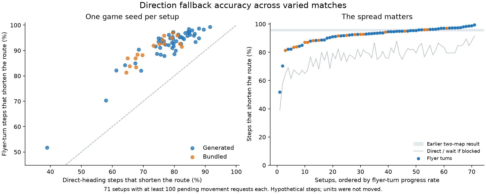

# Pending-direction heuristic: wider one-seed coverage

Accuracy-only experiment. Production PR 1197 remains unchanged at d1c0d4d50109b6f7d30f843368d30406f515b84f. The heuristic never moves a simulated unit; it is evaluated privately at actual pending requests.

## Coverage

91/91 setups completed, 2,871,634 actual ticks, 196,814 sampled pending route queries, including 94,538 pending movement decisions. Each setup uses exactly one game seed (42). Each procedural setup uses exactly one map seed (713), with candidate selection disabled (`--candidates 0`); there are no seed sweeps or successful-map rerolls.

67 playable generator implementations, all 23 bundled map files, and one additional generated 16-team stress format: 91 setups. The extra setup uses shattered-coast at 512×256 with 8v8; its ordinary generator case is a different format/layout. Dimensions range 64–512, including rectangles. Formats: 2v2, 2v2v2, 2v3, 3v3, 4v4, 8v8, duel, ffa11, ffa3, ffa4, ffa5, ffa6, ffa8. AI types: cabino, castor, cortex, econo, maxima, nicowar, numbi, warrush. [Complete case table](cases.md), workloads.json and generators.json retain exact inputs and generator revisions.

The scheduling policy is unchanged from the earlier measurement: global four map-gradient admissions per tick, not the separate PR1220 per-team proposal.

This is deliberately heterogeneous coverage. One seed per setup cannot establish a generator's typical rate or rank formats causally: dimensions, AI composition, alliances and terrain all vary. No per-generator confidence intervals are claimed. Both request-weighted totals and equally weighted case means are reported to expose domination by busy matches.

## Results by route

Progress means the legal proposed step reduces remaining route cost in a freshly computed current-world gradient. It need not be an optimal step. Wrong way means remaining route cost increases. The denominator includes destinations with no reachable route or legal reachable exit; those cannot produce useful route progress. summary.json separately reports progress conditional on a route existing. Other outcomes include blocked/waiting, unchanged cost, or leaving the reachable route field; all remain in the denominators. Origins already at a route goal are excluded.

| Route/request | Decisions | Direct progress | Turning progress | Turning wrong way |
|---|---:|---:|---:|---:|
| movement | 94,538 | 76.43% | 91.32% | 7.26% |
| footprint | 26,797 | 76.57% | 93.07% | 4.46% |
| combat | 67,741 | 76.37% | 90.63% | 8.37% |
| clearing | 0 | — | — | — |
| origin-open | 61,051 | 76.32% | 91.51% | 7.63% |
| origin-blocked | 33,062 | 77.62% | 92.14% | 6.66% |
| origin-unreachable | 425 | 0.00% | 0.00% | 0.00% |
| service-selection | 43,319 | 74.15% | 88.27% | 6.47% |

Overall flyer-turn progress: request-weighted 91.32%; mean case rate 91.17%; median case rate 93.12%. 90 cases have pending movement samples. Cases without any sampled pending queries: none. The Bastion Keys setup had pending selection queries but no pending movement queries. A zero-count category is unobserved coverage, not proof of correctness.

## Spread across setups

The chart and weak-case table require at least 100 pending movement requests per setup to reduce unstable rankings from very small samples. All cases, including smaller samples, remain in cases.md and in the aggregate results. The grey comparison band is the earlier two-map request-weighted result, not a confidence interval.

| Setup | Size | Format | Requests | Turning progress | Turning wrong way | No route/exit |
|---|---|---|---:|---:|---:|---:|
| gen-plantations | 256×256 | 2v2 | 481 | 51.77% | 6.03% | 42.20% |
| gen-canals | 256×256 | ffa6 | 397 | 70.28% | 5.54% | 23.17% |
| map-Centerfolds_2 | 128×128 | ffa5 | 2,149 | 81.29% | 16.10% | 1.07% |
| gen-fjord-continent | 256×256 | ffa3 | 2,342 | 82.11% | 16.70% | 0.09% |
| gen-drumlin-field | 256×256 | ffa6 | 842 | 82.19% | 16.03% | 1.54% |
| map-Garden_3 | 128×128 | 2v2 | 139 | 83.45% | 15.11% | 0.72% |
| map-G2 | 128×128 | ffa4 | 2,008 | 83.81% | 12.70% | 2.19% |
| gen-crater-lakes | 256×256 | 2v2 | 565 | 84.25% | 7.79% | 7.08% |
| gen-amphitheatre | 256×256 | duel | 478 | 84.94% | 12.97% | 0.21% |
| map-Island_of_the_Renfur | 128×128 | 3v3 | 4,856 | 86.99% | 11.14% | 0.10% |
| map-Triangle | 128×128 | ffa3 | 2,092 | 87.00% | 12.38% | 0.00% |
| gen-watershed | 256×256 | ffa8 | 793 | 87.89% | 11.10% | 0.00% |

## By source

| Group | Cases with movement | Requests | Direct progress | Turning progress | Turning wrong way |
|---|---:|---:|---:|---:|---:|
| bundled | 23 | 25,712 | 69.89% | 88.47% | 9.98% |
| generator | 67 | 68,826 | 78.87% | 92.39% | 6.24% |

## By match format

| Group | Cases with movement | Requests | Direct progress | Turning progress | Turning wrong way |
|---|---:|---:|---:|---:|---:|
| 2v2 | 11 | 2,683 | 68.21% | 83.53% | 6.71% |
| 2v2v2 | 1 | 5,093 | 69.72% | 88.18% | 10.33% |
| 2v3 | 1 | 197 | 79.19% | 94.92% | 4.57% |
| 3v3 | 7 | 11,259 | 71.45% | 90.00% | 8.69% |
| 4v4 | 11 | 7,484 | 80.14% | 93.17% | 5.83% |
| 8v8 | 1 | 3,390 | 84.22% | 95.81% | 3.48% |
| duel | 18 | 4,243 | 81.55% | 94.84% | 4.10% |
| ffa11 | 1 | 757 | 73.32% | 91.94% | 6.47% |
| ffa3 | 10 | 7,191 | 72.76% | 88.29% | 10.74% |
| ffa4 | 14 | 10,883 | 76.27% | 92.34% | 6.39% |
| ffa5 | 1 | 2,149 | 64.50% | 81.29% | 16.10% |
| ffa6 | 8 | 4,893 | 76.93% | 91.89% | 5.21% |
| ffa8 | 6 | 34,316 | 79.03% | 92.37% | 6.78% |

Formats have unequal case counts and different generators/AIs; these are descriptive samples, not controlled estimates of an alliance policy's effect.

## Repeated locations counted once

Deduplication retains the first query per case, query subset, unit identity, building identity, route, swim class and coordinate.

| Route/request | Decisions | Direct progress | Turning progress | Turning wrong way |
|---|---:|---:|---:|---:|
| movement | 65,014 | 75.98% | 91.03% | 7.42% |
| footprint | 23,274 | 76.54% | 92.78% | 4.68% |
| combat | 41,740 | 75.66% | 90.06% | 8.94% |
| clearing | 0 | — | — | — |
| origin-open | 60,863 | 76.35% | 91.53% | 7.63% |
| origin-blocked | 18,543 | 77.00% | 91.80% | 6.84% |
| origin-unreachable | 423 | 0.00% | 0.00% | 0.00% |
| service-selection | 40,510 | 74.19% | 88.24% | 6.41% |

## Measurement and reproducibility

Uses the frozen release diagnostic from the earlier 64-game experiment. experiment.json records both binary hashes; prior-source-reference.json identifies the archived source patch, private headers, compiler commands and original checks. The probe implements the ordinary unconstrained flyer heading: wrapped displacement toward building centre (flag position for flags), rounded to eight directions with the existing 2.41 threshold. Direct policy waits if the intended step is blocked. Turning policy tries +1, -1, +2, -2, +3, -3, +4, with normal ground terrain/collision checks; waits if none is legal.

The oracle is a private full field built using the production seeder and Dijkstra from the live current map. It neither publishes a field nor consumes game RNG. Short-lived caching requires matching tracked map generations, identity and slot epoch. A unit's origin can itself be excluded from the field, e.g. forbidden paint or a resource cell; these are scored against the best legal reachable neighbouring exit, counting the step to it. Such origins remain in all totals and are reported separately. All tied best gradient neighbour scores count as optimal; we do not compare against an arbitrary tie-broken direction.

Every completed setup is also run without the diagnostic. Probe/control initial checksum, final checksum and actual tick count match: True. These new paired checks compare endpoints. The earlier two 2,048-tick pilots also established per-tick world/entity equivalence against the current PR on those inputs. No broader per-tick or cross-platform equivalence claim is made.

Apple M3/macOS arm64, existing Apple clang 21 release builds, `PYTHONPATH=. scons release=1 CXXFLAGS=-g0 client_profile=full server=0 -j4`. Existing dependencies unchanged. Matches run concurrently (initially up to four across dispatchers, then a four-worker dispatcher); dispatch was restarted only after its active child runs completed, reusing saved results. No game seed, game state or completed run was discarded for its measurement result. This is unsuitable for CPU/jitter comparison; elapsed times are orchestration metadata only.

Exact game/generation commands, stdout/stderr, effective result records, generated maps and compressed per-request records are in request-data.tar.gz. The live benchmark source and production branch were not edited for this extension; it reuses frozen binaries. Analysis and plotting use repository-pinned NumPy 2.4.6 / Matplotlib 3.11.2 where needed. No runtime dependency or production code change.

## Setup corrections and limits

Initial generation calls supplied dimensions as tile counts; this legacy study interface expects log2 dimensions, as used by the repository tournament runner. Those pre-game failures were retained and corrected. Symmetric arena rejects sixteen colonies; its case was changed to supported 4v4, and the 8v8 stress moved to shattered-coast. Concrete islands failed six-team start-capacity validation at the chosen seed; its final case uses four teams with the same seed. Bastion keys also rejected its initial colony density, so its final setup uses two teams with the same seed. Braided delta requested more roomy islands at six teams; its rejoining-frequency control was raised from 2 to 3, keeping seed and dimensions. Savannah requires at least 128 tiles per side, so its requested 64×64 layout was raised to 128×128 with the same seed. These are documented input corrections, not seed rerolls. Any remaining generation failures are retained in summary.json; no successful generation is selected from a seed search.

This remains a one-step counterfactual. It does not enable heuristic travel, replay repeated heuristic steps, test oscillation/deadlocks, change service selection, or measure arrival time, starvation, outcomes, CPU, frame pacing or devices. Service-selection rows assess directions to candidate destinations, not which inn/hospital a replacement distance heuristic would choose. The oracle describes the current world, which may change before the missing background field publishes. No manual play or cross-platform performance claim.

Broader requests and sidecars can expose failures missed by the original two maps, but one successful seed per setup is a breadth audit rather than a statistical characterization of each generator. Production pending handling remains unchanged.
