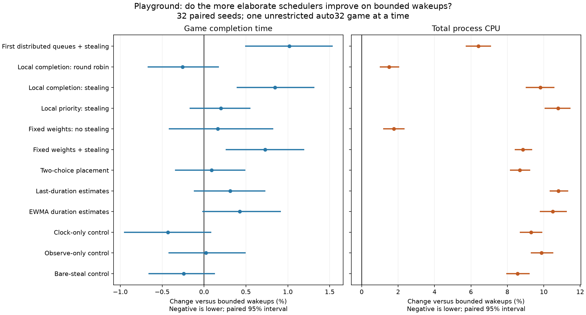

# Playground: 448 whole-game executor comparisons

The campaign stopped at the user-requested Playground boundary. All **448 games finished with winners and no caps**:32 fixed seeds ×14 executor designs. The winner and finishing tick agree across all14 designs for each seed. Oazis, four-game throughput waves and the separate56-game checksum follow-up were held.

One game ran at a time with CPU backend and unrestricted `auto` execution, resolving32 participants on a Threadripper2950X (16physical cores/32SMT threads). All research binaries use common base `054804590ee1dd109f09642fc05654c324f08344`, with archived executor ports and HISTORY measurement adapters. Release GCC13 builds and exact role/source/binary/dependency/command/affinity metadata are included. This is a common-base experiment, not a claim about every later master revision.

Bounded wakeups (`wake-only`) reduced mean completion time **10.26%** and total CPU **38.98%** versus baseline. Paired95% intervals are **[−10.71%,−9.86%]** and **[−39.57%,−38.42%]**. It used the least CPU of all14 designs.

The clock-only control had the lowest wall-time point estimate (31.58s versus31.71s), but its advantage over bounded wakeups was **−0.43% [−0.96%,+0.09%]**, with **9.30% more CPU**. Latest-duration placement used **10.80% more CPU [10.32%,11.34%]** than bounded wakeups, with wall change **+0.31% [−0.12%,+0.73%]**. These data support the simple bounded-wakeup policy for this workload; they do not establish a global executor optimum.

| Design | Mean end time (s) | Mean total CPU (s) | Time vs baseline | CPU vs baseline |
|---|---:|---:|---:|---:|
| baseline | 35.34 | 159.48 | +0.00% | +0.00% |
| wake-only | 31.71 | 97.31 | -10.26% | -38.98% |
| first-steal | 32.04 | 103.54 | -9.35% | -35.07% |
| local-completion-round-robin | 31.63 | 98.77 | -10.49% | -38.06% |
| local-completion-steal | 31.98 | 106.85 | -9.50% | -33.00% |
| local-priority-steal | 31.78 | 107.80 | -10.08% | -32.40% |
| weighted-fixed-no-steal | 31.77 | 99.03 | -10.11% | -37.90% |
| weighted-fixed-steal | 31.95 | 105.93 | -9.60% | -33.58% |
| weighted-two-choice | 31.74 | 105.75 | -10.18% | -33.69% |
| weighted-last | 31.81 | 107.82 | -9.98% | -32.39% |
| weighted-ewma | 31.85 | 107.52 | -9.88% | -32.58% |
| weighted-clock-only | 31.58 | 106.36 | -10.64% | -33.31% |
| weighted-observe-only | 31.72 | 106.91 | -10.24% | -32.96% |
| weighted-bare-steal | 31.64 | 105.64 | -10.48% | -33.76% |

The plot uses direct paired-seed contrasts from the independent audit. Negative is lower. Intervals are exploratory and have no multiple-comparison adjustment. The canonical baseline contrasts use10,000 fixed paired-seed draws/floor quantiles; the independent audit uses separate draws/linear quantiles, retained separately.

## Data and figures

- [Full numerical report, downloadable HTML](results/index.html)
- [All metrics and paired intervals](results/comparisons.csv)
- [All448 game observations](results/every-game.csv)
- [Dataset audit](results/raw-audit.json) and [content provenance](results/dataset-manifest.json)
- [Time versus baseline](results/completion-time.png), [CPU versus baseline](results/total-cpu.png)
- [Direct bounded-wakeup contrast SVG](figures/versus-bounded-wakeups.svg)
- [Independent raw/contrast audit](evidence/independent/playground448-final/review.json)

The CSV includes end-to-end and engine time, mean ticks/s, total user/system CPU, CPU per tick and peak RSS. Mean peak RSS stayed around147–148MiB. Bounded wakeups averaged1,694 engine ticks/s and1.86CPU-ms/tick; baseline1,513ticks/s and3.05CPU-ms/tick.

## Correctness and scope limits

Ordinary timing had checksum telemetry off: winner/tick agreement is **not full-game checksum equivalence**. Separate280 bounded per-tick qualification contexts passed; their compact records/digests are included, while large checksum/replay bodies remain omitted with provenance. Auto qualification used recorded six-CPU allocations and does not prove full32-participant per-tick equivalence. The additional56 checksum games were not run.

Two engine-test failures matched unchanged baseline across all14 roles (ResourceGrowth historical-preflight rejection and TurretTargeting upgrade/incarnation publication);160other selected engine cases passed per role, rawrc1 retained. An original180-second bare-steal executor-suite timeout remains unexplained despite subsequent non-reproduction; original failure and follow-up records are retained. Historical unsafe first static round-robin/strict-affinity prototypes remain distinct from the current bounded-qualified local-completion round-robin research arm.

This evidence covers Playground, CPU mode, unrestricted single-game execution on one host. It does not establish larger-map performance, tournament throughput, interactive/GPU performance or all-platform compatibility. All engine features remain in the compared sources; the experiment makes no gameplay-feature tradeoff. Cross-family CPU differences include queue/placement/accounting/stealing differences, so they cannot all be attributed to the cost-estimation clock alone.

## Reconstruction

Run `python3 index/verify.py` (Python3.11+) to verify every selected file. `index/content-manifest.json` maps original paths, hashes, current source overlays,280 actual qualification contexts and original build/unit-repair records. Rebuild from exact054, then apply authoritative current source overlays last; original patches and the later79→84 harness repair are preserved separately. Recreate recorded dependency versions/flags and map the original machine paths to your checkout. Binaries/full source trees/profiles and large GCS/replay bodies are excluded; this is a compact reproducibility package with explicit omissions, not a complete replay-body archive. Do not run captured administrative controllers without inspecting their original absolute paths and user-requested stop conditions.

The expected `NotADirectoryError` at the regular Oazis output sentinel is the deliberate administrative stop, not an engine failure. No measured game or timing parent was paused or interrupted. No implementation was merged as part of this comparison. Further experiments await the user's decision.
