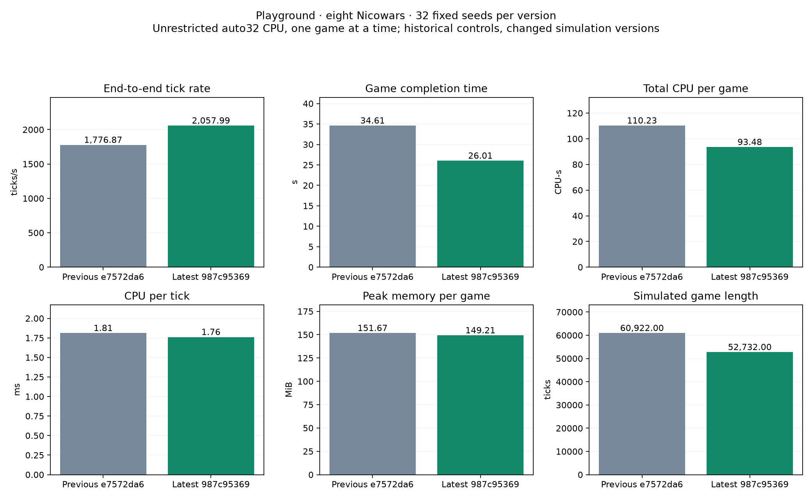

# Latest master: 32-seed Playground performance

Release revision `987c953698bb3f0bfd1078184773075ba3313091`, compared with previous `e7572da6be15566bf20086f40a73a0f4b7c2a83d`.

Same fixed 128×128 Playground, eight Nicowars plus the legacy passive observer, 32 fixed game seeds, one unrestricted auto32 CPU game at a time, one-hour wall cap. All 32 current games ended with a winner; no caps. GCC13 release command, compiler version and shared-library hashes match the previous run.

| Mean per completed game | Previous | Current | Change | Paired 95% interval |
| --- | ---: | ---: | ---: | ---: |
| End-to-end ticks/s | 1,776.868 | 2,057.993 | +15.82% | [+12.71%, +19.02%] |
| Completion time (s) | 34.608 | 26.014 | -24.83% | [-35.77%, -11.63%] |
| Total CPU (CPU-s) | 110.227 | 93.480 | -15.19% | [-27.00%, -1.30%] |
| CPU per tick (ms) | 1.811 | 1.761 | -2.80% | [-5.63%, +0.13%] |
| Peak RSS (MiB) | 151.671 | 149.208 | -1.62% | [-4.90%, +1.70%] |
| Game length (ticks) | 60,922.000 | 52,732.000 | -13.44% | [-25.32%, +0.79%] |

Games changed: 20 finished in fewer ticks and12 in more; only9/32 winners match, and no complete winner/tick endpoint matches. The24.8% lower wall completion time includes changed game length; it is not an isolated same-trajectory engine speedup. Observed end-to-end tick rate increased15.8%. CPU/tick and memory intervals include zero change.

Historical controls were not rerun or interleaved. The10,000 paired bootstrap samples describe seed variability, not machine-state drift. Simulation revision changed63→65; ticks can represent different work. This is one host, CPU backend, unrestricted auto32 and serial games; no platform-wide or concurrent-throughput claim. Timing has no optional checksum/profiling telemetry. Winner/tick observations do not establish per-tick equivalence.

The committed golden trace and a64-tick eight-Nicowar auto32 CPU smoke check passed before timing. This is benchmark smoke validation, not a full cross-platform compatibility qualification.

[Primary comparison and raw audit](results/previous-master-comparison.json) · [Earlier historical references](results/summary.json) · [Every current/historical reference game](results/every-game.csv) · [Manifest](manifest.json)

`verify.py` checks exported hashes and recomputes native summary means/deltas. `compare-previous.py` retains paired bootstrap/plotting and original source-path validation; original paths are provenance. Per-game replays, executable, objects and caches are deliberately omitted. Previous-master raw receipts are already retained in the adjacent `playground-latest-e7572da6` folder on this evidence branch.
