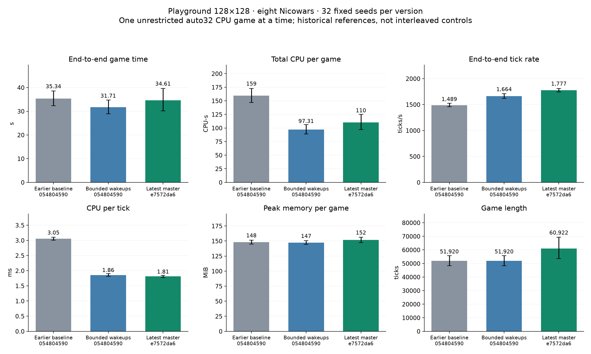

# Latest master Playground benchmark

Latest master `e7572da6be15566bf20086f40a73a0f4b7c2a83d` completed **32 of 32 games**, with **0 one-hour caps**. Each game used eight Nicowars on the same 128×128 Playground map, one unrestricted CPU game at a time, automatic 32-participant sizing and the original 32 fixed seeds.

| Mean metric | Earlier shared executor | Earlier bounded wakeups | Latest master |
|---|---:|---:|---:|
| Game completion time (s) | 35.340 | 31.714 | 34.608 |
| Total CPU per game (CPU-s) | 159.478 | 97.309 | 110.227 |
| End-to-end ticks per second | 1,489.323 | 1,663.675 | 1,776.868 |
| CPU per tick (ms) | 3.054 | 1.858 | 1.811 |
| Mean per-game peak RSS (MiB) | 148.264 | 147.446 | 151.671 |
| Simulation ticks per game | 51,920.000 | 51,920.000 | 60,922.000 |

The two historical references share base `054804590` and their archived research adapters. The latest binary is unmodified release master, including the hiring publication change, bounded wakeups, BitArray inlining, borrowed stream names and routine checksum optimization. Full-game results therefore include changed game behavior as well as core execution changes.

## Changes against earlier bounded wakeups

| Metric | Change in mean | Paired 95% interval |
|---|---:|---:|
| Game completion time (s) | +9.12% | [-5.89%, +26.10%] |
| Total CPU per game (CPU-s) | +13.27% | [-1.62%, +30.13%] |
| End-to-end ticks per second | +6.80% | [+2.76%, +10.45%] |
| CPU per tick (ms) | -2.54% | [-5.78%, +1.12%] |
| Mean per-game peak RSS (MiB) | +2.87% | [-0.61%, +6.61%] |
| Simulation ticks per game | +17.34% | [+2.77%, +32.70%] |

Across these games, total simulated ticks changed **+17.34%**, aggregate end-to-end tick rate changed **+7.53%**, and total completion time changed **+9.12%**. This follows the identity total time = total ticks / aggregate tick rate; it does not establish equal work within a tick. Mean recorded orders per game changed from **22,791** to **24,479**. Winner and finishing tick matched on **0/32 seeds**.

Latest total CPU across completed games: **3,527.25 CPU-s**. The observed maximum peak RSS was **181.84MiB**; the table reports the mean of 32 separate peak readings.

## Measurement and interpretation

Release GCC 13, Linux x86-64, Threadripper 2950X with 16 physical cores/32 SMT threads. Automatic sizing resolved to32 participants in a separate native smoke check. Each timing run used all32 eligible CPUs, SDL dummy drivers, a fresh application profile, CPU gradients and the same fixed map bytes. The legacy random-games driver retains its passive local observer, giving nine controllers for eight Nicowar teams, as in the earlier campaign.

Full process wall time and wait4 user+system CPU include initialization, game execution, replay flush and shutdown. All versions above use end-to-end TPS; historical inner-loop TPS is not mixed with the latest measurement. No optional checksum or profiling telemetry ran in the timed games. Current golden match verification and the 64-tickauto smoke check were separate and passed.

The historical controls were not rerun or interleaved with this batch. The 10000-draw paired-seed bootstrap intervals describe seed variability, not time-of-day or machine-state confounding. Changes in hiring behavior also mean equal seeds need not create the same gameplay or workload. These results measure this one CPU host and single-game regime; they do not establish concurrent throughput or another platform's performance.

## Retained evidence

- [HTML report to download](results/index.html)
- [Every game and all primary metrics](results/every-game.csv)
- [Comparisons and intervals](results/comparisons.csv)
- [Machine-readable summary and methods](results/summary.json)
- [Raw audit](results/raw-audit.json)
- [Exact release build and dependencies](build-complete.json)
- [Frozen workload and seeds](request.json)
- [Native qualification](qualification.json)
- [Source and data manifest](manifest.json)

All 32 latest compact logs/receipts and 64 reference logs/receipts are included. Executables, build caches and disposable profiles/replay bodies are omitted. The fixed map is included. `python3 verify.py` (Python 3.11+) checks selected byte hashes, all 96 native summaries and the reported primary mean/delta calculations. Bootstrap/plotting source and package versions are retained; source commands keep original absolute paths as provenance.

[Earlier448-game design comparison](https://github.com/Globulation2/glob2/blob/5903347157253813a6a328fd4a362d997f77c232/playground-20261015/README.md) retains the wider executor comparison and its correctness limitations. This new dataset is a latest-master workload measurement, not an isolated estimate of any one merged optimization.
