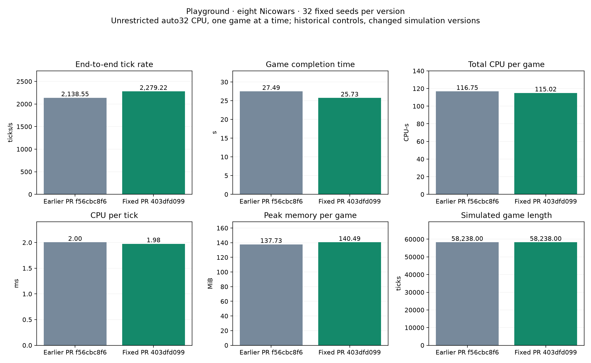
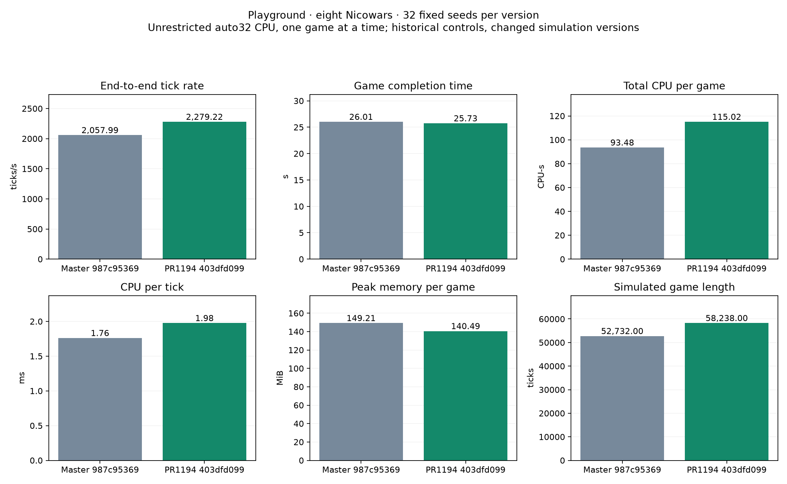

# PR #1194: checksum-fix rerun

Tested updated PR head `403dfd0999a2511cbd84f9869403c8960b991f26` against previous PR `f56cbc8f624dd35c2066cce1aad51d0d9ada25cf` and exact master base `987c953698bb3f0bfd1078184773075ba3313091`.

Same 32 fixed seeds, 128×128 Playground, 8 Nicowars plus the legacy passive observer, one unrestricted auto32 CPU game at a time, one-hour cap. All 32 games reached a winner; no caps. Compiler, release flags and linked library hashes match the prior runs.

| Mean per game | Master 987c95369 | Previous PR f56cbc8f6 | Fixed PR 403dfd099 |
| --- | ---: | ---: | ---: |
| End-to-end ticks/s | 2,057.993 | 2,138.548 | 2,279.217 |
| Completion time(s) | 26.014 | 27.486 | 25.728 |
| Total CPU/game(CPU-s) | 93.480 | 116.748 | 115.023 |
| CPU per tick(ms) | 1.761 | 2.003 | 1.976 |
| Mean peak RSS(MiB) | 149.208 | 137.730 | 140.486 |
| Game length(ticks) | 52,732.000 | 58,238.000 | 58,238.000 |

## Fix versus previous PR

| Metric | Change | Paired 95% interval |
| --- | ---: | ---: |
| End-to-end ticks/s | +6.58% | [+5.98%, +7.21%] |
| Completion time(s) | -6.39% | [-7.02%, -5.80%] |
| Total CPU/game(CPU-s) | -1.48% | [-2.19%, -0.79%] |
| CPU per tick(ms) | -1.39% | [-2.13%, -0.65%] |
| Mean peak RSS(MiB) | +2.00% | [+1.66%, +2.32%] |
| Game length(ticks) | +0.00% | [+0.00%, +0.00%] |

## Fixed PR versus master

| Metric | Change | Paired 95% interval |
| --- | ---: | ---: |
| End-to-end ticks/s | +10.75% | [+7.85%, +13.77%] |
| Completion time(s) | -1.10% | [-13.94%, +13.74%] |
| Total CPU/game(CPU-s) | +23.05% | [+7.91%, +40.29%] |
| CPU per tick(ms) | +12.21% | [+8.79%, +15.84%] |
| Mean peak RSS(MiB) | -5.85% | [-8.30%, -3.24%] |
| Game length(ticks) | +10.44% | [-2.81%, +25.84%] |

## Interpretation and limits

The checksum fix improves observed tick rate 6.58%, completion time 6.39% and CPU/tick 1.39% versus the previous PR. Peak RSS rises 2.00%. All 32 winners, finishing ticks and recorded order counts match the previous PR exactly. These observations are not full-state equivalence proof.
Against master, the fixed PR has 10.75% higher tick rate, 12.21% higher CPU/tick and 5.85% lower mean peak RSS. Whole-game completion time is not clearly different. Its games contain 10.44% more ticks on average; 23 winners differ from master. Gradient timing and trajectories differ, so this is not a same-trajectory master comparison.
Historical controls were not rerun or interleaved. Paired 10,000-draw intervals describe seed variability, not environment drift. One host/CPU/unrestricted auto32/serial regime only; no concurrent-throughput or GPU/platform-wide claim. No optional timing checksum or profiling telemetry. Golden trace and 64-tick auto32 smoke passed separately.

[Combined report](results/fix-overview.html) · [96-summary independent point audit](independent-point-audit.json) · [Manifest](manifest.json)

The evidence retains 32 new compact receipts/logs, exact commands/build/source hashes, fixed map, smoke records, statistics/plotting scripts and two primary comparisons. Prior PR and master raw receipts are retained in adjacent folders on this evidence branch, with their hashes bound in comparison JSON. Generated replay bodies, executables, object/cache files and disposable profiles are omitted.
