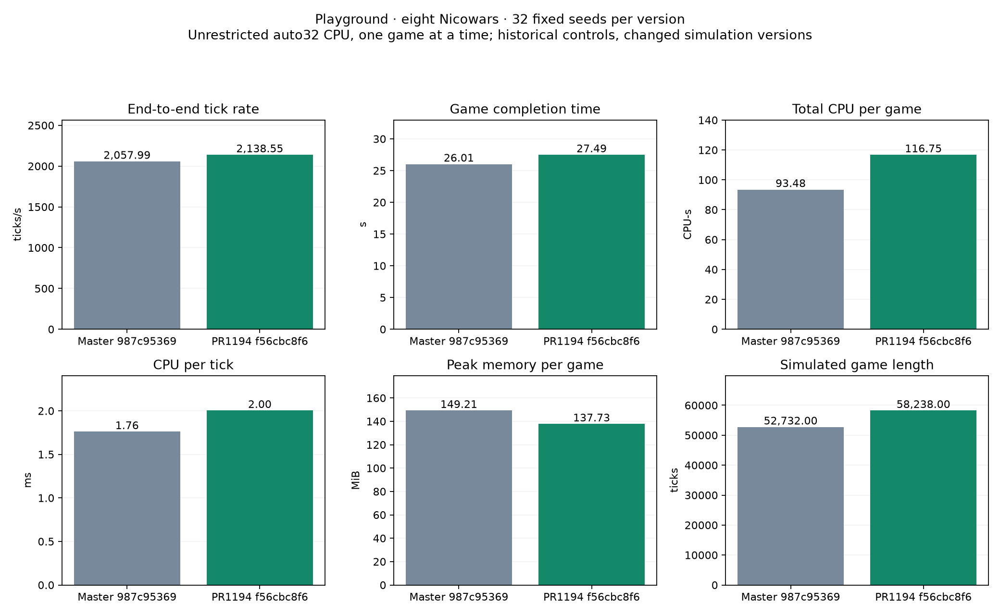

# PR1194: 32-seed Playground performance

[PR1194](https://github.com/Globulation2/glob2/pull/1194), tested head `f56cbc8f624dd35c2066cce1aad51d0d9ada25cf`. Exact master base and historical comparison: `987c953698bb3f0bfd1078184773075ba3313091`.

Same fixed128×128 Playground, eight Nicowars plus the legacy passive observer,32fixed game seeds, one unrestricted auto32 CPU game at a time, one-hour wall cap. All32 PR games ended with a winner; no caps. GCC13 release command, compiler version and linked library hashes match the base run.

| Mean per completed game | Master | PR1194 | Change | Paired95% interval |
| --- | ---: | ---: | ---: | ---: |
| End-to-end ticks/s | 2,057.993 | 2,138.548 | +3.91% | [+1.43%,+6.51%] |
| Completion time(s) | 26.014 | 27.486 | +5.66% | [-8.19%,+21.64%] |
| Total CPU(CPU-s) | 93.480 | 116.748 | +24.89% | [+9.48%,+42.66%] |
| CPU per tick(ms) | 1.761 | 2.003 | +13.79% | [+10.34%,+17.25%] |
| Peak RSS(MiB) | 149.208 | 137.730 | -7.69% | [-10.07%,-5.20%] |
| Game length(ticks) | 52,732.000 | 58,238.000 | +10.44% | [-2.81%,+25.84%] |

Observed tradeoff on this workload: modestly higher tick rate and lower memory, with materially higher CPU cost per tick. End-to-end completion time is not clearly improved. Total CPU per game increases partly because games last more simulated ticks; CPU/tick also increases.

Games changed:22 finished in more ticks,10 in fewer;9/32 winners match, and no full winner/tick endpoint matches. The PR intentionally changes cold-field availability and admission/publication timing. This is not an identical-trajectory core-speed ablation.

Historical base controls were not rerun or interleaved. The10,000 paired bootstrap samples describe seed variability, not machine-state drift. This is one host, CPU backend, unrestricted auto32 and serial games; no platform-wide, GPU or concurrent-throughput claim. Timing has no optional checksum/profiling telemetry. Winner/tick observations are not per-tick equivalence proof.

The committed SIM66 golden trace and a64-tick eight-Nicowar auto32 CPU smoke check passed before timing. These are benchmark smoke checks, not full platform qualification.

[Primary comparison, intervals and raw audit](results/previous-master-comparison.json) · [Earlier historical references](results/summary.json) · [Manifest](manifest.json)

`verify.py` checks exported hashes and96 native summaries; `verify-previous-export.py` checks the primary64-game comparison using raw base receipts already retained in the adjacent `playground-latest-987c95369/latest` folder on this branch. Original absolute paths are provenance. Native executables, disposable profiles/replay bodies, objects and caches are omitted.
