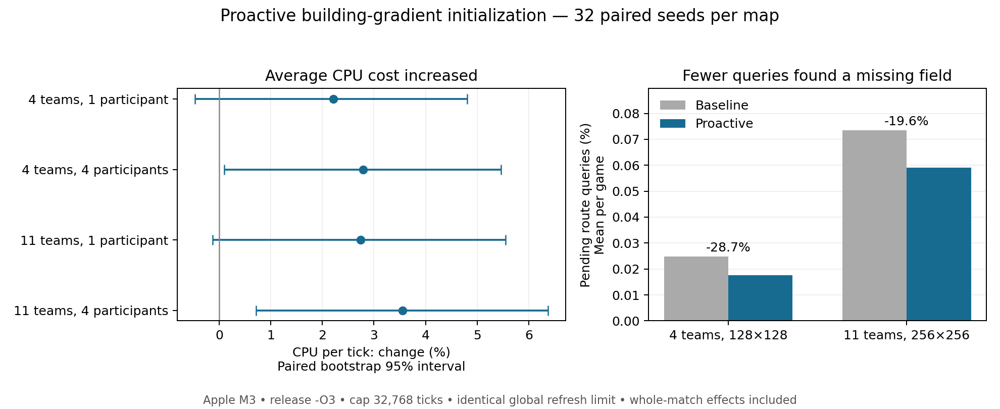

# Proactive building-gradient initialization

Production commit: `69e6c86014c50053d36e840a8cfe5290226b7163`. Baseline: PR1197 `c7f1cd2996a13ac59d56926755c182008b67d736`. Master/base: `486a2230a4ddb257ba9dee34d3aace05f2260d6f`.

Creation and construction type transitions now request minimum-depth background preparation after their footprint is committed. Requests capture at the next completed boundary and publish one tick later. Hiring extends the same fields to primary candidates; ordinary cold queries cannot enroll a duplicate map job. Save format 172 retains queued requests and pending preparations, while the save floor remains 58; replay floor 172 and SIM_REVISION 71 accompany the new golden trace.

## Measured tradeoff

Mean CPU per tick rose by 2.2–3.6%. Pending route-query rates fell by 28.7% on the four-team map and 19.6% on the eleven-team map. These are whole-match effects, including changed rankings, service timing and subsequent match development; they are not isolated kernel costs.

| Map / participants | CPU per tick, µs: before → after | Change, paired 95% interval | Total CPU per game, s: before → after |
| --- | ---: | ---: | ---: |
| holiday / 1 | 169.36 → 173.11 | +2.21% [-0.47, +4.81] | 5.414 → 5.609 |
| holiday / 4 | 189.82 → 195.12 | +2.79% [+0.10, +5.47] | 6.068 → 6.322 |
| large-eleven / 1 | 1270.62 → 1305.45 | +2.74% [-0.13, +5.55] | 41.636 → 42.777 |
| large-eleven / 4 | 1452.38 → 1504.01 | +3.55% [+0.71, +6.37] | 47.592 → 49.283 |

The four-participant CPU intervals exclude zero; the one-participant intervals do not. Four-team games averaged 31,911.6 ticks before and 32,390.4 after (some finish before the cap), contributing to higher total CPU per game. All eleven-team runs reached 32,768 ticks.

| Map | Pending queries, % before → after | Queries returning Pending per 1,000 ticks | Ticks with any Pending, % before → after |
| --- | ---: | ---: | ---: |
| holiday | 0.02478 → 0.01766 | 25.97 → 18.24 | 1.913 → 1.379 |
| large-eleven | 0.07344 → 0.05904 | 265.33 → 217.89 | 12.265 → 10.756 |

Logical pending-query measurements are identical between participant counts. Counts cover all `requestBuildingField` consumers, not just hiring or new buildings; ticks-with-Pending counts global ticks, not individual unit delay.

## Tick-time distribution

| Map / participants | Mean per-game P99, µs: before → after | P99 change (95% interval) | Mean per-game P99.9, µs: before → after | P99 of non-overlapping 8-tick means: change (95% interval) |
| --- | ---: | ---: | ---: | ---: |
| holiday / 1 | 660.3 → 670.9 | +1.61% [-0.92, +4.07] | 1013.7 → 1011.4 | +1.92% [-2.68, +6.37] |
| holiday / 4 | 328.1 → 336.9 | +2.68% [-1.37, +6.86] | 734.6 → 735.2 | +5.27% [+0.46, +10.26] |
| large-eleven / 1 | 5036.7 → 5052.4 | +0.31% [-2.38, +3.04] | 7561.3 → 7317.3 | +1.52% [-1.49, +4.56] |
| large-eleven / 4 | 3340.6 → 3303.9 | -1.10% [-5.20, +3.24] | 6423.0 → 5881.4 | +0.69% [-3.45, +4.86] |

No individual-tick P99 interval excludes zero. The four-team/four-participant P99 of eight-tick averages rises 5.27% [0.46, 10.26], from 177.06 to 186.39 µs per tick in those windows. The eleven-team/four-participant P99.9 falls 8.43% [-13.99, -2.57]. These are exploratory distribution metrics, not independent proof of device-wide jitter improvements. The remaining tail thresholds and adjacent-tick variation are in `benchmark/summary.json`.

## Workload and controls

- 32 paired seeds, 42–73, on each unchanged map: `Holiday_Island_2.map.gz` (128×128, four teams) and `Oazis.map.gz` (256×256, eleven teams). AI roster repeats Nicowar, Econo, Castor, Warrush, truncated to team count. Map hashes and exact commands are recorded.
- Both policies use the existing **global four** scheduled map-refresh admissions per tick and eight-tick map publication delay. PR1220’s per-team change is not included. Proactive preparations use the existing one-tick hiring deadline.
- Apple M3 / Mac15,12, macOS arm64, Apple LLVM21. Both are full release builds with `-O3`, `CXXFLAGS=-g0`, CPU gradients/GPU off. Fast development builds were used only for correctness checks.
- 256 serial runs; cap 32,768 ticks; warmup zero. Policy and participant order alternate by seed/map. Total sampled ticks: 8,309,628. All initial-state checksums match across each four-run set; final checksums match between one/four participants for all 128 policy/map/seed pairs.
- Native compiler/test activity, Docker exec/build and VM CPU ≥10% are guarded. Any observed overlap discards the complete paired set; none was observed or excluded. Other OS activity and thermal effects are not fully controlled.
- Identical private chronological tick writer and owner-only route-read counters in both builds. The increment cost is included in both. Raw samples are native little-endian uint64 nanoseconds before sorting.
- CPU uses process CPU nanoseconds divided by actual measured ticks. Values and percentiles are first computed per game, then averaged across 32 games. Relative effects are ratios of means; intervals use 10,000 paired bootstrap resamples of seeds, RNG seed 20261017. Pending-rate intervals use the same game-level pairing.
- `building_gradient_jobs` counts only scheduled Map jobs and excludes private hiring/preparation jobs. It must not be treated as a total gradient-build counter.

## Native correctness and limits

49 hiring/preparation cases passed; 83 of 85 related cases initially passed, and the two fixtures that assumed synchronous cold reads were migrated to await publication and passed in the final retry (along with all five new proactive cases). This gives all 85 related cases passing across the runs. 41 replay/protocol unit cases and 18 turn-engine cases passed. The committed golden match was regenerated and verified; `test/check_sim_revision.py --base origin/master` passed. Save artifacts include queued and pending format-172 binary/text games, retained-format-126 state, and turn-engine continuation evidence. Formats 170/171 parser boundaries and current replay acceptance boundaries are covered.

See `qualification/qualification.json`, the JUnit files, log archive and save/turn archive. The intermediate related-run JUnit retains the two resolved fixture failures deliberately. Correctness sources were committed unchanged as the production SHA above; benchmark behavior files are byte-identical to that commit, with hashes in `benchmark/provenance.json`. The benchmark checkout remained based on c7 plus the published source overlay and private instrumentation; its exact patch and source manifest are retained.

No cross-platform checksum comparison was completed: Docker remained unavailable after the earlier host disk exhaustion. Linux, Windows, browsers/mobile, manual play and rendered frame pacing are unverified. Prior broader native unit/display failures were not rerun. This is not a full-suite green claim; PR1197 remains draft.

## Reproduction and evidence

Build c7f1cd299 and 69e6c8601 separately with the same private instrumentation patch (`benchmark/instrumentation.patch`) and `benchmark/ProactiveGradientProbe.h` copied to `src/building/`. Use `PYTHONPATH=. scons release=1 CXXFLAGS=-g0 client_profile=full server=0 -j4` (baseline initial build used -j8, with the final incremental build at -j4). Copy each resulting `build/darwin/client/release/client-full-direct-1111/src/glob2` to `artifacts/proactive-gradient/binaries/baseline` or `proactive`. Place `run_matrix.py` under `artifacts/proactive-gradient/` and run it from the checkout root. The runner is resumable and verifies the frozen binary hashes. Source, compiler, dependency prefix, flags, binary hashes, map hashes, per-run commands/environment, exit status, RSS and contention status are retained.

`benchmark/results/` contains all result JSON and run metadata. The map-specific tick archives contain raw chronological samples, and run-log archives include stdout plus `/usr/bin/time -l` output. `smoke-checksums.tar.gz` contains both maps’ 2048-tick world/entity traces; these smoke timings are excluded from the performance matrix. `per-game.csv`, `summary.json`, the pinned analysis/plot scripts and build logs complete the evidence.

Analysis: `uv run --no-project --offline --python 3.12 --with numpy==2.5.4 python artifacts/proactive-gradient/analyze.py`; plotting additionally pins `matplotlib==3.10.7`.
