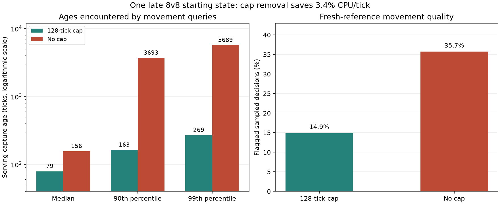

# Adaptive-gradient reconciliation and negative-distance fix

Final production source: **2bb153e249d7e6612c57f6cd3a380312e480c4c4**, master base **3d896cbb95293da6d24caddd247a62c9ca99d77f**. PR1224 remains draft, unmerged. SIM81; save format/replay floor174 and supported save floor58 are unchanged. Research variants below are not production policies.

## What changed after the successful experiment

The historical gain reproduced using preserved binaries, flags and shared River terrain: roughly29% lower CPU/tick for researchA32 versus research rotation. The final candidate changed several things at once, including engine baseline, model, request semantics, maps, hardware/thread configuration and aggregation. The original32-run pooled regression is real for that sample, but it cannot by itself identify the cause.

Two controlled mechanisms explain substantial lost savings:

1. The prototype consumed skipped natural-field rotation turns as idle boundaries. Consolidation removed those turns. On River, guard/clear periodic admissions increased from2842/4093 with preserved turns to11175/14918 without them. Their summed seed/propagation wall scopes increase0.727→2.261s while natural-field scopes stay essentially unchanged. These are diagnostic scopes, not processCPU. Preserving turns is not universally faster or an approved production fix: other-family freshness was not scored by the historical resource-quality probe.
2. Recruitment-distance reads were broadened into refresh demand after collection. In the steady8v8 observation,99.34% of scalar enrollments were already reachable answers. Restricting enrollment to negative answers reduces natural admissions1046→637 and natural seed/propagation scopes1.032→0.615s. It retains the stale-negative liveness fallback. The measured1024-tick CPU window after2048warmup improves7.320→6.763ms/tick (master6.351). Counters cover the final observation boundary too, so do not treat them as exactly the same1024 advancement window. This is a small controlled sample, not a universal CPU-win claim.

Model/policy-loop scope cost was approximately0.6% of a diagnostic run. Actual accepted natural work was97.9–99.1% forced-cap driven; all observed model-triggered admissions in the audited windows were accepted by both coefficient sets. Replacing coefficients alone did not resolve the8v8 regression. The old and final predictors have identical feature units/ordering/normalization/window definitions; the old label offset7..31 became8..31 with the changed publication boundary. OfflineMAE is not equivalent to operating-point utility or CPU savings.

## Removing the128-tick cap

The controlled variant retains minimum spacing8, model threshold32 and reactive FIFO repair, but removes the forced age branch. Both policies use negative-only scalar enrollment. Clean timing and observer/age/reference runs are separate; all4 observer/plain pairs have identical final ticks, checksums and jobs.

|Late8v8 measure|Capped|Uncapped|
|---|---:|---:|
|Measured CPU ms/tick|7.0716|6.8325|
|Movement-query capture age median|79|156|
|Movement-query capture age p90|163|3693|
|Movement-query capture age p99|269|5689|
|Sampled extra direction cost/query|1.736|4.390|
|Sampled flagged decisions|14.90%|35.73%|

CPU is measured over2048 ticks after4096warmup from the same pre-adaptive save. Movement-quality observations use one deterministic probe window36864..37887,879capped/848uncapped decisions; age histograms cover the longer gated suffix and are query-weighted. Fields lacking usable capture metadata are excluded from ages and counted separately (approximately0.29% movement and0.13% positive-planning reads in uncapped8v8). A zero-source capture is also excluded by this diagnostic sentinel; do not attribute every exclusion to legacy saves.

On full River, negative-planning ages change median67→1762,p90 129→15832,p99 984→17587,max7363→17953ticks. A sparse independent fresh-field oracle found15 uncapped false-unreachable samples among30 negative samples, versus0/17capped. The15 failures span two fields and ten distinct captures, not15 independent games. Movement-only quality can miss this failure because units blocked from recruitment never generate movement queries. Age can exceed128 even in capped games: the guard is demand-triggered and submission-based, whereas these ages refer to the serving capture and include idle time/publication delay.

These observations reject simply removing the cap from the **current model**. They do not establish128 as optimal or a cap as permanently necessary.

## The training coverage problem

The512-game fit had476107 complete episodes, but only7 feature ages above1024 (max1053), none above4096. For q128>=8, max training age206; for q128>=32,max155; for q128>=128,max128. Thus the busy-and-thousands-of-ticks-old regime created by uncapping is outside the collected support. Older mixed-policy training included some busy older fields; the final single-capped-policy collection broadened map coverage but narrowed that policy/age coverage.

Distance-only negative planning is also largely absent from the movement-based target. A credible replacement for the guard needs deliberately varied age/policy collection and planning-failure labels. Better capped holdoutMAE does not establish safe uncapped extrapolation. No evidence here establishes a general need for a map-specific mixture of experts.

## Production fix and verification

The source fix only makes successful owner natural-ground distance/availability reads passive. Unreachable answers still request delayed upkeep; coldPending, market/consumer andAIR handling are unchanged. Movement counts/features are unchanged. No experimental instrumentation, turn-preservation or no-cap switch enters production.

New regressions exercise successful distance/availability/recruitment reads for144ticks without additional jobs, and stale-negative recovery through delayed publication with zero movement queries. A lifecycle fixture now requests actual movement demand rather than relying on successful planning reads.

- Ordinary releaseO3, no fast/PCH/unity: macOSARM64 AppleClang21 and Linuxx86_64 GCC13.3; existing pinned dependencies, no added runtime dependency.
- Mac117 focused/hiring/fetch cases pass (68+49); Linux117 pass. Expected first fixture/golden failures and resolved followups are retained; the SIM81 match record/trace was regenerated and gate check passes.
- Clean final source:4096 per-tick exhaustive world, snapshot and full replay vectors match across both architectures,1/4threads and probeon/off—all6runs. Vector hashes are in fix-cross-platform.json.
- Real released173save→174resave→continuation produces identical Mac/Linux vectors. Matched174-header save continuation agrees on2048+ overlapping raw world/snapshot hashes on both hosts.
- A fresh before/fix8v8 movement probe (853/879 sampled decisions) gives flagged17.70%→14.90%, but mean extra cost1.632→1.736: mixed quality, not a universal improvement claim. The actual fixed binary reproduces the negative-only research control's final checksum13526470 and9406jobs over the6144-tick suffix. Raw results are in fix-quality-summary.json.
- Fresh independent source/test and research review:OK. Windows/browser/GPU execution, packaging and maintainer gameplay acceptance remain unverified; no full-suite or fresh broad CPU/quality-frontier claim. No hosted expensive CI requested.

Exact commands, binary hashes, source patches, plans, maps, rawCSV/JSON, histograms, timing definitions and review records are in research-evidence.tar.gz. Native logs/JUnit, commands, saves and checksum evidence are in fix-mac-evidence.tar.gz and fix-linux-evidence.tar.gz. Identical full replay vectors are retained once with hash proofs for the variants. Original absolute paths preserve invocations and can be remapped after extraction.

## Separate map reproducibility confound

Same-file controls were essential. The same River seed generated different terrain on Mac/Linux. For seed385001, production River code casts the first negative floatY=-87.5 to unsigned: Mac gives0, Linux4294967209, yielding different toroidal rows. Both UBSan probes flag this conversion. Linux old/common/current map categorical pixels match exactly; Mac differs. This is a separate confirmed portability defect, not a model coefficient failure or a fix included here.
