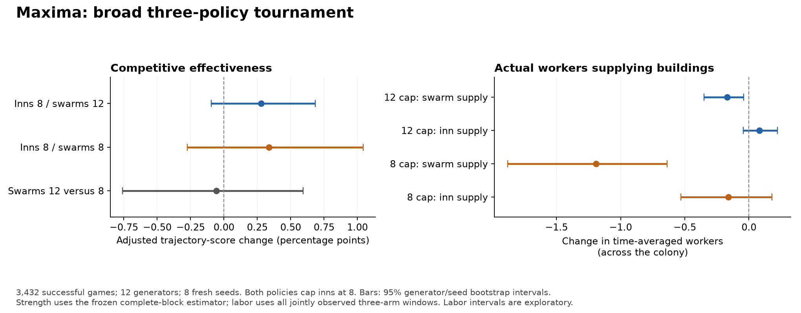

# Final broad Maxima staffing-cap analysis

The broad data support a modest guardrail interpretation. Inn8/swarm12 is less disruptive than inn8/swarm8 and preserves production better. Neither combined policy has a demonstrated overall competitive improvement, and swarm12 has no demonstrated competitive advantage over swarm8. The fresh cohort does not replicate a clear general starvation reduction for8/12. Its most favorable food signal is a small increase in meals, mainly in FFA.

## Design and coverage

3,432 successful games comprise1,144 matched scenarios, each with baseline,inn8/swarm8 andinn8/swarm12. Twelve generators, eight fresh seeds,1v1/2v2/FFA, varied AI rosters and seat rotations. All arms use the same frozen native Linux release/framework, normal rules,95% probability stopping and90,000tick limit. Only subject Maxima player0 changes policy. Role caps retain common20 for other operating buildings; construction/upgrade crews are separate. The two policy arms hold inn8 fixed, so12versus8 isolates the swarm ceiling; baseline comparisons change both role ceilings and do not isolate the inn cap.

Two rejected Lava128/two-colony maps blocked24games. They are unavailable, never substituted or zero-filled. All executed games succeeded; there were no game timeouts. The overall primary estimator uses94complete geometry/seed blocks (1,128scenario pairs), equally weights generators and formats, and clusters all policies/rosters/rotations/formats together. Format-specific estimates use94duel blocks and96team/FFA blocks. Food summaries retain all1,144jointly observed scenarios, including the partial Lava format blocks, so food adjusted_score rows are a different coverage estimator and must not replace the frozen main headline.

## Effectiveness

Metric: adjusted win-probability trajectory log_time_outcome_v1,c=2,fixed90k horizon. Values below are score percentage points, not win-rate percentage points. Intervals are hierarchical generator→seed percentile bootstrap; the fixed-generator seed-only sensitivity remains in the main JSON.

| Contrast | Mean change(pp) |95% interval(pp)|
|---|---:|---|
|inn8-swarm8 minus baseline|+0.336|[-0.276,+1.043]|
|inn8-swarm12 minus baseline|+0.279|[-0.096,+0.683]|
|inn8-swarm12 minus inn8-swarm8|-0.058|[-0.760,+0.593]|

All intervals cross zero. This does not establish equivalence or prove no benefit; it leaves small benefit/harm plausible. Swarm8 has the larger point estimate, but its interval is wider, and the direct12−8 interval gives no reliable ordering.

|Format|8/12−baseline(pp)|95% interval|8/8−baseline(pp)|95% interval|
|---|---:|---|---:|---|
|1v1|+0.111|[-0.057,+0.338]|+0.392|[-0.591,+1.470]|
|2v2|+0.081|[-0.251,+0.463]|+0.009|[-1.109,+1.044]|
|ffa|+0.708|[-0.275,+1.869]|+0.641|[-0.898,+2.338]|

FFA supplies the largest favorable8/12 mean, but its interval is widest. No format independently establishes an improvement. Across complete blocks,8/12 has positive means in7generator families and negative in5;8/8 splits6and6. Family cells are descriptive, not independently tuned policies.

|Paired comparison|Higher score|Identical score|Lower score|Absolute change≥1pp|Absolute change≥5pp|
|---|---:|---:|---:|---:|---:|
|inn8-swarm8 minus baseline|387|359|398|363|175|
|inn8-swarm12 minus baseline|234|711|199|147|66|
|inn8-swarm12 minus inn8-swarm8|394|360|390|362|163|

Every comparison has median score difference zero.8/12 leaves62.2%of scores exactly equal;8/8 leaves31.4%equal. This establishes a larger frequency of score changes under8/8, not proof that a cap never bound in tied games or that intermediate states/orders were identical.

## All-case food and labor

Each scenario is truncated at the latest exact counter publication common to all three arms before the shortest game ends. No extrapolation, interpolation or post-stop fill. Rates use10,000shared observed ticks; worker death rates use actual worker exposure. Population uses its separately recorded common state timestamp. These are observed-window mechanisms, not counterfactual full90k trajectories. All designed scenarios enter coverage; no hunger/changed-game/outcome selection. Many secondary intervals are unadjusted for multiplicity.

|Metric|Unit|Baseline|8/12|8/12 change95% interval|8/8|8/8 change95% interval|
|---|---|---:|---:|---|---:|---|
|swarm_workers|active workers|9.872|9.704|[-0.349,-0.041]|8.682|[-1.879,-0.639]|
|inn_workers|active workers|8.903|8.983|[-0.043,0.223]|8.741|[-0.530,0.179]|
|swarm_share|ppworker-time|25.459|25.275|[-0.291,-0.091]|24.107|[-1.777,-0.966]|
|inn_share|ppworker-time|20.374|20.448|[-0.041,0.237]|20.420|[-0.255,0.383]|
|site_share|ppworker-time|16.063|16.111|[-0.007,0.110]|16.501|[0.202,0.695]|
|idle_share|ppworker-time|11.730|11.799|[-0.052,0.192]|12.403|[0.346,1.059]|
|worker_births|births/10k ticks|29.348|29.255|[-0.335,0.122]|28.191|[-1.762,-0.609]|
|births|births/10k ticks|43.647|43.631|[-0.249,0.220]|42.600|[-1.647,-0.467]|
|meals|wheat/10k ticks|71.447|72.117|[0.136,1.378]|72.178|[-0.892,2.271]|
|harvested|wheat/10k ticks|363.705|364.474|[-0.905,2.727]|358.926|[-9.550,-0.414]|
|delivered|wheat/10k ticks|347.377|348.223|[-0.775,2.665]|343.572|[-8.275,0.259]|
|starvation|deaths/10k ticks|1.412|1.383|[-0.175,0.093]|1.259|[-0.396,0.079]|
|worker_starvation_rate|worker deaths/Mworker-ticks|2.427|2.415|[-0.123,0.079]|2.252|[-0.494,0.065]|
|population|units|133.205|134.868|[-0.319,4.069]|131.906|[-5.114,2.434]|
|combat|deaths/10k ticks|8.315|8.231|[-0.338,0.110]|8.273|[-0.536,0.443]|
|net_conversions|units/10k ticks|9.180|9.357|[-0.041,0.430]|9.399|[-0.422,0.862]|

Worker equivalents are colonywide actual supplying activity, not a per-building requested cap. Under8/12, swarm activity falls0.169workers (~1.7%) and inn activity rises0.080, with its interval including zero. Under8/8, swarm activity falls1.190workers (~12.1%), while inn activity changes−0.162with uncertainty spanning zero. The8/8 healthy-idle share increases0.673pp and construction-supply share0.439pp. These activity changes do not track individual workers from one job to another. They show that lower swarm demand is not automatically converted into additional meal service.

Swarm8 reduces worker births by1.157/10kticks (~3.9%) and total births by1.047; the latter reduction has interval[−1.647,−0.467]. Spawning wheat falls mechanically with births and is not an independent confirming metric.8/12 preserves births almost unchanged. Raising the swarm ceiling8→12 while holding inn8 fixed gives1.031more total births/10k[+0.443,+1.593] and1.022more active swarm workers[+0.566,+1.556], without a demonstrated score improvement. The evidence is consistent with a throughput/growth throttle under8, rather than broad proof of allocator repair.

Under8/12, meals rise0.670wheat/10k (~0.94%), exploratory interval[+0.136,+1.378]. FFA supplies most of this signal: +1.941[+0.321,+4.122], versus−0.086in duels and+0.155in teams. Harvest and delivery improvements remain uncertain. More observed meal consumption is not by itself proof of greater renewable yield, less worker starvation or a stronger colony. Swarm8 has a similar positive meal point estimate but a wide interval crossing zero, and harvested wheat falls4.779/10k[−9.550,−0.414].

The fresh8/12 starvation-rate change is only−0.029deaths/10k(~2%), interval[−0.176,+0.093]; worker starvation per million worker-ticks is essentially flat. The earlier pilot’s stronger starvation improvement does not replicate clearly here. Swarm8 reduces the all-unit starvation-rate point estimate about10.8%, but its broad subject interval also crosses zero. Birth suppression and lower resource demand remain part of interpreting any starvation reduction.

## Alliance accounting

Team outcomes are scored once per alliance. In whole-alliance2v2 telemetry,8/12 has no clear meal, starvation, worker-starvation or inn-labor improvement. Under8/8, alliance starvation falls0.394deaths/10k[−0.758,−0.116], alongside1.157fewer worker births[−2.101,−0.255] and no clear increase in meals. This is a useful secondary pressure-reduction signal, but not independent proof of a meal-allocation fix or competitive improvement. Ownership transfers between allies cancel in net alliance conversions; subject population alone is insufficient.

## Limits and interpretation

3,166of3,432games (~92.2%) end at the95% model threshold;64reach actual engine endings and202reach tickcaps. Candidate arms change which games reach each ending, so actual endings must not be compared as if a randomly selected subset. The trajectory scorer intentionally credits declared outcomes for remaining horizon; adjusted score changes are not actual victory-rate changes.

Joint three-arm exact checkpoint coverage falls from935scenarios at16,384ticks, to469at32,768,162at49,152,77at65,536 and42at81,920. The late group is survival/early-stop selected. The optional full-horizon432game stage was skipped at its fixed08UTC start deadline, so no new no-prediction-stop cohort exists. Broad strength coverage is much stronger than the pilot; controlled late food-exhaustion exposure is still weak.

All-case histories quantify supply activity, food consumption/harvest/delivery, production and mortality. They do not establish local renewable wheat yield for each inn, which buildings share a catchment, or the recruitment/routing decisions that initiate escalation. Broad per-building request/binding/admission histories are not available outside the six predeclared diagnostic scenarios. Score ties do not establish cap inactivity.

The practical result:8/12 is a gentler operational limit than8/8, preserves birth production and has a small feeding signal, but neither is a demonstrated general strength improvement or fix for the original escalation loop. Inn8 is not isolated here. A follow-up should compare inn default/8 crossed with swarm default/8/12 across a declared broad panel, and separately guarantee sustained late observation with consistent stopping rules. Local renewable yield versus demand, staffing requests versus enrollment, and worker-admission/routing reasons would directly test the proposed mechanism. No new runs are launched by this review and policy defaults remain unchanged.

## Evidence

- [Frozen primary results](../overnight/SUMMARY.md) and [machine-readable scores/coverage](../overnight/summary.json.gz).
- [All-case three-arm telemetry](../food-common-window/SUMMARY.md), [estimates/CIs](../food-common-window/balanced-estimates.csv.gz), [case deltas](../food-common-window/joint-common-case-deltas.csv.gz), and [checkpoint coverage](../food-common-window/fixed-checkpoint-coverage-and-means.csv.gz).
- Source/bundle/framework and worker-release evidence:../../freeze-validation.json,../../root-launch-validation.json,../../completion-verification.json; helper provenance and validation in../../scripts/food-analysis.*.json.
- All parse/observation error lists are empty. Native Linux only; this review does not establish cross-platform simulation checksum equivalence.
