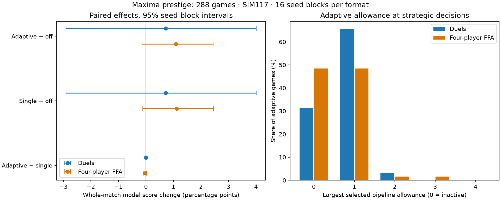

# Ancillary economic and outcome comparisons

All paired seeds and rotations are included. Intervals use the same whole-seed bootstrap as the primary analysis; these are exploratory diagnostics, without adjustment for multiple comparisons. Food fractions mean time with a nonzero director-reported shortfall. They do not measure realized spending or causality.

| Format | Contrast | Schools, change [95% CI] | Trained workers, change [95% CI] | Unserved food time, pp [95% CI] | Critical food time, pp [95% CI] |
| --- | --- | --- | --- | --- | --- |
| 1v1 | adaptive_minus_baseline | +0.032 [-0.153, +0.221] | -2.616 [-7.725, +1.929] | -1.641 [-4.554, +1.299] | +0.300 [-0.957, +1.821] |
| 1v1 | single_minus_baseline | +0.032 [-0.153, +0.221] | -2.616 [-7.725, +1.929] | -1.641 [-4.554, +1.299] | +0.300 [-0.957, +1.821] |
| 1v1 | adaptive_minus_single | +0.000 [+0.000, +0.000] | +0.000 [+0.000, +0.000] | +0.000 [+0.000, +0.000] | +0.000 [+0.000, +0.000] |
| ffa | adaptive_minus_baseline | +0.120 [+0.046, +0.199] | -0.890 [-2.822, +1.202] | +2.877 [+1.033, +4.930] | +1.163 [-0.500, +2.984] |
| ffa | single_minus_baseline | +0.116 [+0.044, +0.193] | -0.821 [-2.756, +1.276] | +2.947 [+1.064, +5.018] | +1.128 [-0.543, +2.958] |
| ffa | adaptive_minus_single | +0.005 [+0.000, +0.012] | -0.070 [-0.275, +0.066] | -0.071 [-0.193, +0.000] | +0.035 [-0.032, +0.137] |

The helper emits at each strategic decision; director snapshots emit only every1,000AI ticks. Capacity exposure below uses every helper decision, while the JSON retains the sparser director-derived series separately. Chosen allowance is not a claim of simultaneous funded spending.

| Format/arm | Games with maximum0 /1 /2 /3 /4 |
| --- | --- |
| 1v1/baseline | 32 / 0 / 0 / 0 / 0 |
| 1v1/single | 10 / 22 / 0 / 0 / 0 |
| 1v1/adaptive | 10 / 21 / 1 / 0 / 0 |
| ffa/baseline | 64 / 0 / 0 / 0 / 0 |
| ffa/single | 31 / 33 / 0 / 0 / 0 |
| ffa/adaptive | 31 / 31 / 1 / 1 / 0 |

Full coverage, actual-win contrasts, adverse cases and all metrics: [supplement.json](supplement.json). Primary effectiveness: [assessment.md](assessment.md).

