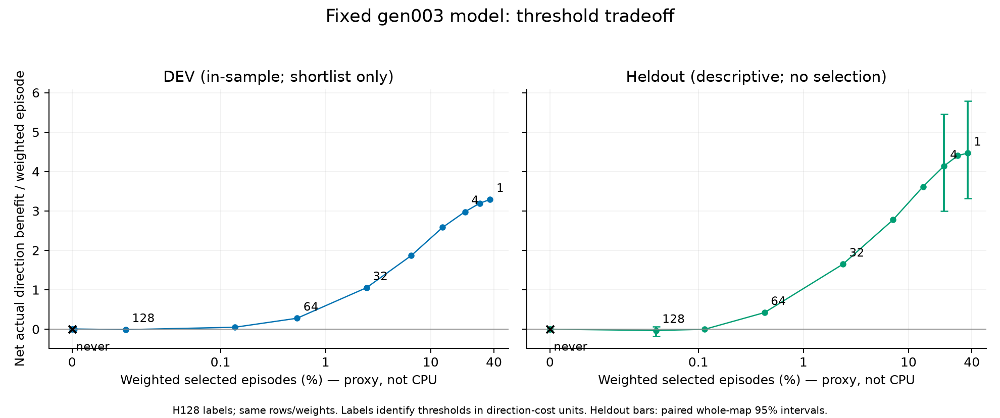
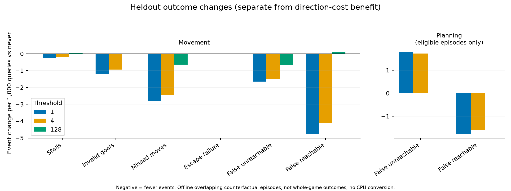

# Gen003 fixed-model threshold sweep

DEV-only shortlist: **1 and 4 direction-cost units**, with 128 as reference and never-discretionary as baseline. This is an offline prospective-experiment shortlist, not a production change or an estimate of CPU savings. All heldout thresholds below are descriptive; none was selected using heldout outcomes.

The exact frozen gen003 deployment model (SHA 9981398a…039aab), H128 target and 12 inputs were unchanged. Predictions were generated once for the same 122,901 known, movement-labelled rows (95,232 DEV/392 maps; 27,669 heldout/120 maps); minimum observed age 8. Every sealed input hash matched f78be1b7…d3fa67. Both populations use equal format/role/cohort/map/family/collection/episode weights. No refit, game, source edit, dependency change, production setting or collector change was made. Analysis took 50.10 CPU seconds on Rig CPU 0/nice19/one BLAS thread; plots used existing pinned matplotlib.

The predeclared primary objective is **mean actual signed direction benefit selected per weighted episode**, versus always deferring discretionary refresh. It assigns no invented CPU price. Selection percent is an episode-choice proxy: episodes overlap, fields/jobs deduplicate, and refreshing changes future features and worlds. It is neither the fraction of ticks rebuilt nor a measured CPU cost. Harm is selected negative benefit magnitude; positive capture is the share of all positive labelled benefit selected. Actual selected benefit includes negative cases.

| Threshold (units) | Net direction benefit | Harm selected | Positive benefit captured | Selected episodes | Mean actual selected benefit | Common128-cost regret |
|---:|---:|---:|---:|---:|---:|---:|
| 1 | 4.4639 | 1.0337 | 92.80% | 36.4292% | 12.254 | 44.7267 |
| 2 | 4.4038 | 0.9931 | 91.10% | 29.3630% | 14.998 | 35.7422 |
| 4 | 4.1327 | 0.9242 | 85.36% | 21.6020% | 19.131 | 26.0791 |
| 8 | 3.6138 | 0.7989 | 74.49% | 13.7197% | 26.341 | 16.5086 |
| 16 | 2.7753 | 0.5743 | 56.54% | 7.1247% | 38.953 | 8.9055 |
| 32 | 1.6491 | 0.3102 | 33.07% | 2.3756% | 69.419 | 3.9529 |
| 64 | 0.4211 | 0.1191 | 9.12% | 0.4260% | 98.836 | 2.6855 |
| 96 | -0.0029 | 0.0817 | 1.33% | 0.1147% | -2.499 | 2.7110 |
| 128 | -0.0333 | 0.0712 | 0.64% | 0.0454% | -73.321 | 2.6526 |
| 192 | 0.0000 | 0.0000 | 0.00% | 0.0000% | — | 2.5612 |
| 256 | 0.0000 | 0.0000 | 0.00% | 0.0000% | — | 2.5612 |
| never | 0.0000 | 0.0000 | 0.00% | 0.0000% | — | 2.5612 |

The table uses heldout rows. **No regret at a changing threshold cost is compared.** The final column deliberately scores every threshold with the same 128-unit opportunity cost: lower thresholds improve unpriced direction benefit while doing much worse under that particular high selection cost. There is no justified mapping from 128 direction units to actual rebuild CPU. A running-policy experiment must measure the resulting work/CPU and quality frontier.

DEV selected 1 for maximum net benefit 3.29081 at 36.77% selection. Threshold 4 was the highest threshold retaining at least 90% of that positive DEV benefit: 2.97791 at 21.16% selection. The fixed model was trained on these DEV maps, so this is optimistic in-sample selection. Matching gen003 OOF predictions do not exist; this sweep performed no new CV fits. The exact DEV choice receipt was written before heldout metrics. The same persistent heldout maps have been examined before; this is not a new independent validation population.

Paired whole-map bootstrap (2,000 draws, fixed hierarchy weights, same map multiplicities across arms) gives heldout net-benefit differences versus never:1=4.46393 [3.32348,5.78410];4=4.13268 [2.99825,5.45763];128=-0.03327 [-0.18213,0.06722]. Versus128:1=4.49720 [3.34196,5.83589];4=4.16595 [3.02141,5.50728]. These conditional intervals cover sampling variation across the 120 observed map clusters; they do not include refitting, model selection or closed-loop distribution changes.

Coverage and separate outcomes

- Most direction benefit is Materials: conditional heldout net benefit at 1/4 is 16.7398/15.7468; Clear 0.7413/0.4698; Guard 0.1491/0.1542; Forbidden 0/0. Markets remains unmeasured. Low thresholds would select 41.9%/22.6% of Guard episodes despite modest direction benefit.
- All eight formats and ten observed dimensions have positive net benefit at 1 and 4, but some generator slices are negative: braided-river has only 30 rows and scores -0.100/-1.233; continents has 58 rows and -0.0179 at both; emoji has 369 rows and threshold 4=-0.2574. Detailed generator support is preserved, not pooled into a universal claim.
- High demand(q128>=32) has net benefit 16.8784/16.7547 at 1/4, selecting 96.7%/62.3% of its episodes. Age 4096+ has net benefit 1.2688/1.2344, based on 3,155 rows. These may imply substantial extra native work and require prospective measurement.
- Direction benefits do not absorb outcome penalties. At1/4 versus never, invalid goals change -1.185/-0.937 and missed moves -2.786/-2.453 per 1,000movement queries; movement false-unreachable -1.648/-1.504 and false-reachable -4.778/-4.138. Planning false-unreachable increases +1.783/+1.726 while planning false-reachable decreases -1.782/-1.596 per 1,000planning queries. Planning here is attached to the same eligible movement episodes, not the full standalone planning stream.
- The input accounts for 202 normally completed and 310 user-capped trajectories. Only complete 8..127 label horizons were retained. Episode estimates and map-cluster intervals do not establish whole-game outcomes or late-game coverage.

`OUTCOME-DENOMINATORS.json` records that movement rates use `queries`, planning rates use `planning_queries`, and target benefit is only `defer_extra - refresh_extra`. `SUPPORT.json` preserves all four observed families, all eight formats and normal/capped trajectory support; Markets is explicitly unmeasured.

`RESULTS.json` contains all thresholds and family/format/generator/dimensions/age/demand slices with separate direction and event outcomes. `thresholds.csv` is the compact table; `predictions.npz` is the single immutable prediction cache. `CHECKS.json` records exact agreement at 128 with the earlier independent audit, metric bounds and never baseline. PlanSHA 7052db0c…9ca30. No model or production threshold was emitted.
