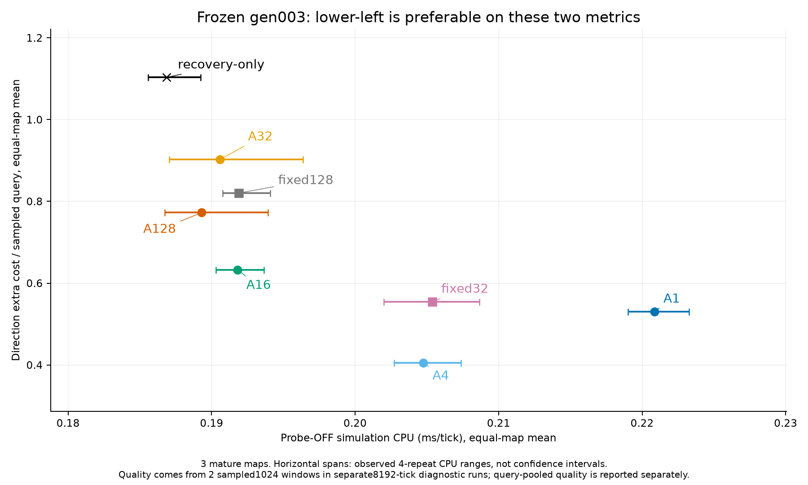
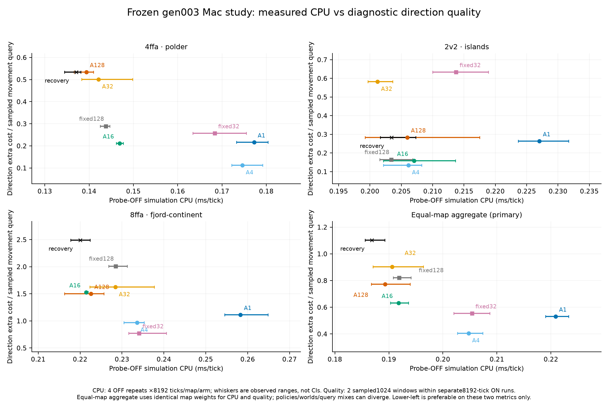
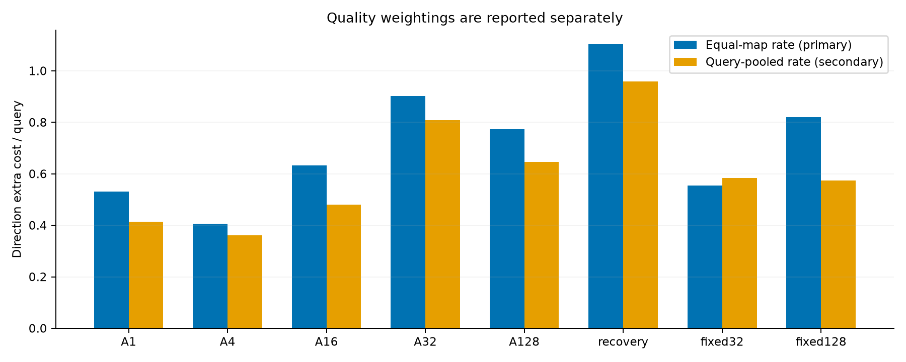
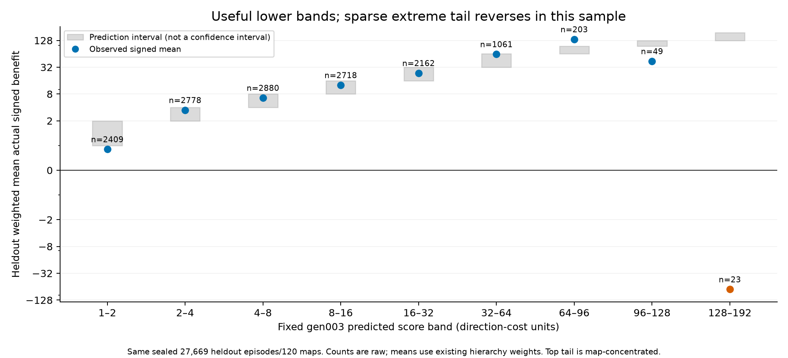
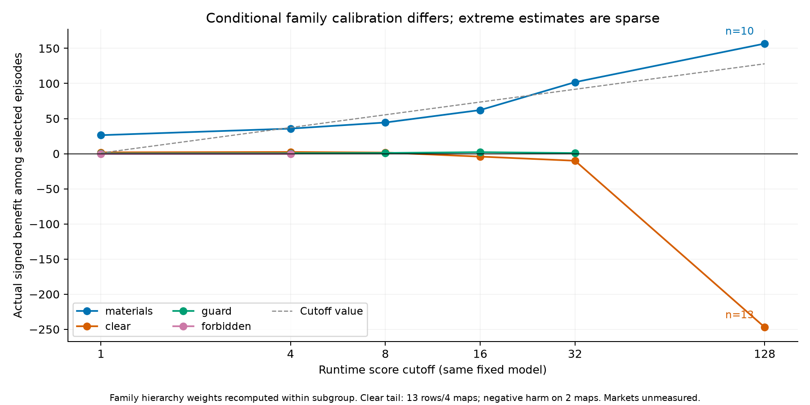

# Threshold diagnosis: operative scale plus sparse, heterogeneous calibration

The practical problem is **not a milli-unit bug and not a universal fivefold horizon rescaling**. Threshold 128 sits above nearly all score mass: only 23/27,669 heldout rows (0.0454% of hierarchy weight) exceed it, although maximum score 187.4 does exceed 128. Thus ordinary warm model admissions are effectively off. Scores in useful lower ranges often rank benefit sensibly, but the extreme tail is sparse, correlated and badly behaved in this sample. A single global multiplier cannot fix the family/context differences.

No predictions or fits were repeated. This diagnosis reuses the sealed gen003 score cache and existing sweep/pilot/paired reports; the bounded context pass only loaded metadata for the same cached rows, verified ordering/labels, and computed descriptive weights. It used 52.6 CPU seconds on Rig CPU 0/nice19/BLAS1, below the higher-priority cumulative768 fit. Current native/model/collector state remains unchanged.

## Score calibration and threshold scale

Predictions and labels are both direction-cost units after dividing integer scores by 1000; cross-language parity and the earlier independent 128 audit already established the conversion. The table subtracts existing weighted cumulative sweep metrics, so it gives the observed signed mean within each score band without another inference pass. These are heldout descriptive results, not calibration-fit targets.

| Predicted score band | Raw rows | Weighted mass | Actual mean signed benefit |
|---|---:|---:|---:|
|1–2|2409|7.0661%|0.851|
|2–4|2778|7.7610%|3.493|
|4–8|2880|7.8823%|6.582|
|8–16|2718|6.5950%|12.715|
|16–32|2162|4.7491%|23.714|
|32–64|1061|1.9495%|62.990|
|64–96|203|0.3113%|136.178|
|96–128|49|0.0693%|43.840|
|128–192|23|0.0454%|-73.321|

Bands 4–8,8–16 and 16–32 have means 6.58, 12.72 and 23.71, consistent with a useful benefit scale. The 64–96band underpredicts its observed 136.18 mean ; 96–128falls to 43.84;>=128falls to −73.32. This is not uniform shrinkage. The highest 23 rows comprise 8 negative, 8 zero and 7 positive outcomes on 9 maps, with raw labels −2194…1864. Sampling uncertainty is large: the earlier paired whole-map interval for threshold 128 net versus never was [−0.1821,+0.0672] units/episode. Do not turn the adverse point estimate into a universal population claim.

Lower thresholds select many more scored episodes:1/4/8/16/32 select 36.43%/21.60%/13.72%/7.12%/2.38% of heldout hierarchy weight. They capture 92.8%/85.4%/74.5%/56.5%/33.1% of positive labelled benefit. Those fractions are not job, tick or CPU rates; overlaps, pending-job deduplication and altered future worlds matter.

## Family/context differences and tail concentration

Each cell is conditional weighted actual benefit among selected rows, followed by raw selected count. Conditional family weights are recomputed; additive pooled contributions are reported separately in family-threshold-table.csv.

| Cutoff | Materials | Clear | Guard |
|---:|---:|---:|---:|
|1|26.39 (6933)|1.92 (3579)|0.36 (3752)|
|4|35.73 (5085)|2.45 (1730)|0.68 (2279)|
|8|44.43 (3760)|1.65 (960)|1.07 (1496)|
|16|62.15 (2228)|-4.12 (428)|2.20 (842)|
|32|101.87 (902)|-10.00 (127)|0.92 (307)|
|64|189.21 (170)|-89.01 (38)|0.05 (67)|
|96|91.87 (47)|-143.07 (20)|0.00 (5)|
|128|156.75 (10)|-247.05 (13)|—|

At cutoff 1 the additive pooled net benefit 4.46393 decomposes into Materials 4.26207, Clear 0.16629, Guard 0.03557, Forbidden 0. Markets is unmeasured. Guard takes 10.09 percentage points of overall scored-episode selection for 0.0356 net units, suggesting a work/value imbalance worth measuring natively. It does not prove Guard refreshes lack other gameplay value. At 128, Materials contributes +0.03060 and Clear −0.06387, producing the pooled −0.03327.

The high-score Clear evidence is only 13 rows from 4 maps. All negative Clear tail harm occurs on **two candidate-gen001 trajectories**:

- 2v2/islands map a701ceca has 4 rows with raw benefit −3350; it supplies 79.4% of weighted Clear-tail negative magnitude. The −2194 and −1004 cases alone drive most of that harm. The same field/team is sampled in two nearby episode pairs around ticks 29,316 and 33,408, so these are correlated cases.
- 8FFA/crater-lakes map c06ca1 has 3 rows, one at −786 and two at 0; it supplies the remaining 20.6%.
- A third map has 4 zero labels. The fourth has 0 and +60. There is no evidence of a universal Clear failure from these 13 rows.

These Clear scores combine high demand (q32=64…383, q128=191…1565), broad target turnover (added 0…8, removed 1…17), ages 17…489, and **zero recorded invalid-goal/no-move counters in every case**. Demand is roughly the 96th–99.9th within-Clear DEV percentile; no individual feature lies outside observed DEV marginal ranges. Exact transformed feature vectors have no DEV matches, which is normal in a large sparse state space and does not establish extrapolation. The capture features do not say whether broad target/route changes matter locally or what the field’s future targets will do. The data support a context/functional-form hypothesis, not a proven source bug or irreducible unpredictability.

The 10 Materials tail rows are equally fragile: five maps, with a single +1864 episode providing 0.02610 of its total +0.03060 pooled net contribution, plus one +708 case. Seven of the ten are age 8 with high query demand and nonzero no-move evidence; the outlier negative Material case is age 20,826 with large turnover and low current demand. All remain within observed DEV marginal feature ranges. Neither family tail supports a blanket calibration conclusion.

## Training, selection and target limits

The fixed default four-head estimator does **not** train against 128-cost regret. Logistic(C=1) predicts positive/negative sign; Ridge(alpha=100) predicts conditional positive/negative magnitudes, and the integer product/difference approximates expected signed benefit. The threshold argument is stored/validated; it does not alter those masks or losses. Generic12 hyperparameters are fixed; its DEV folds report metrics but do not select the default coefficients by regret.

However, reported decision regret and feature-variant CV selection use 128 units as the opportunity cost of each selected episode. Spatial research chooses minimum mean DEV regret at 128; the prior basic-model study likewise selected an almost-inert CART under that objective. This is correct for the stated score but is not a measured rebuild-CPU objective. For a fixed population, R128(policy)−R128(never)=128×selection_fraction−net_direction_benefit. At threshold 1 that adds 42.1654 regret units despite +4.4639 unpriced net direction benefit. A near-never predictor can therefore win this selection rule while a lower runtime cutoff helps native quality. This distinction must remain explicit in any later retraining; no refit was performed here.

The target also omits utility: direction extra cost is zero when movement choices are not comparable; missed moves, stalls, invalid goals and reachability errors are separate counters. Intentional Guard stays and many Forbidden escapes yield no direction-cost signal. Raw direction benefit is not a complete quality score, not a monetary/CPU price, and not necessarily comparable to a query-weighted gameplay objective. Family/cohort-balanced episode weights are deliberate research coverage weights, not measured frequencies of native jobs or their CPU costs. A high fraction of capped trajectories and policy-dependent feature distributions further limit generalization.

## Completed Mac study and actionable conclusion

The root-owned frozen Mac comparison is complete: 144/144 runs, no failures/caps. It retains 96 probe-OFF8192-tick timing runs (four repeats on each of three warm worlds/arm), plus separate diagnostics. The final quality phase uses 24 extended 8192-tick ON runs, all matching the corresponding OFF final checksum. The observer samples 1024 ticks per 4096, so final quality comes from **two sampled 1024 windows**, not every timing tick. The initial 24 ON 2048 runs only repeated the first window and are excluded from final quality estimates; no OFF timings were rerun.

Primary CPU and quality below both give each map equal weight. Query-pooled quality is secondary and reported separately. CPU ranges shown in figures are observed timing-repeat ranges, not confidence intervals or independent-game uncertainty.

| Policy | CPU ms/tick (equal maps) | Extra cost/query (equal maps) | Extra cost/query (query-pooled) |
|---|---:|---:|---:|
|A1|0.220855|0.5307|0.4143|
|A4|0.204763|0.4055|0.3611|
|A16|0.191792|0.6327|0.4804|
|A32|0.190585|0.9025|0.8075|
|A128|0.189302|0.7726|0.6461|
|recovery-only|0.186866|1.1031|0.9581|
|fixed32|0.205380|0.5548|0.5844|
|fixed128|0.191900|0.8204|0.5748|

A4 and A16 are the practical research shortlist in this sample. A4 has essentially the same observed CPU as fixed32 (difference −0.30%, too small to claim a saving) and 26.9% lower equal-map direction error. It improves polder/islands but is worse than fixed32 on fjord. A16 has essentially the same CPU as fixed128 (−0.056%) and 22.9% lower equal-map direction error, with lower observed error on all three maps. Versus A128 it costs about 1.32% more CPU for 18.1% lower error, a small CPU gap that should not be generalized precisely.

A1 is worse than A4 in both aggregate CPU and direction error; simply lowering the threshold does not monotonically improve closed-loop outcomes. A128 records only 2 model admissions across the matched 8192-tick diagnostic continuations; recovery-only records 0 model admissions but retains substantial cold/reactive/history/lazy work. Recovery-only is not a zero-gradient engine. A32 also performs worse than A16 in these observations, so offline ranking does not by itself determine the native policy frontier.

This resolves the immediate interpretation: 128 is an almost-inactive operating cutoff for the current fitted model; 4 and 16 are plausible measured budget points, not corrections to a unit-conversion bug or an old-policy-equivalent threshold. A4 targets more direction quality near fixed32 compute; A16 targets a leaner budget near fixed128. Both remain research shortlist choices. Native per-map outcomes, stalls, reachability/planning rates, work by family and unit/team state remain necessary context; direction error alone is not complete gameplay quality. Policies diverge from the same checkpoint and can change query populations and later worlds.

These are the same three mature worlds, not new independent validation maps. No confidence or universal superiority claim follows from four compute repeats. Stable defaults, active collector policy and the 12-feature model were not changed by this diagnosis. There is no justification here for multiplying all scores, restoring the removed age cap or refitting against an invented CPU price. Future model selection should use a declared measured budget/utility frontier rather than silently treating 128 direction units as a hardware cost.

See ../macos-study/CONCLUSIONS.md and its sealed raw study for the native evidence. MAC-SUMMARY.json is the exact completed input; MAC-PLOT-METRICS.json records per-map/equal-map/pooled derivations. Score context and additive family contributions remain in TAIL-CONTEXT.json; DIAGNOSIS.json and source excerpts preserve the offline diagnosis. No additional game or refit was launched by this analysis.

## Figures

